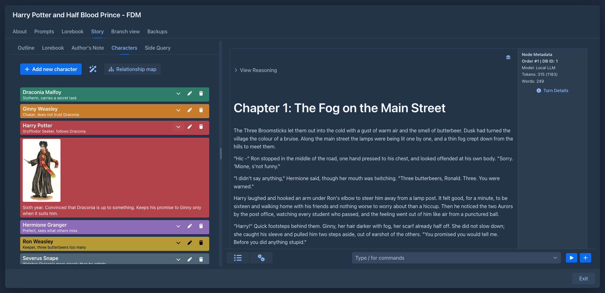
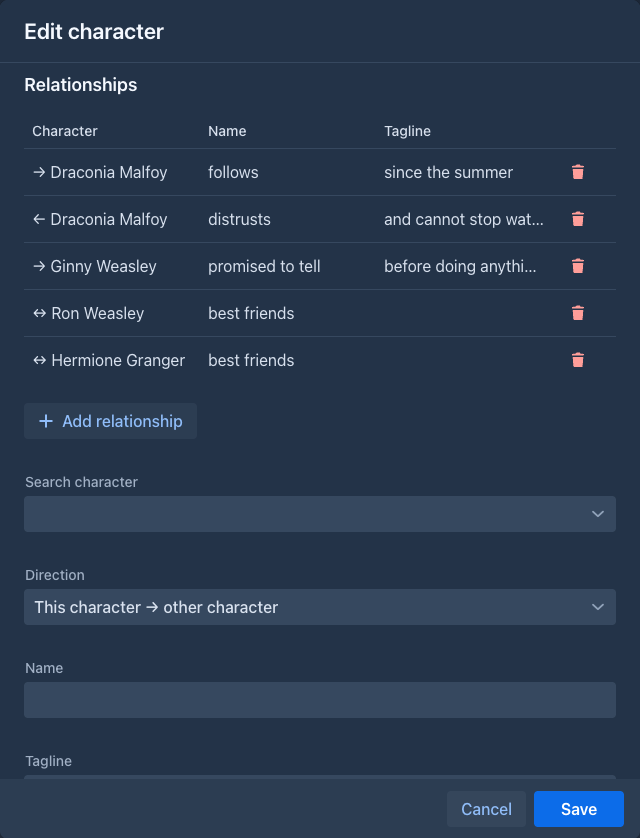
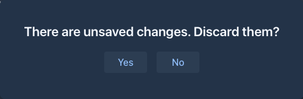

# Character Tracker

The cast of your book in the sidebar: a list of characters with a tagline, a note, an icon and a color, the
relationships between them, and a map of those relationships.

## The Characters tab

The left sidebar of the [story editor](../books/story-editor.md) gets a **Characters** tab next to *Outline*. Above the
list is one line of buttons: **Add** (a new character), a menu with the import of lore entries, the **Relationship map**
and a speech-bubble button for the prompt (hover for the names).

The speech-bubble button opens a popover with **In prompt**, **Depth** and a role, like the [Author's Note](authors-note.md);
the button is green while the characters are in the prompt. When *In prompt* is checked, every generation gets the characters as a message: a line with the name, the tagline in brackets
and the note of each character, and a list of the relationships (`Mara -> Tomas: employs`, `<->` when it goes both
ways). *Depth* is the number of messages after it (`0` the very end, after your instructions, `1` right before them) and
the role is *System*, *Assistant* or *User*. The text takes its tokens from the room for the story. Nothing is inserted
while the book has no characters. The settings are saved with the book.

The wand button between them has the menu item **Import lore entries as characters**, see
[below](#importing-characters-from-the-lorebook).

The list is ordered by name. Every character is on its own color and shows its **name** with the **tagline** below it in
smaller letters (two lines at most). The buttons of a character:

| Button | |
|---|---|
| chevron | Expands the character to show its **icon** and **note**. |
| pen | Opens the character in the dialog. |
| trash | Deletes the character and all its relationships, after a confirmation. |

Characters are saved with the book as soon as you change them, so they are included in its backups.

## Picking characters for a turn

The [new turn](../books/story-editor.md) form has the fields **POV character** and **Present characters**. They stay
free text, but each has a button with a person icon at its end that lists the characters of the book, ordered by name.
A name chosen in the list of the **POV character** replaces what is in the field; a name chosen in the list of
**Present characters** is added at the end, after a comma, unless it is there already. The list is read when you open it,
so a character you added a moment ago is in it. You can still type any name, and a name in the field does not have to be
a character of the book.

## The character dialog

**Add new character** and the pen open the same dialog:

| Field | |
|---|---|
| **Name** | Required. |
| **Tagline** | A few words about the character, shown in the list and in the map. |
| **Note** | Anything you want to remember. |
| **Icon** | Upload a PNG, JPEG or GIF. It is scaled down to at most 200 x 200 pixels, the proportions are kept. |
| **Color** | Background of the character in the list and in the map. |

The fields are applied with **Save**.

If you press **Cancel** (or Esc) while there are unsaved changes, including a
relationship you filled in but did not add yet, you are asked whether to discard them.

### Relationships

When you open an existing character, the dialog also lists its relationships: the ones the character points to (`→`),
the ones that point to it (`←`) and the unidirectional ones (`↔`), each with a name and a tagline. The trash button
deletes a relationship.

To add one, search for the other character, choose the **Direction** (*this character → other*, *other → this
character* or *both ways*), enter a **Name** (e.g. *employs*, *friends*) and optionally a **Tagline**, and press **Add
relationship** (the button is above these fields). Relationships are saved at once. A new character can get relationships
after it has been saved.

## Importing characters from the lorebook

If your characters are already in the lorebook, the wand menu creates them for you. **Import lore entries as
characters** opens a dialog with the entries of the book's lorebook and of all its sub lorebooks, sorted by their
*order*. Each shows its name and a checkbox, and an **i** icon that shows the content of the entry in a popover, for a quick look
before you decide; the checkbox in the header of the list checks or clears all of them. **Import** creates a character
with the name of every checked entry (the tagline, note, icon and color stay empty for you to fill in), **Close** leaves
without importing.

Entries are not compared with the characters you already have: importing the same entry twice creates two characters.

## The relationship map

**Relationship map** shows all relationships of the book as a graph. Every character that has a relationship is a
circle with its icon (or a box without one) on its color, with its name and tagline; every relationship is an arrow
between two characters with its name and tagline. An arrow points at the target; a unidirectional relationship has an
arrow at both ends. Characters without relationships are not in the map.

The characters are arranged in rings around one character - at first the one with the most relationships: the
characters it is related to are on the first ring, theirs on the second and so on. **Double-click a character** to
arrange the map around it. You can also drag the characters, move the map and zoom with the mouse wheel.

## Commands

The characters are also [commands](../commands/index.md), for the command line and for [agents](../agents.md). They work on
the book that is open (an agent: on its working copy), and an open Characters tab shows the change at once. A character is
given by its **name** (the case does not matter), or by its **number** in `/list-characters` (the order of the names) when two
characters have the same name. A relationship is given by its number in `/list-character-relations`. A command that changes a
character takes only the fields you give it; an empty text clears a tagline or a note. The icon can only be set in the
dialog.

| Command | What it does |
|---|---|
| `/list-characters` | The characters ordered by name: tagline, color, whether there is a note, number of relationships. Reads only. |
| `/get-character character` | One character with its note and its relationships. Reads only. |
| `/create-character name [tagline [note [color]]]` | Adds a character. `color` is `#rrggbb`. |
| `/update-character character [name [tagline [note [color]]]]` | Changes a character. |
| `/delete-character character` | Deletes a character with its relationships, after a confirmation. |
| `/list-character-relations [character]` | The relationships, or those of one character. Reads only. |
| `/add-character-relation source target name [tagline [bidirectional]]` | Adds a relationship from `source` to `target` (*employs*), or with `bidirectional` `true` one in which they are equal (*friends*). |
| `/update-character-relation relationship [name [tagline]]` | Changes the name or the tagline of a relationship. |
| `/delete-character-relation relationship` | Deletes a relationship, after a confirmation. |

Adding and changing is not destructive; only the `delete` commands are, which an agent may be set to ask you about.

## Phone

The tab is in the drawer of the story, next to the outline, like the [Author's Note](authors-note.md). The buttons for the
POV and present characters are in the new turn form of the phone too.
