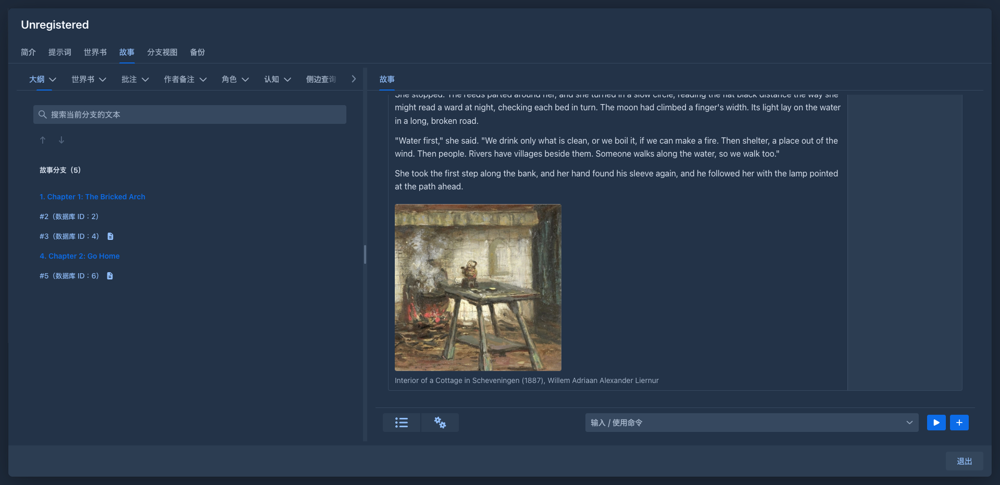

# Chinese localization

Adds Simplified Chinese (中文（简体）) to the languages of the user interface.

## Using it

After an administrator loads the extension ([Managing extensions](../administration/extensions.md)), *中文（简体）*
is in the **Language** selector at the bottom of the workspace (in the menu on a [phone](../phone.md)), next to
English and Japanese. Pick it and the page reloads in Chinese; the choice is saved in your account, so it is used on
every device you log in on. Every user picks their own language.

The interface is translated: menus, buttons, messages, the descriptions of template variables and macros. A text that
has no Chinese translation yet is shown in English.

The extension also adds Chinese to the **Prompt language** of the settings (*Settings → Templates*, see
[Prompt language](../account.md#prompt-language)): the built-in prompts of the application and of the plugins are then
sent in Chinese. It is a choice of its own, independent of the language of the interface. Your books, lorebooks and the
prompts you wrote yourself are not changed.

## Removing it

Unloading the extension takes the language away, of the interface and of the prompts. Users who had chosen it see, and
send, English until they pick another language; their choice is kept and applies again when the extension is loaded.

## For developers

The extension is the example for adding a language: see
[Example plugin → Chinese localization](../../developer/plugins/example.md#walkthrough-chinese-localization).
