# Conlang Translator

Lets the characters of your story speak a constructed language. You describe the language (its rules and its words) and the model
writes the **direct speech** of the characters who speak it in that language, while the story keeps the English behind it.

!!!
The text of the story holds the **conlang**. Everything that reads the story to a model (the next generation, the summaries,
the lorebook scan, the annotations, the other extensions) reads the **English** the speech was translated from, so the model never
has to understand your language to carry on the story. A click on a translated speech shows the English.
!!!

!!!warning Work in progress
The extension works for a person using the screens described here and, through [commands](#commands), for an agent. The phone has only part of it, see
[Limits](#limits).
!!!

## The idea

1. A **language** is two things: **rules** (text, written for the model like a grammar book) and a **lexicon** (the words, written
   mostly by the model and judged by you). Languages are kept in your settings, once, and any number of books use them.
2. A **book** (or a folder of books) chooses its language. A part is translated **by hand** from its menu, **by itself** when it
   is final, or **a range at a time**.
3. One request to the model per part classifies every direct speech (is it said in the language, or in the common tongue of the
   story, by this character, understood by the listener?) and translates the speech that is. A word the language lacks is invented
   by the rules, **reported with the reason**, and added to the lexicon as **new**, for you to accept, change, lock or throw away.
4. The English is kept (in the data of the book, as the *source* of the speech) and read by every model. The conlang is the original:
   what you change in it by hand stays, and a part you edit is never overwritten behind your back.

## Languages

A language is edited in **Settings → Extension Settings → Conlang Translator**, the panel that lists your languages.

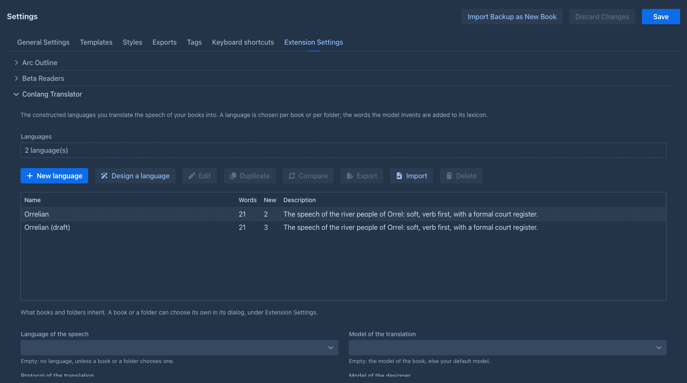

| Button | |
|---|---|
| **New language** | An empty language. |
| **Design a language** | A [wizard](#the-designer) in which the model proposes each part of a new language and you edit and accept it. |
| **Edit** | The [editor](#the-editor) of the selected language. |
| **Duplicate** | An independent copy with a new name, words and all. Use it to try a change (a copy is also the only way to have a language *for one book*: a book that chooses a language shares it with every other book that chooses it). |
| **Compare** | Brings the changes of another language into the selected one, after a [review](#comparing-and-merging). |
| **Export**, **Import** | A language as a document (JSON): the rules and the lexicon, without the links to a book. An import of a language whose name you already have offers the review of the differences or a new language. |
| **Delete** | After a question. |

At the top are the **model and protocol of the designer**. Below the list are the choices that books and folders **inherit** from you: the language, whether a part is translated by itself,
and the model and protocol of the translation. A book or folder can set its own, see [Choosing the language of a
book](#choosing-the-language-of-a-book). **Save** the Settings screen to keep your changes (the words that a translation added meanwhile
are not lost: a language you did not touch is read again when the screen is saved).

### The editor

The editor is a window with five tabs; it works on a copy until **Save**, can be resized, dragged and maximized.

| Tab | |
|---|---|
| **Overview** | The name, a description for you, the option **A hyphen is a part of a word** (off: `thal-orun` and `thalorun` are the same word; on, the hyphen belongs to the form), and the **example book** and **example lorebook** the designer reads. |
| **Rules** | The rules in **sections** (sounds and spelling, grammar, word formation...). Each section says **who reads it**: *the translator* (sent in every request), *only the designer* (the history of the language, notes for making words) or *nobody* (your own notes). The plugin does not parse the rules: they are text for the model. |
| **Categories** | Groups of words (*People & Social*, *Nature*, *Particles*...). The lexicon is shown and sent to the model under these headings. A category that is **always sent** (particles, pronouns, numbers) goes into every request even when the lexicon is too big to send whole. |
| **Registers** | The styles of speech (*formal*, *soft*, *vulgar*, *archaic*...) with a note. A concept may have a form for each register; the model chooses by who speaks and to whom. |
| **Lexicon** | The words, see below. |

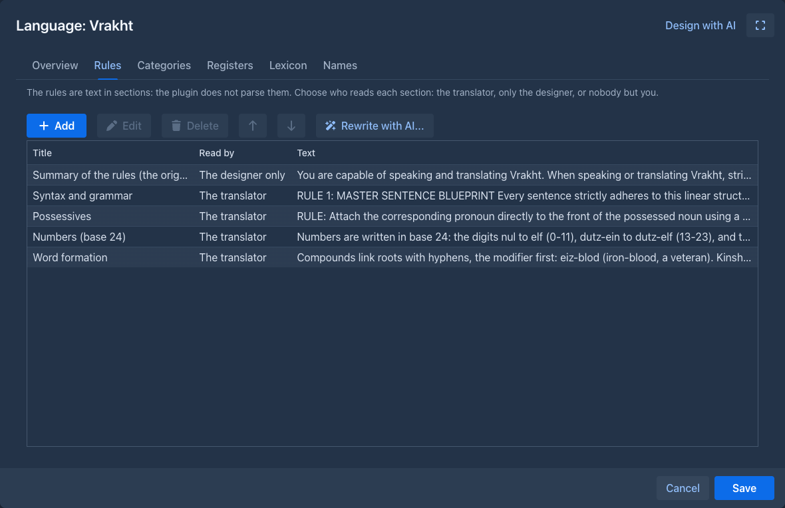

### The lexicon

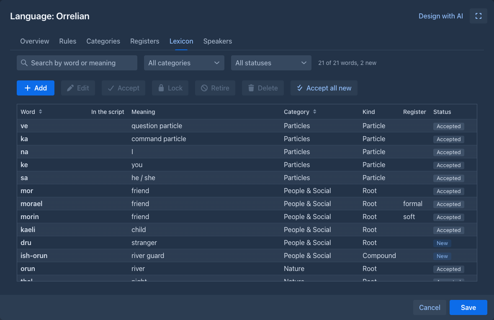

The grid has a **search** (by word or meaning), filters by **category** and **status**, and the actions **Add**, **Edit**, **Accept**,
**Lock**, **Retire**, **Delete** and **Accept all new**. A word has:

- the **form** (how the story writes it), optionally the form in a **script**, a **category** and a **kind** (root, compound, particle,
  name, number, phrase);
- one or more **meanings** (a homophone has several, each with a part of speech and a note) and the **other forms of the concept**
  (the formal, soft and vulgar word for the same thing, shown and sent together);
- the **rationale**: why the model chose the word (the rule or the roots). You read it to judge the word, and it goes back into later requests
  so that the next invention follows the same logic;
- an **origin**: yours, or the model's (with the part it was invented for, the model and the time). A word of the model that you edit becomes yours;
- a **status**: **New** (the model made it and you have not looked yet), **Accepted**, **Locked** (the model may use it but never redefine it) or **Retired**
  (kept, not offered to the model: for a word that was replaced).

A word the model needs but the lexicon lacks is **never dropped for being new**: it is added at once, so the next part says the same thing the same
way, and it waits as *New*. A translation that uses words that are not in the lexicon and that the model did **not** report is flagged, because
nobody can tell whether the word is a mistake.

### Names for the Name generator

The **Names** tab of the editor makes the language available to the [Name generator](name-generator.md): the names it gives sound like the language. Add a **name category**
(for example *Places* or *People*), then check the words of the lexicon it is made of. The **search** and the **category filter** narrow the list, **Check all shown** and **Uncheck all shown**
act on the words that are shown, and **Preview names** makes 20 names from the words that are checked now, before you save anything. The Name generator trains a Markov chain on the checked
words, so a category needs a few words (a dozen or more gives better names).

Only your choice is kept, not the words: a word you change is read as it is now, and one you delete, or retire, is left out when the names are made. After you save the settings, the
category is offered in the Name generator (the lore generator's and the arc outline's **Tools** dialog, the `generate-names` command, an agent's run) as *Conlang - language - category*.
It is your own: another user of the installation sees only their categories.

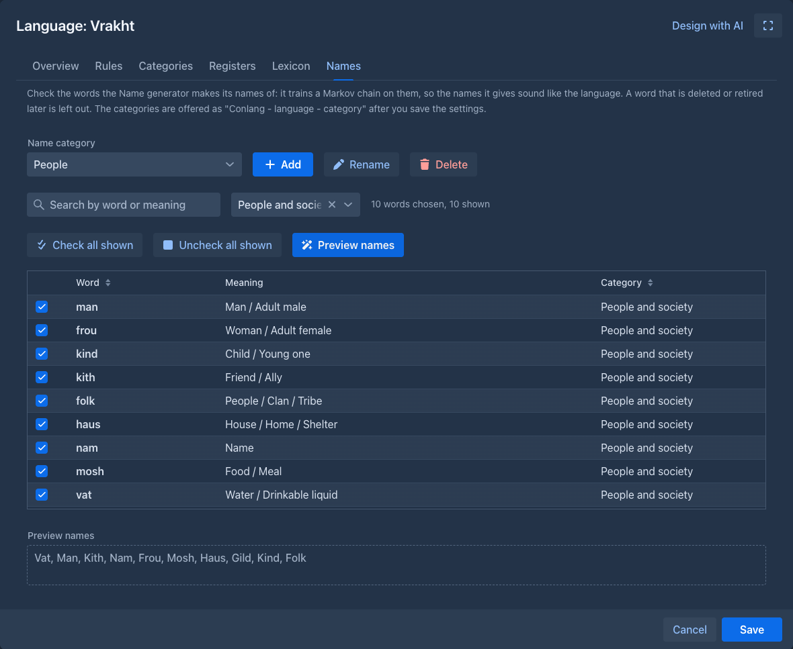

### The designer

The **Design with AI** menu of the editor asks the model for help, always with the language **as it is** (its rules, registers, categories, lexicon and the example lorebook), and
always as a **proposal**: nothing is written before you review it.

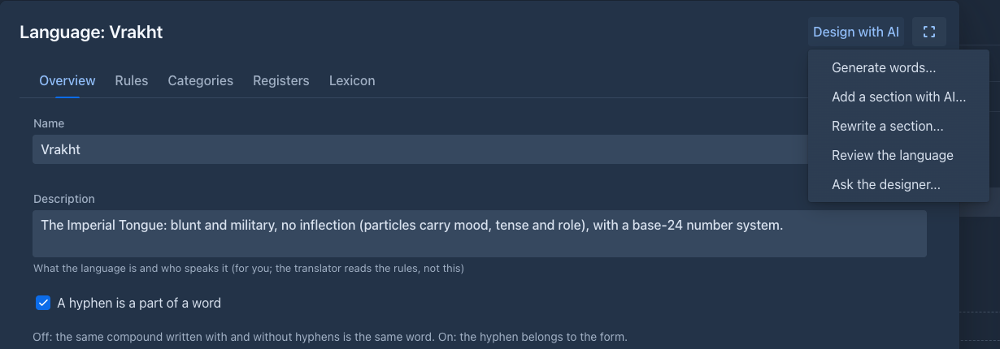

| Action | |
|---|---|
| **Generate words...** | Words for a category, a number of them, with a note ("a siege camp's kitchen"). |
| **Add a section with AI...** | A new section of the rules for what they miss (numbers, colors, politeness) and the words it needs. |
| **Rewrite a section...** | The model rewrites a section as you ask. The model gives back the **whole section**, so a very long section is slow and costly: keep sections short, one topic each. |
| **Review the language** | A list of contradictions, gaps and words that break the sound system, each with a section and a fix. Nothing is changed. |
| **Ask the designer...** | A conversation; an answer with words or sections can be reviewed as changes. |

**Design a language** in the panel is a wizard of seven steps (the brief, the sounds, the writing, the grammar, word formation, the first words by category, and a test with
sentences). Each step is a section that the model proposes and you edit, refine with a note and accept; the language exists only in the window until **Finish**.

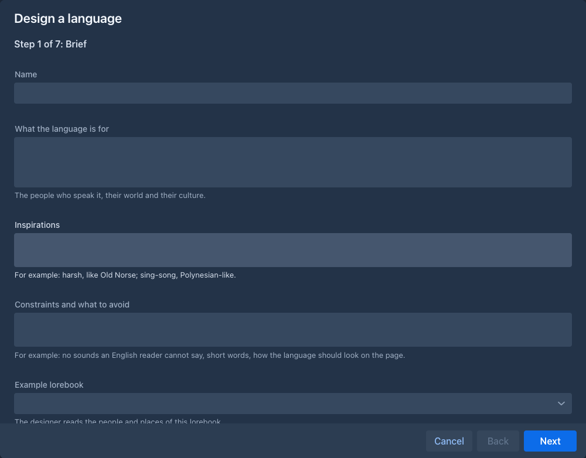

### Comparing and merging

**Compare** (and the import of a language you already have) opens a window with the differences between two languages, each a line with a check box: what was added,
changed, deleted or moved among the language's fields, rules, categories, registers, words and categories of names. A change that both sides made differently is a **conflict**:
your value is kept until you choose theirs or write your own. What you pick is written into the language on the screen, and stored when you save the Settings screen. The
same window shows what the designer proposes.

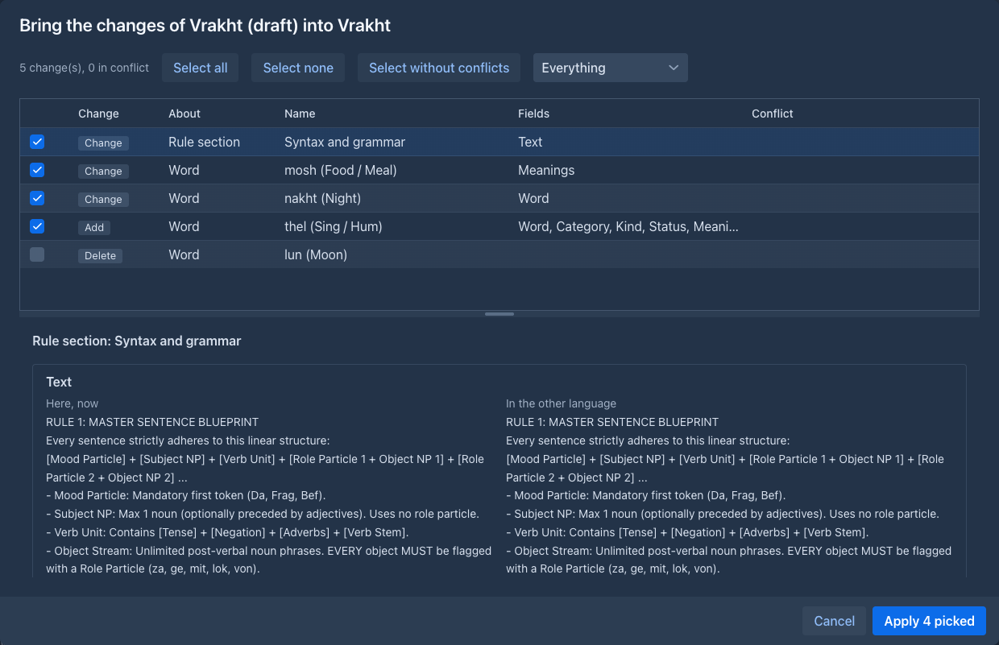

## Choosing the language of a book

The **Prompts** tab of the book window, under *Extension Settings*, has the fields of the extension; the folder window has the same. Empty means *inherit*: the folder
above, then the settings of your user.

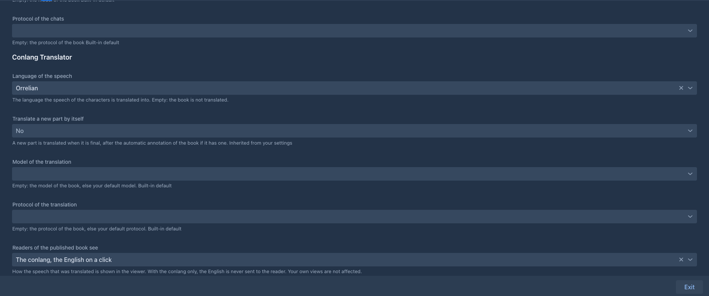

| Field | |
|---|---|
| **Language of the speech** | The language the book is translated into. Empty: the book is not translated. |
| **Translate a new part by itself** | A part is translated when it is final: after a generation, after the automatic annotation and redraft if the book has them. |
| **Model of the translation**, **Protocol of the translation** | Empty: the model and protocol of the book, else your defaults. |
| **Readers of the published book see** | What the [viewer](#the-viewer) shows. |

## The Conlang tab of the book

The story window has a **Conlang** tab (in the same dock as the chapters and the lorebook; drag it where you like) for the language of *this* book. It has four tabs
of its own, and **Refresh** reads the language again after you changed it in the window of the book. A book with [more than one language](#more-than-one-language-in-a-book) has a field
next to **Refresh** that chooses which of them the *Words*, *Speakers* and *Quick translate* tabs are about.

### Words

The lexicon of the book's language, with the search, the filters and the actions of the [editor](#the-lexicon): look a word up while you write, edit it, accept the words the
model invented, lock or retire one. The change is stored in your library at once (the words a translation added meanwhile are not lost).

### Speakers

Who speaks the language **in this book**. The speakers belong to the book, not to the language: the same language is spoken by other people in another story, so a language
you duplicate, export or compare carries no characters.

By default **everybody speaks the language except the listed characters** (or, the other way round, only the listed ones). This is only the default: the
text overrides it ("she said in the common tongue", "the guard could not understand a word") and the model decides for every speech. For each character
you may note the **gender** (a language that marks gender gets it wrong when the part only says "her") and the **voice** ("formal, clipped, coarse"), which
the model matches to the registers of the language. Changes are stored in the book at once.

Each character can also have a level of **understanding**: *understands nothing*, *knows a few words*, *follows most of it* or *follows everything*. Leave it empty (or *follows everything*) and the
models are told nothing. Use it for the people who hear the language without speaking it: *Tomáš: understands nothing*, *Other villagers: follows most of it* (the name is only text, so a group works). The levels are
**static for the whole book** and are handed to the models as information; what a character does with it is up to the model, and you can always say more in the instructions ("Tomáš does not understand what they say").
They reach the models in two ways: the **story model** gets a short message with the levels (inserted into the prompt like the Author's Note; the checkbox above the list turns it off and the number says how many
messages from the end it goes), and the model that **reviews a part** (*Annotate with AI*) gets them as a section of the facts, so it can flag a character who reacts to words they cannot follow. If you would rather
place the text yourself, turn the insertion off and use the  [macro](../templates/macros.md#commands) in a template; it takes an optional list of characters to keep.

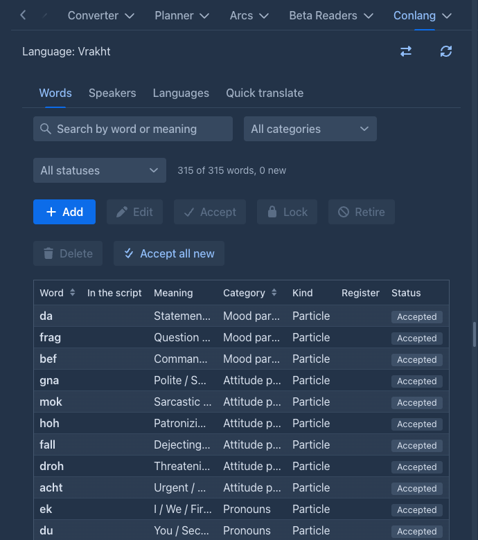

### Languages

The other languages of the book, besides the one its **Language of the speech** field names: see [More than one language in a book](#more-than-one-language-in-a-book).

### Quick translate

Write a text in English (a phrase, a name, a line you have not written yet), optionally who says it and to whom, and press **Translate**: the model translates it into the
language of the book with the rules, the registers and the lexicon, and the notes of the characters named in the text. Nothing is written into the story. The result is the
translation, a note on the choices, and the **words the translation needed** that the lexicon lacked, each with its meaning and why; select the ones you want and **Import the selected words**:
they go into the lexicon as *new*, the same as the words of a translated part. Words in the translation that are neither in the lexicon nor reported are listed as a warning.

## More than one language in a book

An epic may have a tongue for the elves, another for the dwarves and a third for the orcs. A book names **one language first** (the field above, which a folder or your settings may also give)
and the **Languages** tab of the **Conlang** tab adds **other languages** from your library, one by one, and takes them away again.

- **Each language has its own speakers.** The *Speakers* tab is about the language the field at the top chooses. The first language is spoken by everybody except the characters you list, as before;
  **a language you add starts as "only the listed characters speak it" with nobody listed**, so it is not asked for anything until you list who speaks it. List a character as an exception of the first
  language when another language is theirs, or the first language is asked for their speech too (a speech two languages claim stays with the one that is asked first). A character may speak more than one language
  (list them in both; the text of the part tells the model which one a speech is in).
- **One request for each language.** A request holds the rules and the lexicon of one language only, and only the speeches of its speakers; a part with the speech of two languages takes two requests, one after
  the other. The second one reads the part with the English of the first one's speeches and leaves those speeches translated. A part whose point of view and present characters are all outside the speakers of a
  language is not asked for that language (a part that names no character is asked for every language that has speakers).
- **A passage knows its language.** The popover, the export and the viewer work as before; **Translate dialogs (constructed language)** again for one language leaves the speeches of the others alone, and **Put the English back**
  can be for one language or for all.
- **The menus ask which language** when the book has more than one: the menu of a part (*Translate dialogs (constructed language)*: one of the languages or *All languages*) and the right click on a selected sentence (one language).
  **Translate parts (constructed language)** has a *Language* field (all languages by default); *the parts that are not translated* means "not translated in that language".
- **The automatic run** translates a new part into every language whose speakers may be in it.

## Translating

- **By hand:** the menu of a part has the **Translate** sub menu (the right click on the text has one too), and in it **Translate dialogs (constructed language)** (these items and **Translate parts** are shown only in a book that has a language of this plugin). A part that is translated already is translated again **from its English**, so this is also how you retranslate a
  part after the rules or the lexicon changed. A book with more than one language asks first [which one](#more-than-one-language-in-a-book).
- **By itself:** with **Translate a new part by itself**, a generated part is translated as soon as it is final. A *regenerate* of a part gives it new English and removes the old translation.
- **Speeches the model missed:** a translation sometimes leaves a speech in English. **Translate → Translate missing dialogs (constructed language)** in the menu of a part translates only the speeches that are still in English and leaves the translated ones as they are; with text selected, the right click **Translate → Translate missing dialogs in selection (constructed language)** does it for the speeches the selection touches. The model is sent the part as it is, with the translated speeches in it, and asked only for the speeches still in English, so the run is cheaper than a translation of the whole part. Nothing but speech is written, so it is not a way to translate a sentence the model does not see as speech: use *Translate selected text* for that.
- **A sentence you wrote:** select it in the text of a part, right click and choose **Translate → Translate selected text (constructed language)**. The model translates the selected text
  (spaces and a pair of quotation marks around it are left out) with the language, the notes of the characters and the story around it; the text is replaced by the translation and
  the English is kept as the source of the speech, so a click on it shows the English like on any translated speech. The words the model had to invent are added to the lexicon as
  *new*, as for a translated part. A selection that holds a translated speech is refused (put the English back first), and so is one made in a part that changed meanwhile.
- **A range:** **Translate parts (constructed language)** in the tools menu of the story opens a window that stays open beside the story.

  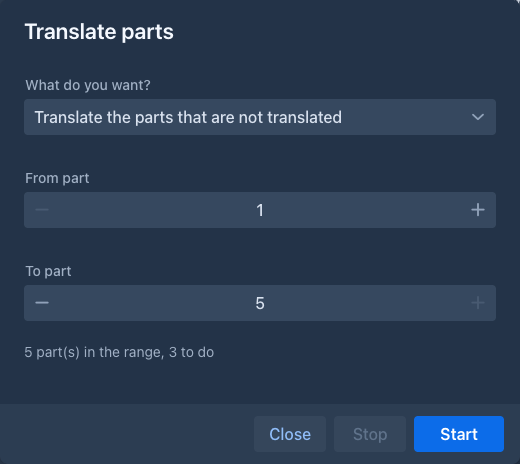

  Choose **From part** and **To part** (parts with text, counted from 1 as in the export) and what to do: *Translate the parts that are not translated*, *Translate the translated
  parts again* (after the rules or the lexicon changed), or *Put the English back*, after a question. The window says how many parts the range holds and how many the choice
  works on, shows *Part n of m*, and a **Stop** that takes effect after the part that is being done (a request to the model that has begun cannot be taken back). A part that fails is
  counted and the run goes on; a missing language or model ends it. The story is drawn again when the run is over. A part you edit while it runs makes that one part fail, not the run.

A translation is stored like any change of the text: the history of the part gets a version, the part is **not marked as edited**, and the English is kept. **A speech you changed by hand
is left as it is** when the part is translated again or put back to English, because it holds your words.

!!!
A translation takes as long as the model takes for the part: minutes on a local model that thinks. The extension asks the model to think (the translation of gender, number and
register is much better that way), so give the model a generous output limit.
!!!

## What the reader sees

### In the story

A translated speech has a **dotted line**. A click on it shows the English in a popover: who said it, and *(not understood by the listener)* when the listener does not understand the
language; a red note says that you edited the conlang text after the translation, so the English may not be what it says now.

**Edit the source** (a button in the popover, in your own views only; the readers of a published book do not have it) opens a small window with the translation as the story has it and the English
the models read. Use it when a native speaker fixed the translation by hand and the English says something else now, or when the model got the English wrong. Saving gives the speech its new
English, takes the translation as it is now as the one the English belongs to (the red note goes away) and from then on the models read the new English in its place. The text of the part is not
changed, and *Translate dialogs (constructed language)* again replaces both. `conlang-edit-source` does the same from the command line.

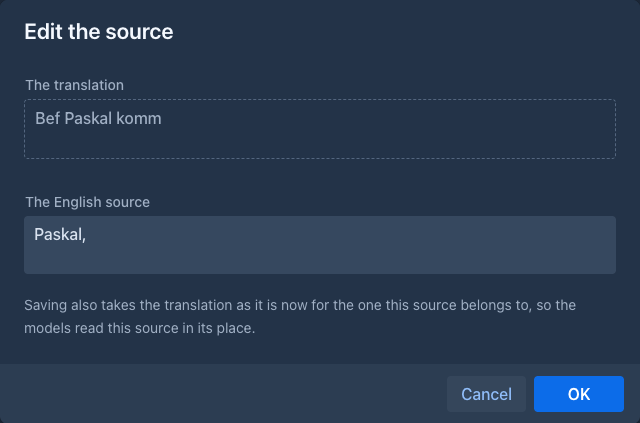

**Search and replace in the sources** (the button with the arrows at the top of the Conlang tab) opens the application's search and replace window over the English sources of the translated speeches of the
active branch (plain text or a regular expression, with or without case; the table lists the speeches that have a match by part and speech number). Use it for a name that was spelled two ways in the English.
Only the sources change; to change the words of the translation itself use the search and replace of the book. A speech whose source was changed after the search is left as it is and counted.

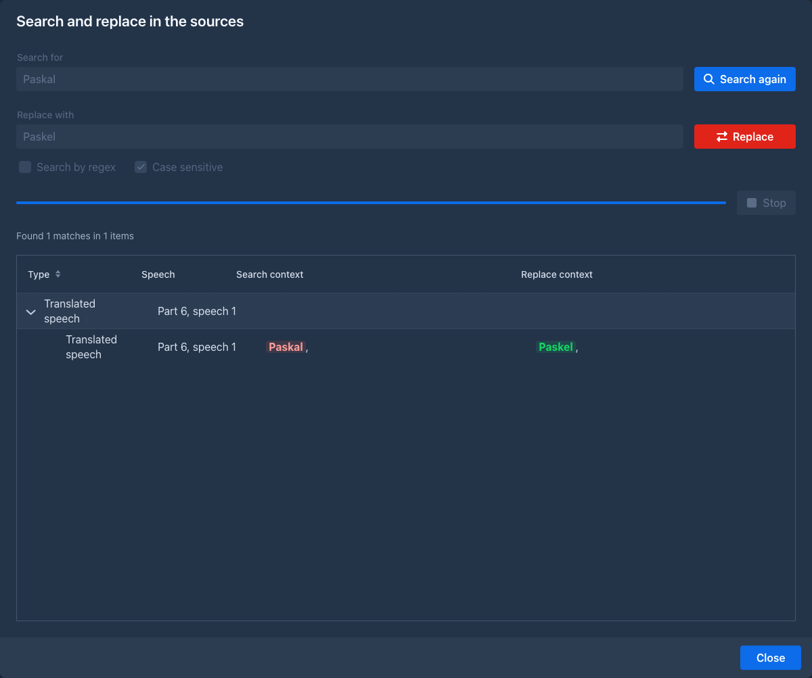

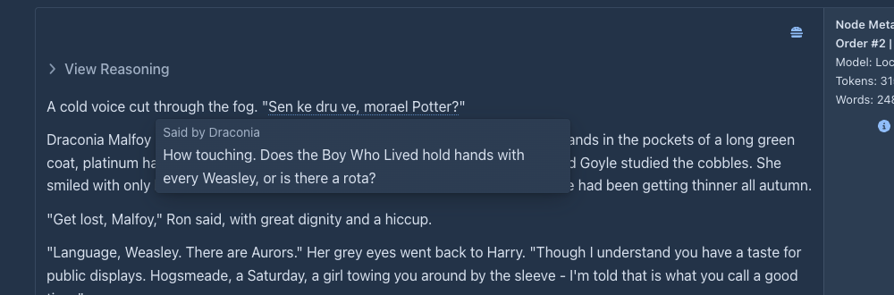

### The viewer

The viewer of a [published book](../books/publishing.md) shows the translated speech the way the book asks, with the field **Readers of the published book see** (a choice of the book or of its folders; your own defaults never
decide what a reader sees):

| | |
|---|---|
| **The conlang, the English on a click** | The default. A click (a tap on a phone) opens the popover with the English. |
| **The conlang only** | The English is never sent to the reader's browser. |
| **The English only** | The book as if it had never been translated. |

In the click mode the page holds only the conlang; the English of a speech is fetched from the server when the reader clicks it.

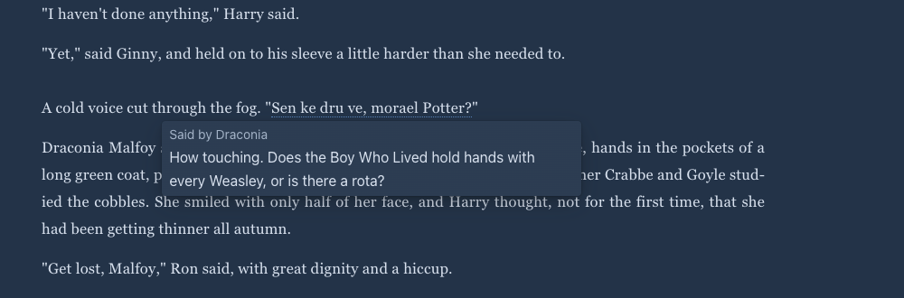

## Exporting

When the book has translated speech, the [export](../books/export.md) dialog has the field **Translated speech**:

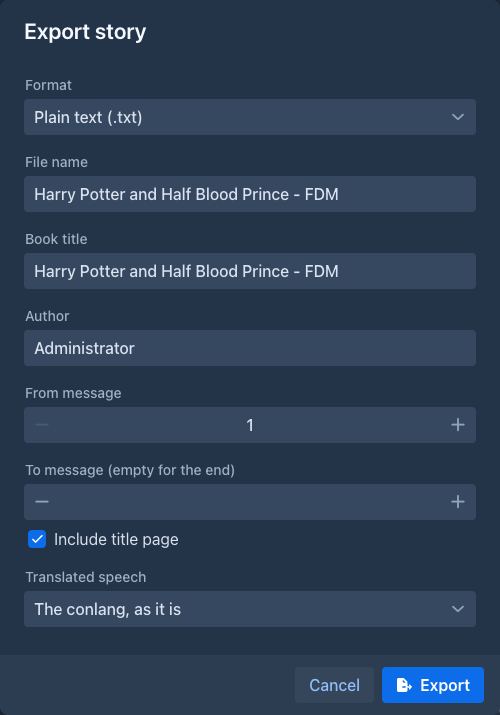

| | |
|---|---|
| **The conlang, as it is** | The default: the text as it is stored. |
| **The English only** | The speech is replaced by its English. |
| **The conlang, the English in footnotes** | Every translated speech gets a footnote with the English (and the speaker). |
| **The English, the conlang in footnotes** | The other way round. |

The footnotes are the [footnotes of the export](../books/export.md#footnotes): linked notes in HTML and EPUB, endnotes after each part in plain text, real footnotes at the foot of the page in Word and PDF. A speech you edited after it
was translated stays as it is and has no footnote. The stored text of the book is never changed by an export.

## Commands

Everything the screens do is also a command, for the [command line](../commands/index.md) and for [agents](../agents.md): an agent can make a language, grow it, translate a book and check the result without
a person at the dialogs. A language is addressed by its **name** (the case does not matter) or its id; a rules section by its title or its number in `conlang-list-rules`; a category by its name or number; a word by its
form (the id of `conlang-list-words` only to tell homophones apart); a part as in the other commands of the application, by its handle or its position on the active branch (the first part is 1). The command line takes every
argument of a command; an agent may leave out the optional ones.

| Command | |
|---|---|
| `conlang-list`, `conlang-get`, `conlang-create`, `conlang-duplicate`, `conlang-update`, `conlang-delete`, `conlang-export`, `conlang-import`, `conlang-set-references` | The library. `conlang-delete` asks, and is not available to an agent. |
| `conlang-list-name-categories`, `conlang-add-name-category`, `conlang-update-name-category`, `conlang-delete-name-category`, `conlang-preview-names` | The categories of names for the [Name generator](name-generator.md) (the **Names** tab). Add and update take the words of the lexicon (`;` between them) or a whole category of the lexicon; deleting asks the user; the preview needs the Name generator. The generator's own `list-name-categories` and `generate-names` list and make the names. |
| `conlang-set-book-language` | The language of the open book (the **Language of the speech** field of its *Extension Settings*). |
| `conlang-add-book-language`, `conlang-remove-book-language` | The other languages of the open book. Removing asks the user, and is not available to an agent. |
| `conlang-list-rules`, `conlang-get-rules`, `conlang-add-rules`, `conlang-update-rules`, `conlang-delete-rules`, `conlang-move-rules` | The sections of the rules. |
| `conlang-list-categories`, `conlang-add-category`, `conlang-update-category`, `conlang-move-category`, `conlang-delete-category` | The categories of the words. |
| `conlang-list-registers`, `conlang-add-register`, `conlang-update-register`, `conlang-delete-register` | The registers. |
| `conlang-list-words` | The lexicon, paged, with filters: category, state (*new*, accepted, locked, retired) and a text. |
| `conlang-get-word`, `conlang-add-word`, `conlang-update-word`, `conlang-delete-word` | A word. A word an agent adds or changes is the model's and **new**; a locked word cannot be changed or deleted. |
| `conlang-lock-word`, `conlang-unlock-word`, `conlang-retire-word`, `conlang-restore-word`, `conlang-accept-words` | The state of the words. |
| `conlang-check-lexicon` | Repeated meanings, words without a category, compounds with parts that are not in the lexicon, and the homophones (for information). No model. |
| `conlang-status` | The language of the book and which parts are translated. |
| `conlang-translate-part`, `conlang-translate-range`, `conlang-translate-sentence`, `conlang-translate-text`, `conlang-revert-to-source` | Translating: one part (`missingOnly` translates only the speeches still in English, `within` quotes a passage to limit that to), a range (`mode` *new* or *again*), one sentence of a part, a text that is only returned, and the English back. A range asks the user for *again*; so does the English back. With the optional `language` they are about one language of the book (all of them by default, the first for a sentence or a text). |
| `conlang-edit-source` | Sets the English source of one translated speech (`part`, `speech` as `conlang-list-passages` numbers it, `source`); the translation as it is now counts as the one it belongs to. Replaces the old source. |
| `conlang-check-translation`, `conlang-get-source`, `conlang-list-passages` | Reading: the words of a translated speech that the lexicon does not have, the text of a part as the models read it (the English), and the translated speeches of a part with their English. |
| `conlang-speakers`, `conlang-set-speakers-mode`, `conlang-set-speaker`, `conlang-remove-speaker` | Who speaks the language in the open book (`language` names one of the book's languages, the first by default); `conlang-set-speaker` also sets the level of `understands`. |
| `conlang-set-understanding-prompt` | Whether the levels of understanding are inserted into the prompt of the story by themselves, and how many messages from the end. |
| `conlang-design-words`, `conlang-design-rules`, `conlang-rewrite-rules`, `conlang-design-stage`, `conlang-ask-designer`, `conlang-try-sentences` | The designer. With `ask true` a command returns the proposal as a numbered list of changes and holds it; nothing is changed. |
| `conlang-review` | The designer's review of the language: findings only. |
| `conlang-apply-changes` | Applies the held changes, all of them or the numbers given (the same as **Apply** in the review). |
| `conlang-pending-changes`, `conlang-take-pending-changes`, `conlang-discard-pending-changes` | What an agent run left in the book, see [below](#agent-runs). |
| `conlang-understanding` | Who does not follow which language, as text, for the  macro (the characters are optional). |
| `conlang-lexicon`, `conlang-rules` | The lexicon and the rules a translation request sends, as text, for the  and  [macros](../templates/macros.md#commands). |

### Agent runs

An agent works on a **copy of the book**, and the languages are not part of the book, so an agent cannot change your library behind your back. The first time a run **changes** a language (a word, a rule, or the words
a translation invents), that language is copied into the copy of the book, together with the version it was copied from; from then on the run reads and writes its own copy. A run that only reads, or only translates with the
words it has, never copies anything. The copy goes wherever the copy of the book goes: the checkpoints and their restore, the review of the run, and its delete.

When you **apply** the result of the run, the language lands in the book, **not in your library**. The **Conlang** tab of the book then shows *An agent run changed the language ...* with **Review** and **Drop**.
Review compares three versions, the language when the run copied it, the run's version and your library as it is now, so what you changed in the library meanwhile is kept, and what both of you changed is a conflict for you
to decide. The same from commands: `conlang-pending-changes` lists the changes as numbers and `conlang-take-pending-changes` takes them (it asks you). A language the run made is added whole after you confirm.

The run reads the library until it first changes a language, and its own copy afterwards: what you change in a language while the run works is not seen by the run, but is not lost either.

## Limits

- **The quality is the model's.** The extension checks what it can for free (that the quoted speech is in the part, the language, the words against the lexicon and its rules for
  compounds and affixes) and reports the rest; it does not check your grammar. Try a language on a few parts before a long run, and use **Review the language** of the designer when a mistake repeats.
- **A language is shared by the books that use it.** A word you change, or a word a translation adds, changes it for every book of the series. That is meant (one world), and
  **Duplicate** is how to keep a language apart.
- **An agent's language changes wait in the book.** They are taken into the library by you, after the run is applied; a language is not locked while a run works.
- **Commands do not replace a word in the story** and a retranslation cannot keep the translations whose English did not change (every part of the range is asked again).
- **A phone** has the panel, the editor, the review and the wizard, but the lexicon grid scrolls sideways; the tap on a speech in the viewer works; the story side (the menu of a part, the range window, the click in the story) was not tried there.
