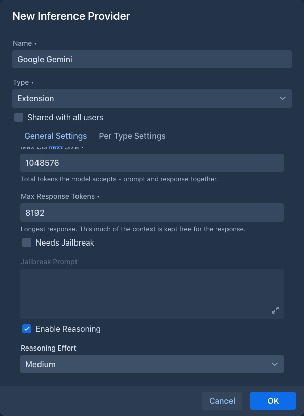
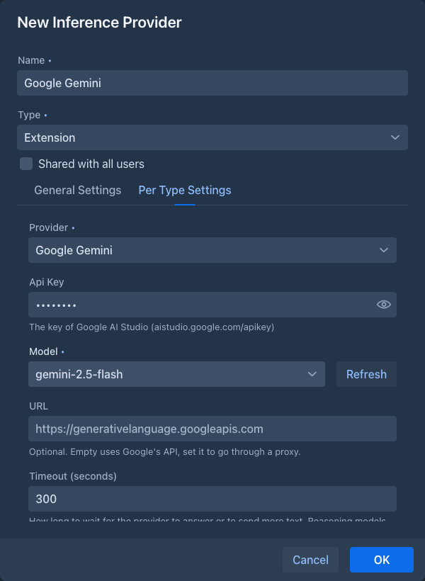
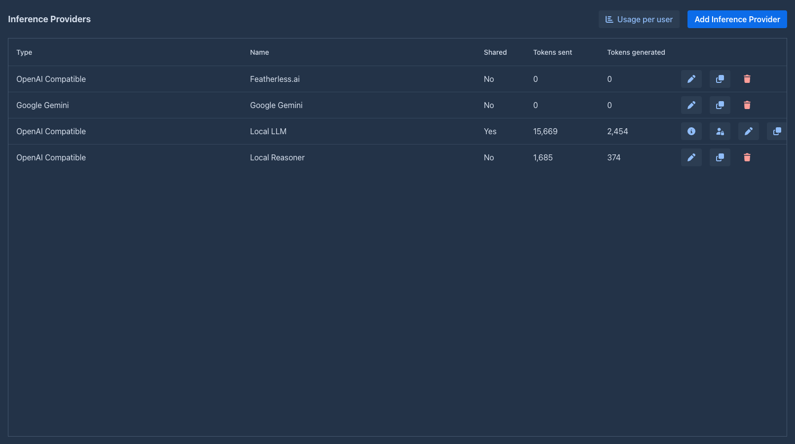

# Google Gemini

Adds Google's Gemini models as an [inference provider](../inference-providers.md), over Google's own API instead of an
OpenAI-compatible one.

Google also offers an OpenAI-compatible endpoint, which works with the normal *OpenAI Compatible* provider. This
extension talks to the Gemini API directly (the Google Gen AI SDK), which gives the things the compatible endpoint
doesn't: the **summaries of the model's thinking** shown as reasoning, the thinking level of Gemini 3 and the thinking
budget of the earlier models, the safety filters, and the exact token counts Google reports.

!!!warning Your story text goes to Google
Every request of an AI that uses this provider - the prompt with the story, the lorebook entries and the summaries, the
answers of the model, the files and pictures an agent or a command sends - is sent to Google's servers
(`generativelanguage.googleapis.com`, or the proxy you set). Google's terms and privacy policy for the Gemini API decide
what happens to it there (retention, whether it is used to improve models; this depends on the plan of your API key). The
other providers send to the server you chose, which may be your own. Do not use this provider for text you may not send to
Google. On a server shared with other users, an administrator who shares an AI of this provider sends the story text of
everybody who uses it to Google.
!!!

## Installing

Load the extension in *Admin → Extensions*, as described in [Managing extensions](../administration/extensions.md).
The JAR is large (about 14 MB): it contains Google's SDK and the libraries only the SDK needs. Nothing else in Marginalia
uses them.

Once it is loaded, the **Type** list of the inference provider dialog has a new entry, **Extension**, and the **Provider**
list at the top of the *Per Type Settings* tab offers **Google Gemini** (it is chosen for you while it is the only one).
Without a loaded extension that provides AIs, **Extension** is not offered.

## Adding a Gemini provider

1. Get an API key in [Google AI Studio](https://aistudio.google.com/apikey).
2. On the **Inference Providers** tab click **Add Inference Provider**, enter a **Name**, choose the type **Extension** and
   the provider **Google Gemini**.
3. Fill in the *General Settings* (context size, response size, [reasoning](#reasoning)) and the settings of the
   provider on the *Per Type Settings* tab, then click **Test Connection**.

The provider is then on the list like any other, with the name of the provider in the *Type* column:

| Field | |
|---|---|
| **Api Key** | The key of Google AI Studio. It is stored encrypted and not shown again; when you edit the provider, click **Reset** to enter another one. |
| **Model** | The model to use, e.g. `gemini-2.5-flash` or `gemini-3-pro-preview`. **Refresh** lists the models your key can use for writing text; you can type a name that is not in the list. |
| **URL** | Optional. Empty uses Google's API (`generativelanguage.googleapis.com`), set it to send the requests through a proxy. |
| **Timeout (seconds)** | How long to wait for Google to answer, and for more text once it started writing. The default is 300. |
| **Retries** | How often a request is repeated when Google answers with a rate limit (429) or a server error (5xx), or cannot be reached. The default is 2, 0 turns retrying off. |
| **Turn off the safety filters** | Sends `BLOCK_NONE` for the adjustable safety categories (harassment, hate speech, sexually explicit, dangerous content). Fiction often runs into the filters. Google still blocks some content whatever is sent. |

**Test Connection** lists the models and asks the chosen one for a few tokens, with the values in the dialog (before you
save them).

## Reasoning

The reasoning settings are those of the general settings of the provider, like for any provider:

- With **Enabled Reasoning** off the model thinks as it does by default and its thinking is not shown.
- With it on, the model sends the summaries of its thinking and they are shown as the reasoning of the story part. The
  **Reasoning Effort** sets how much it thinks: for Gemini 3 models it is the thinking level (low, medium, high), for the
  earlier models a budget of 1 024, 8 192 or 24 576 thinking tokens. **None** is the same as off.

Thinking tokens count as generated tokens, and they are taken from the response size you set: if the model uses it all for
thinking, the story part comes back empty and the error says the response size was used up. Raise **Max Response Tokens**
or lower the effort.

## What works

Everything a story needs works as with an OpenAI-compatible provider: streaming, stopping a generation, summaries,
[extensions that call the model](index.md), functions the model can call (the
[Name generator](name-generator.md) offers some), and images and files attached to a message. The tokens a user uses are counted in the
**Tokens sent** and **Tokens generated** columns from the numbers Google reports, and the
[limits](../inference-providers.md#limits-of-shared-providers) of a shared provider apply.

The token counts shown in the story (the size of a part, the prompt) are counted by Google (the `countTokens` request of the
model), once for each text: the answers are remembered. When Google cannot be asked (no key, no network, an error), Marginalia
estimates the count itself for a minute and then tries Google again; a text that is saved or edited while another save is
going on is estimated too. The estimate differs a little from what Google bills.

## When the extension is not loaded

The providers you created stay in the list when the extension is unloaded, with the type *Extension: google-genai*, and
work again when the extension is loaded. While it is not loaded, a book that uses such a provider can't generate: the error
tells you to load the extension or to choose another provider. The provider can still be opened and its general settings
changed; the Gemini settings are only shown when the extension is loaded, and they are not touched.

## Not supported

- **Vertex AI** (Google Cloud with a project and credentials). Only API keys of the Gemini API are supported.
- Image generation and the other output types of Gemini: only text is written.
