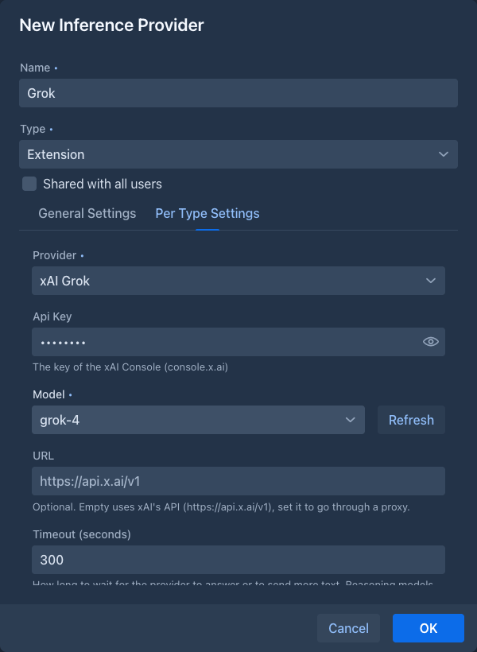
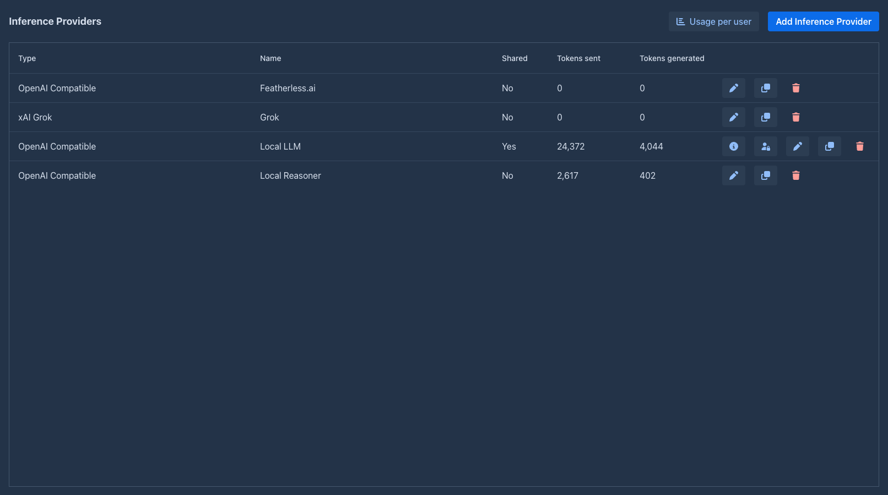

# xAI Grok

Adds xAI's Grok models as an [inference provider](../inference-providers.md), over xAI's own API.

Grok is also reachable with the normal *OpenAI Compatible* provider and the URL `https://api.x.ai/v1`. This extension talks
to the xAI API directly, which gives the reasoning shown as such, the exact token counts xAI reports (the reasoning tokens
included) and counts, and a model list and connection test made for the service.

!!!warning Your story text goes to xAI
Every request of an AI that uses this provider - the prompt with the story, the lorebook entries and the summaries, the
answers of the model, the pictures an agent or a command sends - is sent to xAI's servers (`api.x.ai`, or the proxy you set).
xAI's terms and privacy policy for the API decide what happens to it there. The other providers send to the server you chose,
which may be your own. Do not use this provider for text you may not send to xAI. On a server shared with other users, an
administrator who shares an AI of this provider sends the story text of everybody who uses it to xAI.
!!!

## Installing

Load the extension in *Admin → Extensions*, as described in [Managing extensions](../administration/extensions.md). Once it is
loaded, the **Type** list of the inference provider dialog has the entry **Extension**, and the **Provider** list at the top of
the *Per Type Settings* tab offers **xAI Grok**.

## Adding a Grok provider

1. Get an API key in the [xAI Console](https://console.x.ai).
2. On the **Inference Providers** tab click **Add Inference Provider**, enter a **Name**, choose the type **Extension** and the
   provider **xAI Grok**.
3. Fill in the *General Settings* (context size, response size, [reasoning](#reasoning)) and the settings of the provider on the
   *Per Type Settings* tab, then click **Test Connection**.

| Field | |
|---|---|
| **Api Key** | The key of the xAI Console. It is stored encrypted and not shown again; when you edit the provider, click **Reset** to enter another one. |
| **Model** | The model to use, e.g. `grok-4` or `grok-3-mini`. **Refresh** lists the models your key can use; you can type a name that is not in the list. |
| **URL** | Optional. Empty uses xAI's API (`https://api.x.ai/v1`), set it to send the requests through a proxy. |
| **Timeout (seconds)** | How long to wait for xAI to answer, and for more text once it started writing. The default is 300. |
| **Retries** | How often a request is repeated when xAI answers with a rate limit (429) or a server error (5xx), or cannot be reached. The default is 2, 0 turns retrying off. |
| **Send the reasoning effort** | *Automatic* sends the effort to `grok-3-mini` only, *Always* to every model, *Never* to none. |

**Test Connection** lists the models and asks the chosen one for a few tokens, with the values in the dialog (before you save them).

## Reasoning

The reasoning settings are those of the general settings of the provider, like for any provider. With reasoning on, the
reasoning a model shows arrives as the reasoning of the story part. The effort is sent only to the models that take it
(`grok-3-mini`: *low*, or *high* for medium and high); the other Grok models think as they do by default and refuse the parameter.

## What works

Streaming, stopping, JSON schemas, functions the model can call, pictures (JPEG, PNG) and text files as attachments, the limits
of shared AIs and the usage counting work as with the OpenAI-compatible provider. The usage is what xAI reports; the reasoning
tokens count as generated ones. The temperature, top p and the penalties of the [protocol](../protocols.md) are sent when
enabled; some reasoning models refuse the penalties. Not supported: the server-side tools of xAI (live search, code execution)
and image or video generation.
