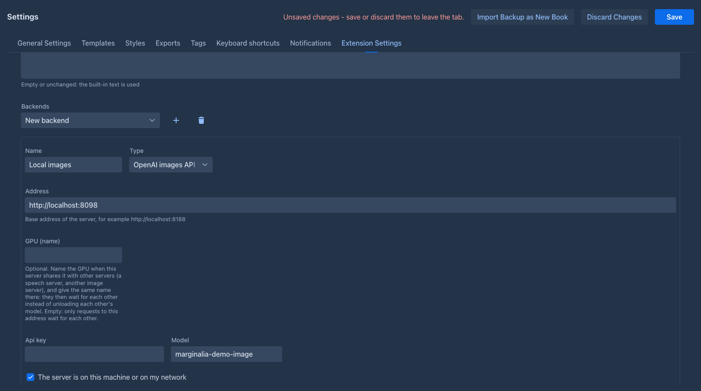
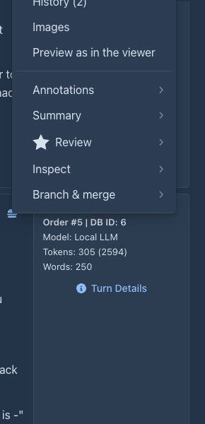
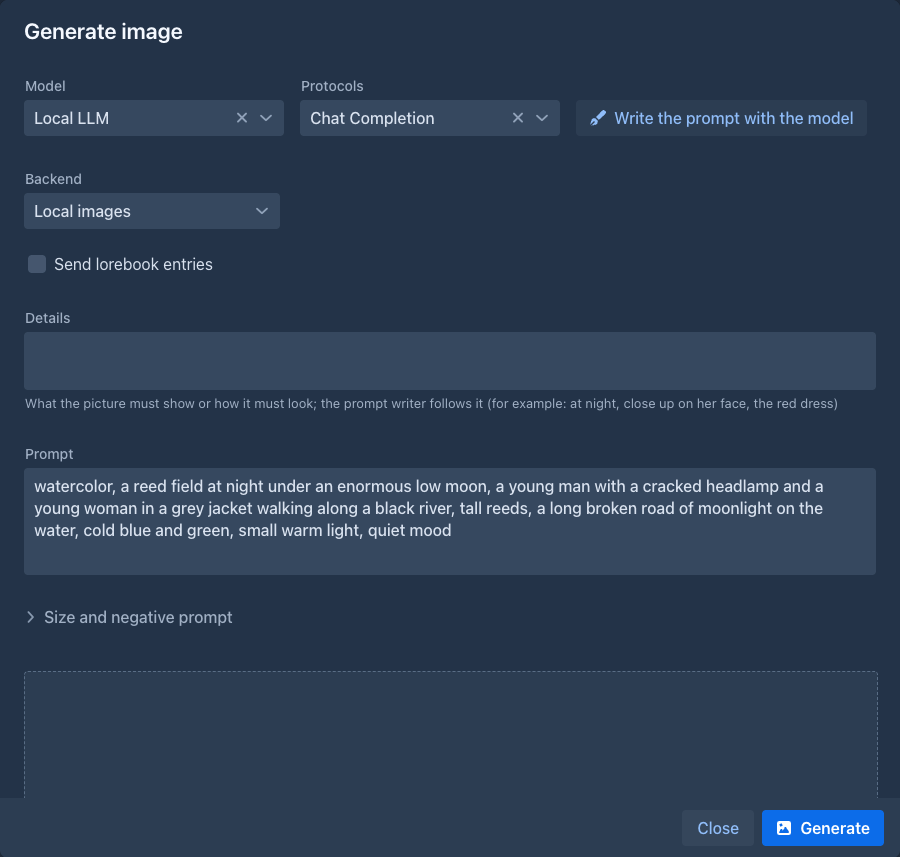
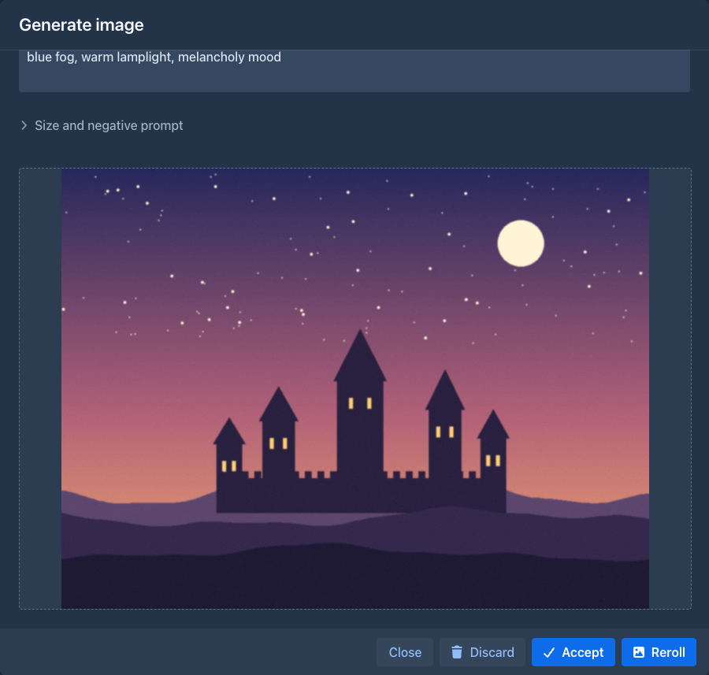

# Image Generator

Makes an image for a part of the story. The model writes the image prompt from the part, you edit it, an image backend draws
the picture, you reroll until it fits and accept it - it becomes an image of the part, like one you add by hand with *Images* in
the part menu (it is shown in the story, and in the exports).

The extension does not make images itself: it talks to a **ComfyUI** server or to a server with the **OpenAI images API** (also
spoken by stable-diffusion.cpp, LiteLLM and many hosted services).

## Adding a backend

*Settings → Extension Settings → Image Generator Settings* lists the backends. Add one (+), fill it in and save the *Settings* page.

| Setting | What it does |
|---|---|
| Name, Type | The name shown in the window. **ComfyUI** or **OpenAI images API**. |
| Address | The base address of the server, for example `http://localhost:8188` for ComfyUI. |
| Api key | Sent as a bearer token. It is stored encrypted and not shown again; type a new one to replace it, or **Remove the key**. |
| Model | OpenAI images API only: the `model` of the request. |
| Workflow | ComfyUI only: a workflow saved in ComfyUI with **Save (API Format)**. Write `{{prompt}}`, `{{negative}}`, `{{seed}}`, `{{width}}` and `{{height}}` where they go. |
| The server is on this machine or on my network | Allows addresses of the local network. Leave it off for a server in the cloud: it then cannot be made to call your own machine. |
| Width, Height, Negative prompt | What the window starts with (you can change them there for one image). |
| Timeout | How long to wait for one image. |
| Release after idle | See [One GPU](#one-gpu-for-the-model-and-the-images). |

**Test connection** checks the address and the key.

The panel also has the **Style** put in front of every prompt (the look of the book, for example *watercolor, soft light*) and the
**Instruction for the prompt writer**, the text the model is given to write the prompt from a part. Empty or unchanged uses the
built-in one.

## Making an image

1. Choose **Generate image** in the menu of a part. The model of the window (the book's by default, the last choice is remembered)
   starts writing the prompt of the part; you can stop it with **Abort**, change the prompt, or press **Write the prompt with the
   model** to write it again. Before you write it again you can fill in:
   - **Send lorebook entries** - the entries of the book's lorebook (and its sub lorebooks) go to the model as in a generation, so
     it knows how the characters and places look. An entry is sent when its filters are found in the part: its text, instructions,
     scene setting, point of view and characters present, or in your *Details*. Entries that are always on come too. Only as many
     fit as the context of the model allows (a notice tells how many were left out). The choice is remembered.
   - **Details** - what the picture must show or how it must look (*at night, close up on her face, the red dress*); the prompt
     writer follows it. It is for this window only.
2. Choose the backend and press **Generate**. Under *Size and negative prompt* you can change the size and the negative prompt for
   this window.
3. The image appears. **Reroll** makes another one with a new seed, **Discard** drops it, **Accept** adds it to the part and closes
   the window. **Abort** stops an image that is being made (ComfyUI is told to interrupt the job).

The open part shows the new image under its text at once.

## One GPU for the model and the images

With one small GPU, the language model and the image model cannot be loaded together. The extension does not manage the memory;
each backend can have two lists of requests that you set up:

- **Before the first image** - made once, when the window starts to use the backend. For example a request to your proxy that
  unloads the language model and loads the image model.
- **After the last image** - made when you accept, discard or close the window, or when **Release after idle** seconds passed since
  the last image (so a forgotten window does not keep the GPU; 0 turns it off). For ComfyUI this can be `POST <address>/free` with the
  body `{"unload_models": true, "free_memory": true}`; for a proxy a request that loads the language model again.

With `llama-server` in router mode behind LiteLLM, the *before* request can unload the language model through the proxy: see
[Freeing the GPU for another model](../prompt-cache.md#freeing-the-gpu-for-another-model).

Both moments take a **list of requests**, made one after the other (**Add a request** adds one, the bin removes one). A swap often needs
several: unload the language model, then start the image server, and after the images stop it. Each request has an address, a method
(`POST` by default), headers (`Name: value`, one per line), a body, a **timeout** (empty: 60 seconds, at most 600; give a server that
loads a big model more) and **Wait afterwards** (seconds to pause after the answer, for a server that is still busy after it said yes).
The headers are stored encrypted, like the api key (a request often carries `Authorization: Bearer ...`). The backend stays held while
you reroll, so only the first image pays for the swap. If a proxy in front of the models swaps them by the model name, leave both empty.

When a request of the *before* list fails, the rest is not made and the image stops (the message says which request failed: *Request 2
of 3: ...*), so that nothing is loaded on a GPU that is still full. The *after* list is made **completely** whatever happens to one of
its requests (every server must be stopped), and the first failure is shown as a warning. A backend saved with the single request of an
earlier version shows it as the first request of the list.

**Several people on one GPU.** Everyone whose backend has the same server address (`http://host:port`) goes through one gate: the
*before* request is made for the first window that starts and the *after* request when the last one is done, so closing one window
does not unload the model under the image of another, and the images are made one at a time (a second window waits its turn).
The requests are those of the user who comes first and last.

## What is not done

- Backends are per user, not per book.
