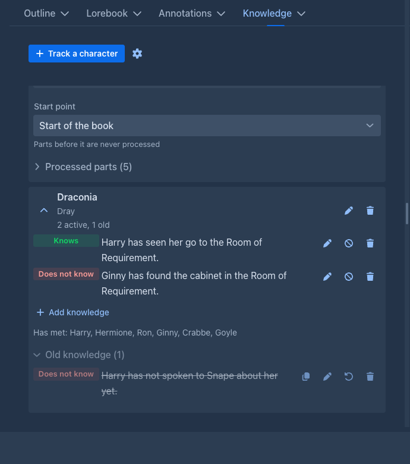
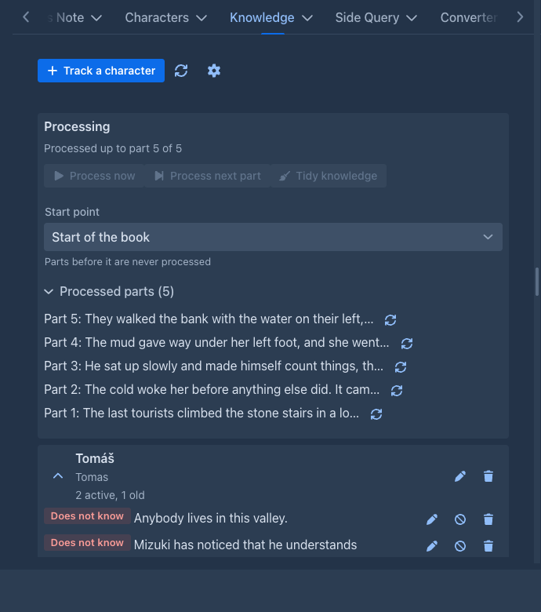
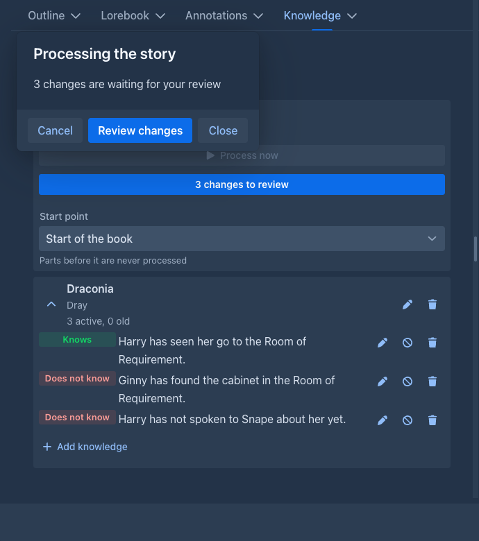
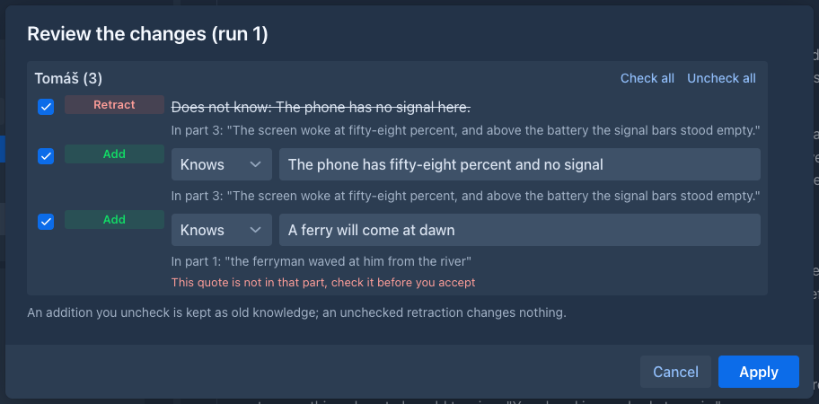

# Knowledge Tracker

Keeps track of what the characters of your story know, and what they do **not** know, and puts it into the prompt. A model
tends to let a character know things about people they have never met (their name, their job, their face) unless the
instructions guard against it; with the Knowledge Tracker the prompt says, for every tracked character in the scene,
what that character knows and that it knows nothing else.

!!!
You choose who is tracked. Only the characters you add to the tab are described to the model, and only while they are
among the *present characters* of the part being written. Nothing is guessed from the story text.
!!!

## The Knowledge tab

The left sidebar of the [story editor](../books/story-editor.md) gets a **Knowledge** tab next to *Outline*. Everything is saved to the book as you change it.



**Track a character** asks for a **name** and, optionally, **aliases**: the other names the character is written as in the
*Present Characters* field of a part, separated by commas. A name or an alias can belong to one tracked character only.

Open a character with the arrow on its card to see what it knows:

| | |
|---|---|
| **Knows** (green) / **Does not know** (red) | One short sentence about anything: a person, a place, a secret, an event (*Peter knows about the plot against the duke*, *Fiora does not know that Thomas is her father*). Write what a character does **not** know explicitly, that is what the model respects. |
| The order and **#12** | The newest knowledge is on top (old knowledge too). An item the model learned ends with the small number of the part it was learned in (**#12**): a click scrolls the story to that part and flashes it (on a phone it closes the drawer first). Items you wrote have no number, and neither has one whose part is not on the active branch (another branch, or the part was deleted). |
| **Add knowledge** | Adds an item, active at once. Keep it to **one thought**: an item that says two things (*does not know who Thomas is, has never met him*) is retracted as soon as one of them stops being true. The **edit** button changes the text and the kind. |
| **Retract** (the circle with a slash) | The item is not true any more (*has not met Thomas* after they meet). It is not deleted: it becomes *old knowledge* and is no longer sent to the model. |
| **Lock** (the padlock, on items the model learned) | The [tidy pass](#tidying-the-knowledge) never sees a locked item: use it for what must stay, a betrayal, a secret. The story can still contradict a locked item (a character who loses their memory): the reading of the story retracts it as usual. |
| **Delete** | Removes an item for good, after a question. Retract keeps it, so use it when in doubt. |
| **Select items** (next to **Add knowledge**) | Delete many items quickly: every item of the character, old ones included, gets a check box. **Select all** / **Deselect all** ticks or clears them, **Delete selected (n)** removes the ticked ones for good after one question, **Cancel** leaves the selection. |
| **Has met** | The people the character has met, noted by [processing](#processing). Processing can note a name that is not a person (a note in the present characters field): open **Edit** and change the **Has met** list, one name after another separated by commas. The names you write stay when the story is read again; one you remove comes back only if the part it was seen in is read again. |
| **Old knowledge (n)** | Collapsed by default. Each old item can be **copied**, **edited**, **restored** (it is active again, from now on) or deleted. |

### Mass changes

The **Mass changes** button (the list icon next to **Track a character**) opens a window with every tracked character and
all its items, old ones too, in a grid with check boxes: the kind, the text, the state (*Active*, or old: *retracted*,
*declined in a review*, *tidied*), where it comes from (*Initial state*, *Written by hand*, *Learned from the story*) and
the part it was learned in. Tick items in as many grids as you like (the box in the header of a grid ticks all its items,
**Select all** / **Deselect all** in the bottom bar all the items of all the characters), then:

| | |
|---|---|
| **Retract selected (n)** | The ticked active items become old knowledge, as **Retract** does for one. |
| **Restore selected (n)** | The ticked old items are active again, from now on. |
| **Delete selected (n)** | Removes the ticked items for good, after one question. |

The counts on the buttons say how many of the ticked items each one changes. The ticks stay after a change, so retracted
items can be deleted next.

**Export to JSON** (at the top of the window) downloads the tracked characters of the book (names, aliases, items with their
kind, state, origin and lock, the people they have met) as a file; nothing of the processing, so it fits any book.
**Import from JSON** reads such a file into the book and only adds: a character whose name the book tracks already (as a
name or an alias) gets the aliases, items and met people it does not have yet (an item with the same kind and text is
skipped), the others become new tracked characters; an alias another character already has is left out. An imported item
has no part of this book behind it, so a reprocess never drops it: one the model learned counts as written by hand, an old
one stays old. The message after the import says how many characters were added or updated and how many items were added
or were there already.

## What goes into the prompt

For every tracked character that is among the present characters, the prompt gets a block like this:

```
What the characters of this scene know. A character acts only on the knowledge listed for it:

Fiora knows: Mara, a courier of the Guild of Lamps and the sister of her friend Nell; she owes the Guild of Lamps forty crowns.
Fiora does not know: that her father is alive, or that Thomas is her father.
Fiora has met: Mara.
Fiora is currently with: Mara, Thomas.
Fiora has never met or heard of anyone else in this story and knows nothing else of its secrets, plans or events.
```

Only active items are sent. The last line (the **closed world** line) is what stops the model from giving the character
knowledge it cannot have; it covers what the story tells (people, places, secrets, plans, events), not what a person of that
world knows anyway, so a character still knows its own town. You can switch the line off in the settings. A tracked
character that is not present gets nothing at all, not even a line saying it does not know.

### Who is present

The block is made from the **Present Characters** field of the part. The field is free text, so it is read leniently:

- text in brackets is ignored: `Tomáš (tired), Mizuki` is Tomáš and Mizuki;
- the names are split at the **separators** (default: `,` `;` a new line, `/`, `|`, `、` `，` `；`);
- what is after ` - ` or `:` is a note and is dropped (`Mara - wounded`);
- upper or lower case, accents and a leading *the* do not matter;
- a name has to match **as a whole**: *Mara's brother* is not *Mara*. Use the aliases when a character is written in more
  than one way. The point is that a missed match costs one block, while a false match would describe a character that is
  not in the scene.

The *Point of View* field is not read on its own, so write the point of view character among the present characters too.

## Processing

The plugin follows the story. **Processing** reads the parts of the active branch in order, from the **start point** on, and
keeps a **cursor** (the last part it read). Without the model it notes who has met whom: a tracked character has met every name
that is in the present characters field together with it, and the block lists them. With the model it also finds what the
characters **learned** (see [Reading what the characters learn](#reading-what-the-characters-learn)).



The panel at the top of the tab shows where it stands. It reloads by itself when a new part is final (after the automatic
annotation and redraft, if the book has them); if you add, edit or delete parts some other way, press the **Refresh** button
(the arrows next to the gear) to read the story again. It has:

- **Process now**: reads the parts that are not processed yet.
- **Process next part**: reads only the first part that is not processed yet, one step at a time (with the model: one request for that part, whatever *Parts per run* says). Use it to try the settings or to look at what the model finds for a single part. The command `knowledge-process` with `parts` set to 1 does the same.
- **Start point**: the part processing begins at (*Start of the book* by default). Parts before it are never read. Moving
  it back reads the parts from the new start again, moving it forward leaves what was read.
- **Processed parts**: the latest parts that were read. A part whose text **changed since it was processed** (you edited or
  redrafted it) is marked; nothing is reprocessed by itself because of it. The button of a row, **Reprocess from here**,
  takes back what came from that part and the later ones (items and retractions you wrote by hand stay) and reads them again.

What the plugin does by itself, when **Process new parts automatically** is on (it is off by default):

- Before a generation starts, the parts written since the last time are processed, so the prompt knows who has met whom. A part
  that is being replaced by a *Regenerate* or a swipe is left alone. With the model, this reads with the model only when
  **Ask before applying** is off (see below); otherwise it only notes who has met whom, and what the model finds is started
  from the tab, because a review is never forced on you in the middle of a generation.
- When a part is **regenerated** and the new text arrives, what was learned from the old text is taken back.
- When you **swipe** or switch to another branch, the cursor goes back to the last part both branches share.

## Reading what the characters learn

Tick **Read what the characters learn with the model** in the settings. Then **Process now** asks the model, for the next
parts of the story, what each tracked character that is in them **learned**: what it saw, heard, read or was told. It also
says which items the story **contradicts** (*has never met Thomas* after they meet). The request holds the parts (with their
point of view and present characters), what each tracked character knows now, and, as you choose, the lorebook; the model
is told to leave out what a person of that world knows anyway (who the king is) and what follows from the character itself
(a succubus knows she has a tail), and to report nothing it is not sure of. A tracked character that is not present in
any of the parts is not asked about at all.

Every run is one request to the model. When **Process now** would need more than three of them (a long stretch of story
that was not processed yet, or **Parts per run** set low), it first tells you how many parts and requests that is and
roughly how much text goes through the model, and starts only when you confirm. Each request also carries the
instructions, the lorebook and the knowledge of the characters, so the real cost is higher than the text alone.

When **Ask before applying** is off the changes are applied at once, and each one is written to the log **Applied
automatically** in the Processing section of the tab: who got what or lost what, from which part. Nothing in the log is
editable, but every row has a **Revert** button: an added item is declined (it stays under *Old knowledge*, as a declined
addition does in the review), a retracted item becomes active again. A row whose item you edited, deleted or retracted
by hand since is left alone. The log keeps the last 200 changes.

With **Ask before applying** off the new part is read as soon as it is final: when the generation is over, or, if the
book has the automatic annotation (and redraft) or a translation on, when that is done, so the model reads the text you keep and works
while you read it. It is a step of [what follows the part](../books/story-editor.md#what-follows-a-generated-part). The next generation then finds the knowledge up to date and does not wait. What is left (a run you
stopped, a window you closed) is read before the next generation, as before.

While the model works a small **progress panel** floats over the page. It is **not modal**: you can keep reading and
editing the story, and you can **drag** it by its title. Closing it hides it, the work goes on (**Cancel** stops it).



While the model answers, the panel shows **What the model is writing** as it comes: its reasoning first and then the answer, so a
long wait on a slow model is not a blank bar. When the request is over the same text stays under **What the model thought** (a
block for every request of the run, with what it answered), also when it proposed **nothing** and no review opens: the tab keeps a
button **Last run: what the model thought** that opens the panel again, so you can see why nothing was added.

When the model has answered, the panel says so and shows **Review changes**; the same button is in the processing panel
of the tab (*3 changes to review*). **The review never opens by itself.** It is a table of the changes, grouped by
character:



Under the table, **What the model thought** (closed at first) holds the reasoning of the model that came before its answer, when the model sends
it: it shows why a change was proposed, or why one that you expected is missing, so you can judge the change before you apply it. A model that
does not reason shows nothing there.

| | |
|---|---|
| The check box | Whether the change is applied. All are checked at first; each character has **Check all** / **Uncheck all**. |
| **Retract** / **Add** | A retraction makes an item old (it is kept, see [the tab](#the-knowledge-tab)). An addition is a new item, *Knows* or *Does not know*. The text and the kind of an addition can be **edited** before it is applied. |
| The quote | The words of the part that show it, and which part it is in. A quote that is not found in that part is marked: the model may have made it up, check it before you accept. |

**Apply** applies the checked changes and moves on. **Cancel** stops the whole series and changes nothing: the same parts are
proposed again next time. An addition you uncheck is **kept as old knowledge** with its quote (you can restore it);
an unchecked retraction leaves the item as it is. What the model said that could not be used (a character it was not asked
about, an item that is not there, a change without a quote, something the character knows already) is listed under *Left out*.
What was applied carries its part, so **Reprocess from here** takes it back again. If the story changed while you
were reviewing (another branch, a part deleted), the changes are not applied and you process again.

Parts are read in **runs** of **Parts per run** (1 by default); one that does not fit the context of the model is cut
down to what fits. A series goes on, run after run, until the last settled part; in a series that asks you, a run in which
the model found nothing is skipped without asking. With **Ask before applying** off, the changes are applied at once and the
panel keeps a log with one line per run.

!!!
The prompt was tested against a model on a few scenes, not widely: it keeps characters from learning what they did not
perceive, but check what is proposed, especially for characters that are in a long scene. The request is sent to the model
you choose below, with the usual cost and privacy of that service.
!!!

## Tidying the knowledge

The model writes down what each character learns, and over a long story the list grows, with more small things than you want
to send to the model on every request. **Tidy knowledge** (next to **Process now**, needs the model setting) asks the model to
read what a character knows again, with the last processed parts of the story for context, and to

- **drop** an item that is not worth keeping: trivia, a detail of a scene that everybody in it saw (the story holds it), something
  that later events overtook, something that says the same as another item;
- **merge** several items about the same thing into one that keeps every fact.

A dropped or merged item is not deleted: it becomes *Old knowledge* and can be restored. The changes are reviewed, like the ones of
a reading (**Ask before applying** decides), or applied at once and written to the log with a **Revert** button.

What the pass may touch is only what the model learned and you did not **lock**. The initial items, the ones you added or edited
by hand, the locked ones and the old ones are never changed (the first two kinds and the locked ones are shown to the model so that
it can see what an item would duplicate). A secret that no part has mentioned for a long time is no reason to drop it, and the
prompt says so; when the model is in doubt it keeps the item. A character with fewer than **Tidy: from this many items** (8) items
that the model learned is not tidied, and **Tidy: parts of context** (10) is how many of the last processed parts it reads.

**Tidy automatically** (a setting, off by default) runs the tidy by itself at the end of a run whose changes are applied without
asking (**Ask before applying** off, so the automatic reading of the new parts too), once the model has read **Tidy after this many
parts** (10) parts since the last tidy. What it changes is applied and written to the log with a **Revert** button, and the run's log
says so. A run you review never starts a tidy by itself, and a character with too few items is skipped without asking the model.

The same from the command bar: `knowledge-tidy` (`ask true` to get the changes as a list; the open tab then shows the review
button), and `lock-knowledge` / `unlock-knowledge` with the character and the number of the item.

## Settings

The gear next to *Track a character*:

| Setting | |
|---|---|
| **In prompt** | Inserts the block into the prompt of every generation. The button turns green while it is on. |
| **Depth** | Where it goes, counted in messages from the end of the prompt: `0` after the instructions of the turn, `1` right before them. It never goes before the system prompt. |
| **Role** | Whether it is sent as a *System*, *Assistant* or *User* message. |
| **Say that nothing else is known** | The closed world line. |
| **Give what the characters know to the annotation** | On (the default): [Annotate with AI](#annotating-with-what-the-characters-know) gets what the tracked characters of the part knew when it begins. |
| **Process new parts automatically** | See [Processing](#processing). |
| **Read what the characters learn with the model** | Processing asks the model what each tracked character learned and proposes it. Off (the default): processing only notes who has met whom, which costs nothing. |
| **Ask before applying** | On (the default): every proposal is shown for review. Off: it is applied at once and logged. |
| **Let the model read earlier parts** | While it reads the new parts the model may read the part an item was learned in (the items say "learned in part 12"), to see whether what it reads confirms, repeats or contradicts it: hearsay that is now seen with the own eyes, for instance. At most 5 reads of one part each per request, the text of a long part is cut to what fits the context, and the review shows which parts it read. Every read is one more round to the model, so it is off by default. A model that can not call functions reads the request as before. |
| **Parts per run** | How many parts one request reads. Larger is cheaper but gives a longer answer and a harder review. |
| **Tidy automatically**, **Tidy after this many parts** | The tidy pass runs by itself at the end of a run that applies its changes without asking, every this many parts (10). Off by default. |
| **Tidy: parts of context** | How many of the last processed parts the tidy pass reads (10). |
| **Tidy: from this many items** | A character with fewer items that the model learned (and that are not locked) is not tidied (8). |
| **Lorebook for the model** | *Entries the parts activate* (the default: the entries a generation would use for these parts), *The whole lorebook* (every entry; when it does not fit the context, the activated ones are sent and the note says so) or *No lorebook*. |
| **Model / Protocol for the extraction** | Empty: the model of the book. A cheaper model is enough for this, and on a server that holds one prompt cache a separate model keeps it from being replaced. |
| **Separators of this book** | How the present characters field is split into names, one per line (a new line is `\n`). A word such as `and` splits between spaces, so *Jack and Jill* stays one name until you add it. |
| **My separators (all books)** | The same for all your books. The book's own separators win; with neither, the built-in ones are used. |

## Prompts

The system message of the reading (**Knowledge extraction prompt**) and the one of the tidy pass (**Knowledge tidy prompt**) are
[inherited settings](../books/prompts.md#inherited-settings): a book uses its own, else the nearest folder above it that sets one,
else yours, else the built-in text that was tested against a real model.

Set them in the *Prompts* tab of the book, under *Extension Settings*, in the dialog of a folder, or for all your books in
*Settings → Extension Settings → Knowledge Tracker* (empty shows the built-in text in grey). Keep the JSON answer format of the
built-in text: the plugin reads the answer by it. The instructions for `read_part` are added by the plugin when the model may read
earlier parts, so your prompt does not need them.

## Annotating with what the characters know

The block above keeps the model from making a character omniscient *while it writes*. The same records also help to find the slips that got
in anyway. When a model [annotates a part](../books/annotations.md#letting-a-model-annotate) (**Annotate with AI**, a range of parts, the
automatic annotation, `/generate-annotation`), the tracker tells it what the tracked characters of that part knew **when the part begins**,
and the editor flags a character who says, thinks or does what they cannot know: *Fiora greets Thomas by name; the records say she has never
met him.* The note names the fact.

- **The facts are those of the part, not of the end of the book.** What a character learned in a later part is not yet known; an item that a
  later part retracts was still true. What the part itself brings (what is learned, who is met, what stops being true in it) is listed apart,
  so the first half of the part is not checked against the second.
- **Which characters.** The tracked ones that are in the *Present Characters* of the part, are its point of view, or are named in its text
  (a whole word, any case, aliases too).
- **Items that are not facts at any point** are left out: the ones you retracted by hand, the ones the tidy pass dropped, the ones you declined
  in a review.
- **Only what is recorded.** The model is told that what the records do not say is not a fact, so it does not flag a character for a thing the
  tracker simply never heard of. *Say that nothing else is known* also adds "(nobody else)" to who a character has met.
- If a part before the reviewed one was not read by the tracker, the facts say so: what the characters learned there is missing, and
  **Process now** first gives a better review.
- The facts cost tokens in the request of the annotation, only for the parts that have a tracked character. Switch them off with **Give what
  the characters know to the annotation**.

## The block as a macro

Instead of (or besides) the automatic insertion you can place the block yourself with the
[ macro](../templates/macros.md#commands). The argument is the list of
the characters of the scene, so a template can pass the field of the part:

```

```

The macro prints the block whether or not **In prompt** is on, so switch that off when you use the macro, or the model gets it
twice. Depth and role do not apply to the macro (the block is part of the message that contains it). It prints nothing when
none of the listed characters is tracked. The answer of a command macro is kept with the part the new part continues from,
so a second generation from the same part does not see a change you made in between; a regenerate and a swipe ask again.

## Commands

For the [command line](../commands/index.md) and for agents:

| Command | |
|---|---|
| `knowledge-status` | The settings and where processing stands. |
| `list-tracked-characters`, `add-tracked-character`, `update-tracked-character`, `delete-tracked-character` | The tracked characters, addressed by name, alias or number. |
| `list-knowledge`, `add-knowledge`, `retract-knowledge`, `restore-knowledge`, `delete-knowledge` | The items of a character, addressed by their number in `list-knowledge`. |
| `knowledge-process` | Processes now (`parts`: at most that many). With the model on, `ask true` returns what the model found as numbered changes and holds them: nothing is changed yet. The open Knowledge tab shows a **changes found by a command** button that opens the usual review (Apply / Cancel); an agent applies them with `apply-knowledge-changes`. |
| `apply-knowledge-changes` | Applies the held changes, all of them or the numbers given (the same as **Apply** in the review of the tab). |
| `knowledge-tidy` | The tidy pass. With `ask true` it returns the changes as a numbered list and holds them (the tab shows a button to review them; `apply-knowledge-changes` applies them). |
| `lock-knowledge`, `unlock-knowledge` | Lock an item (character, item number) so that the tidy pass leaves it alone, or unlock it. |
| `knowledge-reprocess` | Reprocess from a part (its handle or position); asks first. With the model on it only takes the state back, `knowledge-process` reads the parts again. |
| `knowledge-set-start` | Sets the start point; without a part, the start of the book. |
| `knowledge-tracker-block` | The block as text, for the macro. |

The command line splits its arguments at spaces: put a list of characters in quotes (`/knowledge-tracker-block "Fiora, Mara"`).

## Storage

Everything is stored with the book (in its attributes), so it is part of [book backups](../books/backups.md) and copies.
