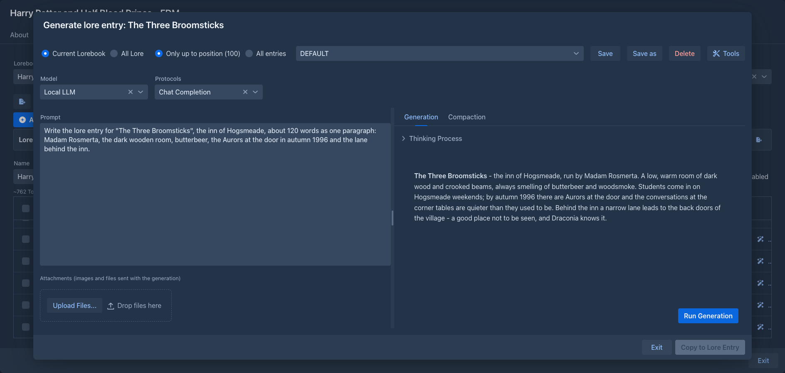
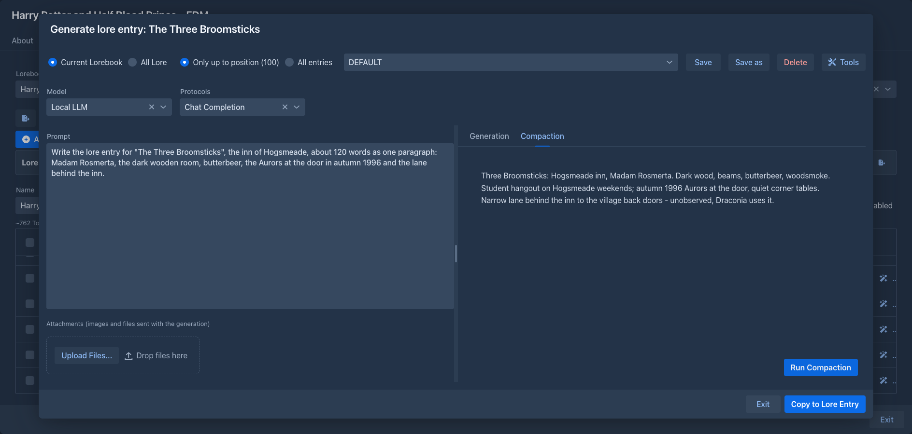

# Lore Generator

Lets the model write the content of a [lorebook entry](../lorebooks/entries.md) for you. It reads the lore you already
have, so the new entry fits the world, and compacts the result into the short, dense form lore entries work best in.

!!!
Lore Generator is not available in the [phone layout](../phone.md#extensions).
!!!

## Opening the generator

With the extension installed, every row of the lorebook editor gets a wand button (**Generate lore entry**). It opens
the generator for that entry. If the entry already has content, the dialog says so at the top: copying the result to
the entry replaces the content.

The generator starts with your **Default Model** and **Default Protocol** from *Settings*, see
[Account & settings](../account.md). The **Model** and **Protocols** lists under the header of the dialog let you use
another model or protocol for this generation (the choice is not saved); the protocol is optional. Without a model it
only shows a warning.

## What the model sees

The two choices at the top of the dialog decide which lore goes into the request:

| Choice | |
|---|---|
| **Current Lorebook** (default) / **All Lore** | Only the entries of the lorebook the entry is in, ignoring its [sub lorebooks](../lorebooks/lorebooks.md); or the entries of that lorebook together with all its sub lorebooks. |
| **Only up to position (n)** (default) / **All entries** | *n* is the order of the entry. Only the entries that come before it are shown (a lower order, or the same order and created earlier), so the model builds on what already exists and doesn't get lore that was written after the entry. *All entries* shows everything. |

The entry you are generating is never included, with or without content. Whether other entries or lorebooks are
enabled, their tags and filters and their insertion mode are ignored: what you pick here is what is sent, in the
order the entries are inserted into a prompt. The templates of the entries are processed as usual.

## Prompts

The generation prompt is what you ask the model to write. The prompts are listed in the box next to the choices, in the
same top row; the text of the selected one is in the text area on the left, and you can change it for a single
generation without saving. The two halves of the dialog are separated by a splitter you can drag.

| Button | |
|---|---|
| **Save** | Saves the text under the selected name. |
| **Save as** | Asks for a name and saves the text as a new prompt (or replaces one of that name, after asking). |
| **Delete** | Deletes the selected prompt. When the last one is deleted, the built-in `DEFAULT` prompt comes back. |

The built-in prompt has placeholders in brackets (the subject, the details to include, the length, the structure):
fill them in before you run it. Prompts belong to your account, and the one you used last is selected again the next time
the dialog opens.

## Generation and compaction

The right side has two tabs.

**Generation** - **Run Generation** sends the lore followed by the generation prompt. The answer appears as it is
written, with the model's reasoning (when it gives any) in a *Thinking Process* section above it. **Stop** (in place of
*Run Generation*) ends it early; what was written so far is kept.

**Compaction** - available once there is a generation. **Run Compaction** sends the same lore followed by the
compaction prompt, with the generated text in it, and the model condenses it into a compact entry. The compaction
prompt is set in *Settings → Extension Settings → Lore Generator*; when it is empty, the built-in one is used (it
strips the prose and keeps the facts). Running the generation again discards the compaction.

While the model is working, all controls are frozen except **Stop**; you can't close the dialog either.

### Remembered per entry

When you **Copy to Lore Entry**, the options of that generation are stored with the entry: the prompt text, which saved
prompt it came from, the lore and entries choices and the checked name categories. Opening the generator for that entry
again restores them, taking priority over the prompt you used last and your saved name categories. An entry that was
never generated into opens with the usual defaults. The options belong to the entry, so they travel with backups and
exports of the lorebook.

### Tools

When a suite of [tools for the model](tools.md) is installed (names from the [Name generator](name-generator.md) or the
[Name provider](name-provider.md), places from the [Place provider](place-provider.md)), the top row has a **Tools** button.
It opens the window where you choose which suites, and of the ones with categories which categories, the model may use; see
[Tools for the model](tools.md) for how it works. While something is checked the model can call the tools during the
generation (not the compaction), and the hint of each suite it gets is added to the end of the generation prompt. The choice
is saved with your account and with the entry.

### Attachments

Under the prompt you can add files for the model to look at: reference images, a map, a character sheet. Drop them on
the upload area, choose them, or paste them into the prompt with Ctrl+V (a screenshot or a copied file becomes an
attachment; pasted text is inserted as usual). Up to 20 MB each. They are listed with their name, type and size, and the trash
button removes one. They are sent with the generation, not the compaction, and you can add and delete them only while
no generation runs.

Whether the model can use them depends on the model and the [inference provider](../inference-providers.md): images
are sent as images, audio only as WAV or MP3, other files as files. When the provider refuses an attachment, you get a
message and nothing is generated.

## Copying the result

**Copy to Lore Entry** is available when the compaction has a result. The compacted text becomes the **content** of
the entry, and the generated text before the compaction goes into its **note**. Both are replaced. If the compaction
is one code block (the built-in prompt asks for that, to make the text easy to copy), the code block around it is
removed. The lorebook is refreshed, and the dialog stays open; **Exit** closes it.

## Commands

The generator also works without the dialog, as three [commands](../commands/index.md) for the command line and for
[agents](../agents.md). They do the same two steps as the dialog and, like the dialog, they store nothing: they return
the text, and putting it into an entry (what **Copy to Lore Entry** does) is up to the caller, so all three only read. The
lorebook and the entry are given by number, as in `/list-lorebooks` and `/list-lore-entries`; the model is your default
model and protocol.

| Command | What it does |
|---|---|
| `/list-lore-templates [template]` | Lists your saved generation prompts (name, length, start of the text) and the one used last. With a name it returns the whole text of that prompt. |
| `/generate-lore-entry [prompt [template [lorebook [entry [order [scope [limit [images]]]]]]]]` | Generates a text with the lore of the lorebook and returns it. The text sent is a template followed by the prompt of the caller (see below). With `images` the model also looks at pictures, as with the attachments of the dialog. |
| `/compact-lore-entry text [lorebook [entry [order [scope [limit]]]]]` | Compacts the text with the same lore and returns the result, without the code block around it. |

The entry the text is for decides which lore the model sees. Give its handle or its number as `entry` (and the `lorebook` it is in, by handle or number, when you give the number) and the lore is the same as in
the dialog: with `limit` `UP_TO_POSITION` (the default) the entries before it, the entry itself never. An entry that does
not exist yet has no number: give the `order` it will get instead (the `order` of `/list-lore-entries`, lower comes first)
and the model sees the entries before that order; without either, the text is written for a new entry after all the others.
`scope` is `CURRENT_LOREBOOK` (the default) or `ALL_LORE`, `limit` is `UP_TO_POSITION` or `ALL_ENTRIES`, as in the dialog.

A generation is only as good as its prompt, so the command always starts from one of your saved generation prompts (see
[Prompts](#prompts)): the one named in `template`, or the one used last when none is named. The `prompt` of the caller
follows it under the heading *Task for this entry* and is where the subject, the facts, the length and the sections go,
which is what the template asks for. `template` `none` sends the prompt alone, for a caller that has written the whole
prompt itself, for example after getting the text of a template from `/list-lore-templates` and editing it. A command
that is called with a template and no prompt sends just the template.

The `images` of `/generate-lore-entry` are the images the dialog would attach to the generation. An [agent](../agents.md) passes a list of
paths of image files of its workspace (`/refs/map.png`; at most 8, PNG, JPEG, GIF or WebP, scaled down when large), which you put there with
**Upload file** in the Workspace tab. The command bar has no way to name an image, so `images` is for agents. It is your default model that looks at the
pictures: if it does not take images the command fails and says so. Only the generation takes images, as in the dialog; `/compact-lore-entry` works on the text alone.

The model gets no tools here. A caller that wants names asks for them first, with `/generate-names` of the
[Name generator](name-generator.md) or `/pick-real-names` of the [Name provider](name-provider.md), and writes the ones it
likes into the prompt. An agent can also take the text of a template from `/list-lore-templates`, change it and pass the
result as the prompt.

## Storage

The prompts and the compaction prompt are stored with your settings, so [database backups](../administration/database-backups.md)
include them. Nothing is stored with the lorebook; the generated text exists in the dialog only until you copy it.
