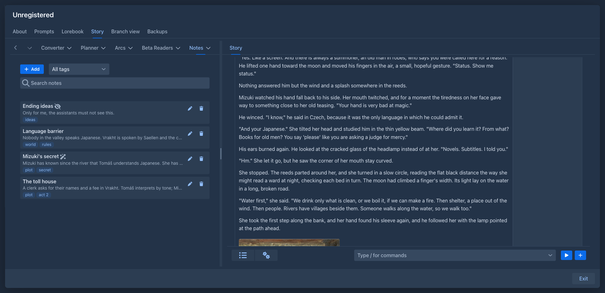
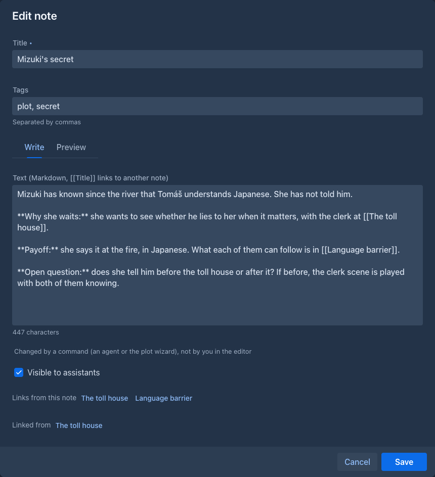
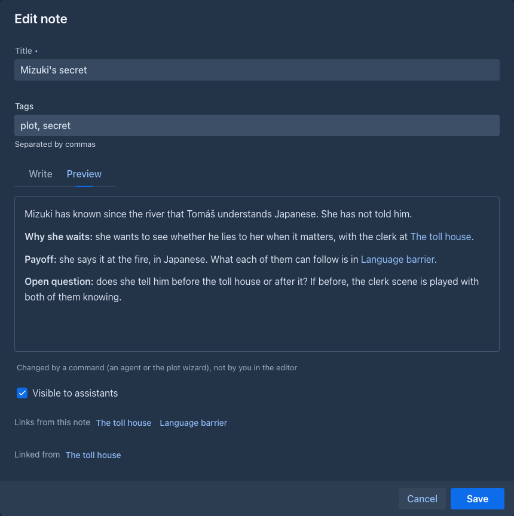
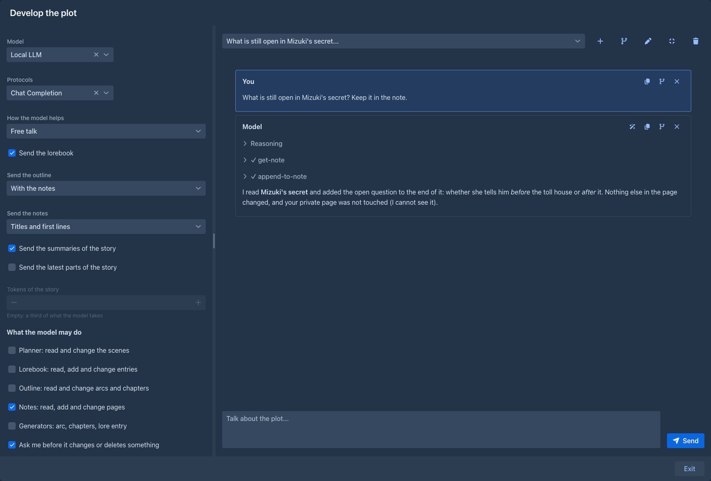

# Story Notes

A small wiki for your book, in the sidebar: pages for the plot you are planning, an idea you are not ready to use, the
rules of a magic system, what the villain really wants. They are your own thinking, in your own words, with tags and
links between the pages. Unlike the [Author's Note](authors-note.md), which is one text sent with every generation, the
notes are not sent to the model on their own. The [plot wizard](arc-outline.md#developing-the-plot-in-a-conversation) and
agents can read them, and change them if you let them.

## The Notes tab

The left sidebar of the [story editor](../books/story-editor.md) gets a **Notes** tab next to *Outline*. It lists the pages of
the book ordered by title. Above the list are **Add** (a new page), a filter by **tag** (shown once a page has a tag) and a
search over the titles, the tags and the text of the pages.

Every page shows its title, the first line of its text and its tags. Click the page, or the pen, to open it; the trash can
deletes it after a confirmation. Two small marks can follow the title: a crossed eye (the page is
[hidden from assistants](#what-assistants-can-see)) and a wand (the last change came from a command, not from you).

## A page

The dialog of a page has:

| | |
|---|---|
| **Title** | Required, unique in the book (the case does not matter), without brackets or a bar (`|`). It is what other pages link to. |
| **Tags** | Separated by commas. They filter the list. |
| **Text** | Markdown. **Write** and **Preview** switch between the text and how it will look. `[[Title]]` in the text links to the page with that title; `[[Title|other words]]` links to it too but shows *other words* in the preview (`[[Language barrier|how they talk]]`). |
| **Visible to assistants** | On by default. See below. |

Under the text the dialog lists the pages the text **links to**: a link to a page that exists opens it, a link to one that
does not offers **Create** and starts a new page with that title. Under it are the pages that **link here**. Renaming a page
changes the `[[links]]` to it in the other pages (the words a link shows stay).

**Preview** shows the text as Markdown, with every `[[link]]` as a link: click it to open that page (a link to a page that does not exist starts a new one with that title):

Nothing is saved before **Save**; closing a changed page asks before it discards the changes. If the page was changed by a
command while you were editing it, you are asked before your version overwrites it. **Ctrl/Cmd+Enter** saves. The pages are
stored with the book, so they are in its backups and copies.

## What assistants can see

"Assistants" are the commands the notes bring, which agents, macros and the plot wizard use. A page with **Visible to
assistants** switched off does not exist for them: it is not listed, found, read or changed, and a title only it has is
refused when they try to create it. Switch it off for what only you should see. Pages you have switched off are still in
your backups.

The commands (for the command bar and for agents; the title is the address of a page):

| Command | |
|---|---|
| `/list-notes [<tag>]`, `/get-note <note>`, `/search-notes <query>` | The pages, one page with its text, its links and the pages that link to it, and a search. |
| `/create-note <title> [<content> [<tags>]]` | Adds a page. |
| `/append-to-note <note> <text>` | Adds a paragraph at the end of a page. |
| `/update-note <note> [<title> [<content> [<tags>]]]`, `/edit-note <note> <find> <replace> [<all>]` | Change a page, or replace a piece of its text: `find` must be in the page exactly as written (the case matters) and, unless `all` is `true`, exactly once; with `all` every occurrence is replaced, for a name or a term all through the page. The answer says how many pieces were replaced. These change text that exists, so they are *destructive*: an agent set to ask asks you first. |
| `/delete-note <note>` | Deletes a page, after a confirmation. |
| `/note-text <note>` | The text of a page, made for macros:  puts it into a template. Empty for a page that does not exist or is hidden. |

A page a command changed is marked with the wand until you save it yourself.

## With the plot wizard

When this extension is installed, the [plot wizard](arc-outline.md#developing-the-plot-in-a-conversation) of the Arc Outline has
a **Send the notes** option (the titles with their first lines, the full text, or nothing) and a **Notes** group of tools:
the model can search and read the pages, follow their links, add a page or add to one when you ask it to keep something, and
change text in one. Changing the text of a page is asked first while *Ask me before it changes or deletes something* is
on; the wizard cannot delete a page. See the option and the group in the table of the wizard.

## Other extensions

The extension offers two sources of text to other extensions (the [Side Query](side-query.md) can attach them from its plug
button): **Story notes (titles)** and **Story notes (all)**. Both leave out the hidden pages.
