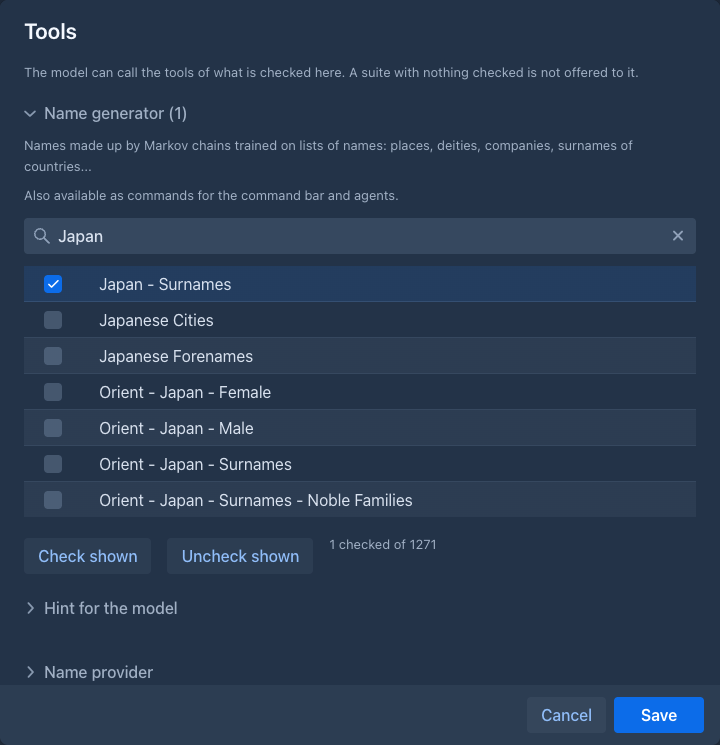
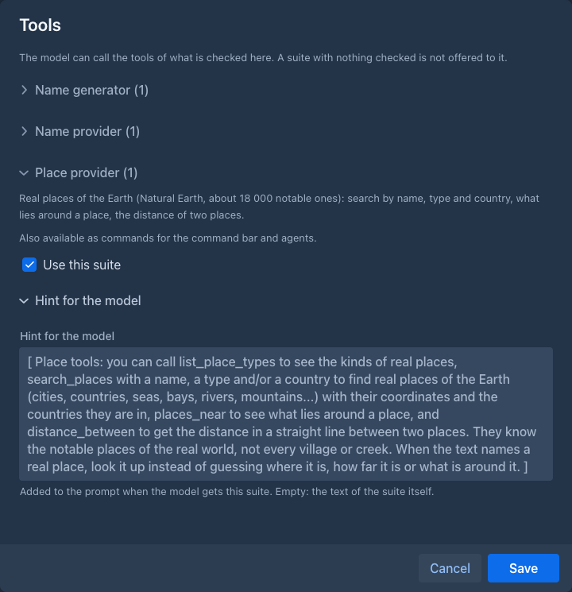

# Tools for the model

Some extensions give the model **tools**: functions it can call while it writes, to get names, to look up real places, and
so on, instead of inventing them. The tools of one extension are a **suite**; the suites there are:

| Suite | Extension | What the model can do with it |
|---|---|---|
| Name generator | [Name generator](name-generator.md) | Get names made up to sound like a category (places, deities, surnames of a country...). |
| Name provider | [Name provider](name-provider.md) | Get real names with their original spelling. |
| Place provider | [Place provider](place-provider.md) | Look up real places, what is around them and how far apart they are. |

A dialog that runs the model with tools has a **Tools** button: the generators of the [Lore Generator](lore-generator.md) and of
the [Arc Outline](arc-outline.md) (not its story import, whose names are in the story already). The button is shown only
while at least one suite is installed, and when you have chosen something it says how many things are on: **Tools (3)**.

## Choosing the tools

**Tools** opens a window with one section for each suite, under the name of the suite, with the number of things checked in it.
A section with something checked starts open. What is in a section depends on the suite:

- A suite with **items** (the Name generator and the Name provider have one for each category or list of names) shows a table
  with a checkbox each and a **filter field of its own** above it: type a part of a name to show only the matching items. The
  items that are checked always stay in the table, whatever the filter says. **Check shown** checks all the items the table
  shows at that moment, **Uncheck shown** unchecks them, and a line below says how many are checked. The model gets only
  the checked items: it can list them and ask for names of them, and no others.
- A suite **without items** (the Place provider) is on or off: **Use this suite**.

Every section also has a **Hint for the model**. It is a short text added to the end of the prompt when the model gets the
suite, telling it when and how to use the tools (for the names: call the tools instead of inventing names, pick from what
you get, keep a real name as it was returned). The built-in text is shown in grey in the field; write your own to replace
it, leave the field empty to use the built-in one.

The model gets the suites that have something checked: nothing checked in any of them, no tools. The choice is saved with
your account, so it is the same the next time; the Lore Generator also saves the choice with each entry it generated, and
opens that entry with it. A suite that was unloaded is skipped, and a checked item that the extension no longer has is
ignored. Extensions can be loaded and unloaded while Marginalia runs; the button follows.

If two suites had a function of the same name the generation would not start and say which; the suites that come with
Marginalia do not.

## As commands

The suites are also commands of the [command bar](../commands/index.md) and of [agents](../agents.md) (`/pick-real-names`,
`/generate-names`, `/search-places`...), so what the model gets here and what an agent can call are the same suite under the same
name.

## From an older version

The **Name tools** button became **Tools**. The categories you had checked are checked in the suites of the Name generator and the
Name provider, and the hints you wrote in *Settings → Extension Settings* (*Name generator hint*, *Name provider hint*) are
now the hints of those two suites in this window; the fields in the settings are gone.
