# Inference providers

An inference provider is a connection to a model: the API address, the API key, the model and its limits. Every
book uses one provider. You can have as many as you like, for example a large cloud model for the story and a small
local one for experiments, and switch a book between them at any time.

Providers belong to your account. Other users don't see them or their API keys. API keys are stored encrypted (see
[The data folder](administration/index.md#the-data-folder)).

Adding a provider needs the permission **Create own models**, which an administrator gives you (administrators always
have it, see [Permissions](administration/permissions.md)). Without it you can only use the providers the
administrators [share](#shared-providers) with you; the **Add Inference Provider** button is not shown.

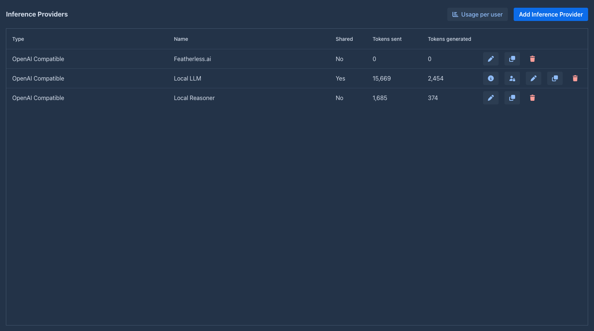

## Supported APIs

Marginalia works with any API that implements the **OpenAI Chat Completions** interface (`/v1/chat/completions`,
with streaming). Most services and local servers do:

| Service | OpenAI URL |
|---|---|
| OpenAI | `https://api.openai.com/v1` |
| OpenRouter | `https://openrouter.ai/api/v1` |
| LiteLLM proxy | `http://localhost:4000/v1` |
| llama.cpp (`llama-server`) | `http://localhost:8080/v1` |
| LM Studio | `http://localhost:1234/v1` |
| Ollama | `http://localhost:11434/v1` |
| vLLM | `http://localhost:8000/v1` |

The ports are the defaults of each server; use the ones your server actually runs on.

!!!warning Port 8080
The Docker version of Marginalia uses port 8080 as well. If you run llama.cpp on the same machine, start it on another
port (`llama-server --port 8081`).
!!!

!!!
With the [Docker version](getting-started/docker-server.md), `localhost` means the Marginalia container. Use
`http://host.docker.internal:<port>/v1` for a model server on the same machine, see
[Models on the same machine](getting-started/docker-server.md#models-on-the-same-machine).
!!!

## Adding a provider

Open the **Inference Providers** tab and click **Add Inference Provider**. Existing providers are edited with the pen
button and deleted with the trash button. The clone button (two sheets) makes a copy of a provider under a name you
confirm (the original's with *(Copy)*): the copy has the same address, model, **API key** (or the settings of the
extension), reasoning, token limits and parameters, so a second model on the same service takes a name and a click.
The copy is not shared and has no limits or usage of its own. You can clone only your own providers (not a shared one of
an administrator, whose key you must not see) and only when you may create providers.

At the top of the dialog:

| Field | |
|---|---|
| **Name** | Your name for the provider, shown when you pick a model for a book. Include the model, e.g. `OpenRouter - Claude Sonnet`. |
| **Type** | The kind of API: **OpenAI Compatible**, or **Extension** for a provider that an [extension](extensions/index.md) brings (it is offered only while such an extension is loaded, e.g. [Google Gemini](extensions/google-genai.md) or [Anthropic Claude](extensions/anthropic.md)). The type can't be changed after the provider is created. |
| **Provider** | Only for the type **Extension**: which extension's provider this is. Its own settings fill the *Per Type Settings* tab. |

### Per Type Settings

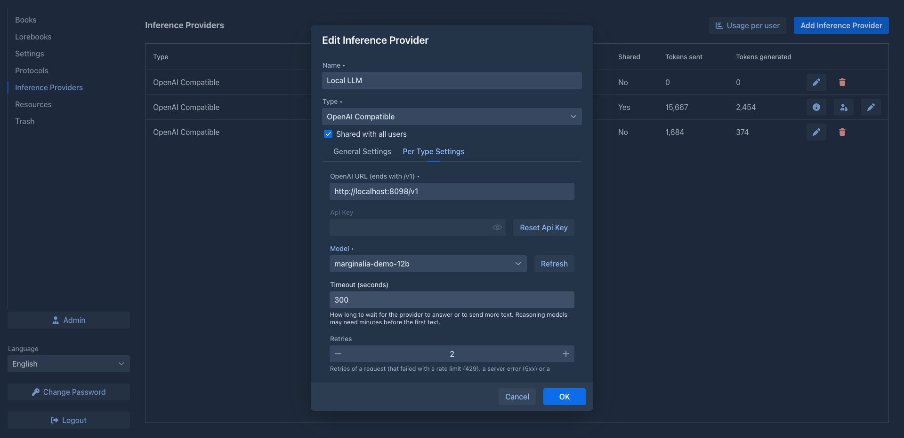

The tab is taller than the dialog and scrolls. The lower fields:

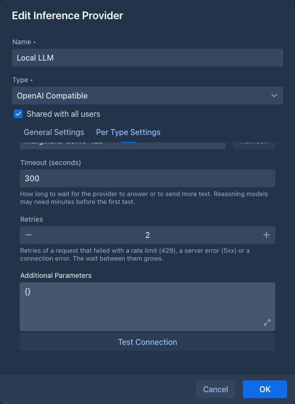

| Field | |
|---|---|
| **OpenAI URL (ends with /v1)** | The base address of the API, see [the table above](#supported-apis). Without `/chat/completions`. |
| **Api Key** | The key of the service. A local server usually doesn't check it: leave the field empty and Marginalia sends the placeholder `none`. |
| **Model** | The model to use. Click **Refresh** to load the list of models from the API, or type the model ID yourself (e.g. `anthropic/claude-sonnet-4.5` on OpenRouter). |
| **Timeout (seconds)** | How long to wait for the API to answer, and for more text once it started writing. The default is 300. Reasoning models may need minutes before the first text; a request that hears nothing for this long fails with a timeout message (the thinking of a model counts as text, so a model that keeps thinking is not cut). A change is used by the next request, also of an agent that is working. |
| **Retries** | How often a request is repeated when the API answers with a rate limit (429) or a server error (5xx), or cannot be reached. The wait between attempts grows, and a `Retry-After` header of the API is respected. The default is 2, 0 turns retrying off. Only the start of a request is retried, text that already arrived is never written twice. |
| **Tokenizer** | How Marginalia counts the tokens of the texts for this provider. **Automatic** (the default) tries the tokenizer endpoints of the server one after the other (OpenAI, llama.cpp, LiteLLM) and uses the first that answers, and a local estimate when none does. Choose one to use only that, or **LOCAL_TOKKIT** for the local estimate that never calls the server (useful when counting would make the server load another model). A tokenizer from a plugin is listed here too; it gets the address, the model and the text, never the API key, and only when you choose it. **Test tokenizer** counts a sample text with what the provider would try and shows what each answered. When you create a provider, a plugin tokenizer that fits the address is preselected until you choose yourself. |
| **Additional Parameters** | A JSON object with extra fields for every request to this provider, e.g. `{"top_k": 40, "min_p": 0.05}` for a local server, or `{"provider": {"order": ["anthropic"]}}` for OpenRouter. A field set here wins over the same setting from the [protocol](protocols.md) (e.g. `temperature`) or the response limit (`max_completion_tokens`). Must be a valid JSON object or empty. |

When you edit an existing provider, the API key is not shown again. It is kept as it is unless you click
**Reset Api Key** and enter a new one.

**Refresh** asks the API for its model list (`/v1/models`) with the URL and key from the form. If it fails with
*Failed to download model list*, check the URL (it must end with `/v1`), the key, and that the server is running.
Some services don't list models; type the model ID instead.

**Test Connection** checks the values in the form without saving: it asks the API for its model list and then for a
one-token answer from the selected **Model**, without retries. A success message means the URL, key and model work
together. A failure names the cause (see [Error messages](#error-messages)). Some services have no model list; the
test then only needs the one-token answer.

### General Settings

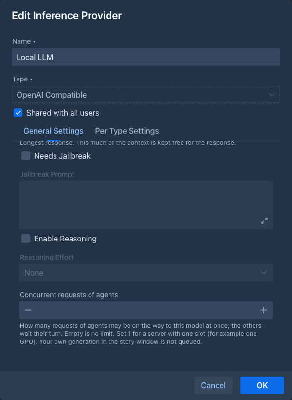

| Field | |
|---|---|
| **Max Context Size** | Required. How many tokens the model accepts in total, prompt and response together. |
| **Max Response Tokens** | Required. The longest response the model may write. Sent to the API as `max_completion_tokens`, and this much of the context is kept free for the response. Must be lower than *Max Context Size*. |
| **Concurrent requests of agents** | Optional, for a server that answers one request (or a few) at a time. How many requests of [agents](agents.md#one-model-several-agents) may be on the way to this provider at once, the others wait their turn. Empty is no limit. Your own writing in the story window is not queued. |
| **Needs Jailbreak**, **Jailbreak Prompt** | An extra prompt for models that refuse to write some content. When checked, the jailbreak prompt is put at the very beginning of the prompt. |
| **Enable Reasoning**, **Reasoning Effort** | For reasoning ("thinking") models, see [Reasoning models](#reasoning-models). |

Marginalia keeps **Max Response Tokens** of the context free for the response and fills the rest with the prompt:
templates, [lorebook](lorebooks/index.md) entries and [summaries](books/summaries.md) are counted in, and the oldest
parts of the story that don't fit are left out. With a context of 32 000 tokens and responses of up to 2 000 tokens,
the prompt gets 30 000 tokens.

Take **Max Context Size** from the documentation of the service, and set it a little lower: token counts are not
always exact, and a request that exceeds the real limit fails. A [protocol](protocols.md) can lower both limits
for some books, but not raise them.

## Error messages

When the API refuses a request, Marginalia says what to fix instead of showing an internal error, followed by what the
API itself said:

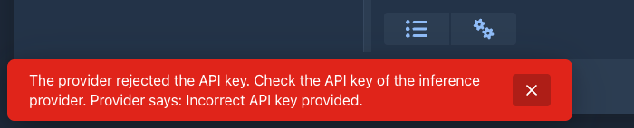

| Message | Cause |
|---|---|
| *The provider rejected the API key.* | Wrong, expired or missing **Api Key**. |
| *The API key is not allowed to use this model or endpoint.* | The key is valid but has no access to the model. |
| *The provider does not know the configured model.* | Wrong **Model**; use **Refresh** to see the names the API knows. |
| *Nothing was found at the configured URL.* | Wrong **OpenAI URL**; it usually ends with `/v1`. |
| *The prompt does not fit into the context of the model.* | **Max Context Size** is higher than what the model really accepts. Lower it. |
| *The provider is limiting requests.* | Rate limit or exhausted quota, even after the retries. |
| *The provider failed to process the request.* | The service has a problem (5xx), even after the retries. |
| *The provider did not answer in time.* | Raise **Timeout (seconds)**, or check the server. |
| *Cannot connect to the provider.* | The server is not running or not reachable from Marginalia, or the URL has a typo. |
| *The provider rejected the request.* | Another refusal, often an unsupported field in **Additional Parameters** or reasoning that the model doesn't support. |

## Warning before sending

Marginalia fills the context only up to **Max Context Size** minus **Max Response Tokens**. If the finished prompt is
still bigger than that (for example because an extension added text, or the token count was off), a warning shows the
estimated sizes before the request is sent. The request is sent anyway; the API may reject it or cut the prompt.

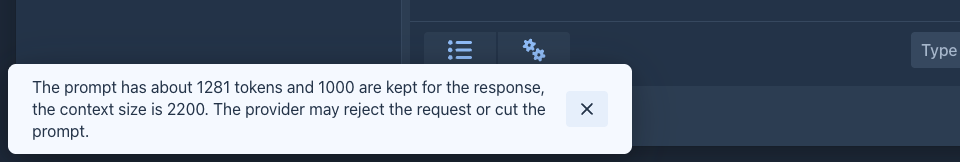

## Reasoning models

Reasoning models think before they answer. With **Enable Reasoning** checked, Marginalia sends the chosen
**Reasoning Effort** (*None*, *Low*, *Medium* or *High*) to the API as `reasoning_effort`. More effort usually means
better planned text, but slower and more expensive responses. Not every API supports the parameter; if requests
fail with reasoning enabled, turn it off.

When the model returns its reasoning (as `reasoning_content` or `reasoning`, depending on the server), it is shown
above the generated part under **View Reasoning**. The reasoning is not part of the story and is not sent back to the
model.

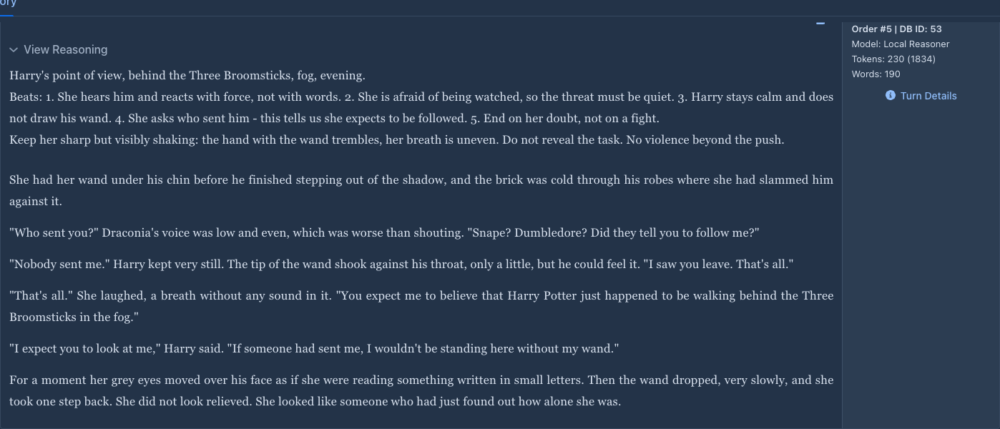

Reasoning counts toward the response: give reasoning models a larger **Max Response Tokens**, or the text may be cut
off after a long reasoning.

## Token counting

Marginalia counts tokens to decide how much of the story fits into the prompt. It asks the provider when it can,
and tries these methods in order:

1. the OpenAI token counting endpoint (`/v1/responses/input_tokens`),
2. the `/tokenize` endpoint of llama.cpp,
3. the `/tokenize` endpoint of LiteLLM,
4. the `/v1/messages/count_tokens` endpoint of LiteLLM (for Anthropic models),
5. a local estimate with the OpenAI tokenizer.

The first method that works is used from then on. The local estimate is close for most models but not exact, which
is another reason to keep **Max Context Size** a little below the real limit. Providers of the type *Extension* count
as their extension says; the [Google Gemini](extensions/google-genai.md) and [Anthropic Claude](extensions/anthropic.md) ones ask the provider to count.

## Prompt cache

Every request Marginalia makes for a kind of work (a new part, an annotation, a redraft, a summary...) carries the header
`X-Session-ID`, a hash that is the same for the same user and kind. A server or proxy that keeps a prompt cache can use it
to find the cache of the previous request of that kind. A server that doesn't know it ignores it. See
[Prompt cache and session id](prompt-cache.md), with an example for one slot of llama.cpp kept on disk.

## Shared providers

On an installation with several users, an administrator can **share** a provider: check **Shared with all users** in
the provider's dialog (the checkbox is only there for administrators). Every user then finds it in the **Model** list
of their books and in their **Inference Providers** tab, marked *Shared* **Yes**. They can use it, but they can't open
it, see its address or API key, change it or delete it; only its owner can. Books, backups and restores that refer to
a shared provider keep working for everybody who can see it.

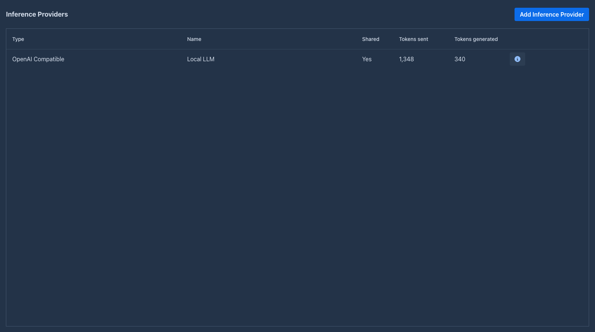

Sharing a provider lets the other users spend the owner's quota with the service. To stop users from adding providers
of their own, so that they can only use the shared ones, see
[Users and providers](administration/users.md#users-and-providers).

## Limits of shared providers

An administrator can limit what each user may do with a shared provider. In the **Inference Providers** tab, the
administrator who owns a shared provider has a **Limits** button (a user with a lock) in its row, which opens a table with
the limits that were set. **Add limit** creates a new one: pick the user and a limit type.

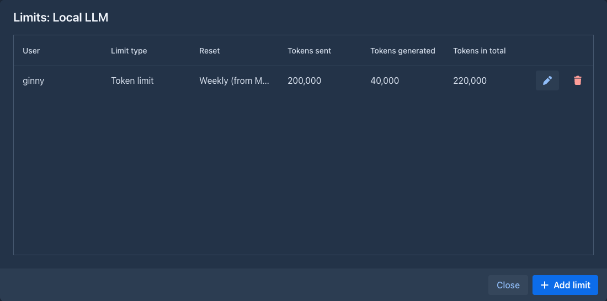

| Limit type | Meaning |
|---|---|
| Unlimited | No limit (the same as having none). |
| Token limit | The user can use up to the given number of tokens per period. |
| Not available | The user can not use the provider; anything that would send a request to it fails. |

A **token limit** has a **reset** (daily, weekly from Monday, or monthly; calendar periods in the time zone of the
server) and three limits that can each be left empty for no limit: the tokens **sent**, the tokens **generated**, and
both together (**in total**). Whichever is reached first stops the user until the next reset. If all three are set, the
sent plus the generated limit must not be below the total (the total could then never be reached), otherwise the dialog
refuses to save. For example a total of 100,000 with 100,000 sent and 20,000 generated is fine, a total of 100,000 with
20,000 sent and 10,000 generated is not.

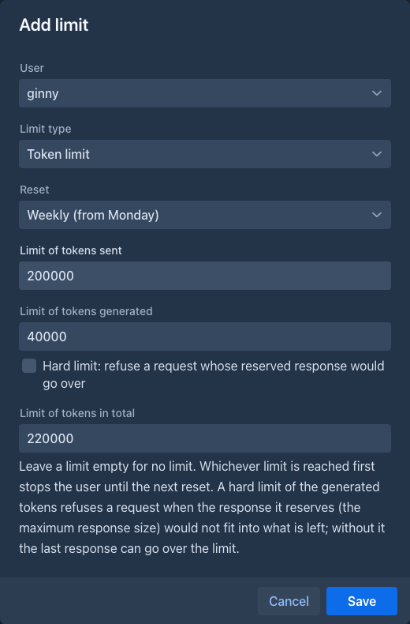

Nothing is reset on a timer: the tokens used start from zero when the user uses the provider (or looks at their limits)
for the first time in a new period. The size of a request is known before it is sent, so a request whose prompt would
take the user over the **sent** or **in total** limit is refused (the prompt is measured with Marginalia's own estimate,
which can differ a little from the service's count). The tokens **generated** are not known in advance: they are counted
when the request ends, so the user is stopped only once the limit is reached and the last response can go over it. Users
without a limit in the table are not limited.

To keep the generated tokens from going over, check **Hard limit** (only available with a limit of the generated tokens).
A request reserves room for the largest response it allows (the **Max Response Size** of the provider, or the lower one of
the protocol), and with a hard limit it is refused when that reserve does not fit into what is left of the generated
limit. So a hard limit lower than the response size of the provider refuses every request; the table and the user's
info show *hard* next to such a limit. The hard limit only covers the generated tokens, the **in total** limit can still be
gone over by the last response.

Every user sees the shared providers in their tab as read-only rows. The **info** button (the circle with an *i*) of a
shared provider shows their own limit: what they used in this period, the limits and when they reset. When a limit is
reached, the story editor, summaries and extensions show an error instead of sending the request.

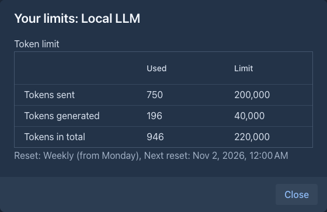

## Usage

The **Inference Providers** tab shows, per provider, the **Tokens sent** (the prompt, "prefill") and **Tokens generated** (the
response, reasoning included) you have used with it, added up over all your books, summaries and extensions. A shared
provider has a count of its own for each user, so you see only your part.

Administrators also get a **Usage per user** button on the tab, which opens a table with what every user has used of every
provider (tokens sent, tokens generated, requests and the time of the last one).

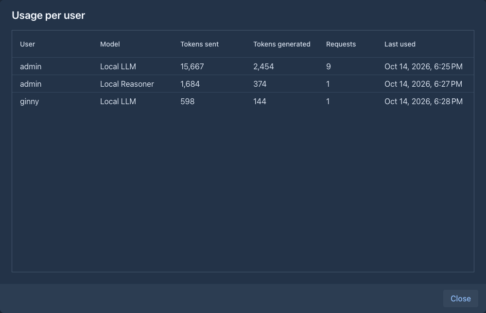

The numbers are what the service reports. A service that doesn't report them (or a request you stop in the middle)
is counted with the local estimate described in [Token counting](#token-counting), so those numbers are approximate.
A request that fails before any text arrived isn't counted. Unless an administrator has set a
[limit](#limits-of-shared-providers) for you on a shared provider, the counts are only informational.

!!!
Marginalia asks the service to report the token counts (`stream_options` with `include_usage`). To change that for a
provider, put your own `stream_options` into its **Additional Parameters**, for example
`{"stream_options": {"include_usage": false}}`: it replaces what Marginalia sends, and the local estimate is used.
!!!

## Using a provider in a book

Each book has its model in the **Model** field of its **About** tab. To use a provider for all new books, select it
as **Default Model** in the **Settings** tab. Changing the provider of a book takes effect with the next generated
part; parts written before stay as they are.

## Troubleshooting

| Problem | What to check |
|---|---|
| *Failed to download model list* | URL ends with `/v1`, API key, the server is running and reachable from Marginalia. Type the model ID if the service has no model list. |
| *The provider did not answer in time.* | Raise **Timeout (seconds)** of the provider; reasoning models may need minutes. |
| *The provider is limiting requests.* | Wait, or raise **Retries**. |
| *Book is missing model.* | The book has no provider. Select one in **About → Model**. |
| *Contextual limit not sufficient.* | The prompt without any story doesn't fit into the context minus the response tokens. Raise **Max Context Size** (or the protocol's **Max Context Tokens**), lower **Max Response Tokens**, or shorten the templates and lorebook entries. |
| Text stops in the middle | **Max Response Tokens** (or the protocol's **Max Reply Tokens**) is too low, especially for reasoning models. |
| Errors from the API with reasoning on | The API doesn't support `reasoning_effort`. Turn off **Enable Reasoning**. |
