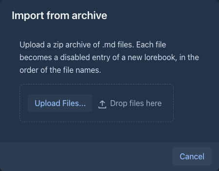
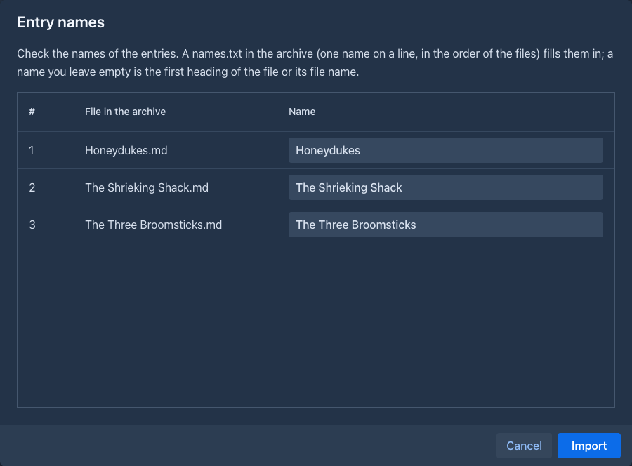

# Import & export

## Exporting

Select the lorebook in the editor and click the **export** button (file icon, *Export Lorebook*). The browser downloads
`<lorebook name>.json` with:

- the lorebook and **all its sub lorebooks** (every level), with their names, enabled state and tags;
- every entry with its content, note, order, filter, insertion mode, tags and negative tags.

Use it to keep a copy, to share a world with other users, or to move it to another installation. The data that
[extensions](../extensions/index.md) keep in a lorebook or an entry is in the file too, and is restored by the import.
Entry revisions of the [Lorebook VCS](../extensions/lorebook-vcs.md) extension belong to the old entries and do not show
on the entries the import creates; the extension has its own export for them.

### Exporting for SillyTavern

The **export** button opens a menu with two items: **Export Lorebook** (the file above) and **Export to SillyTavern**,
which downloads the lorebook as a SillyTavern world info file that SillyTavern can import. It is the reverse of the
[import](#importing-sillytavern-world-info):

| Marginalia | SillyTavern |
|---|---|
| *Entry Name* | Title / memo (`comment`) |
| *Content*, *Order*, *Enabled* | Content, order, disabled |
| No filter | Constant entry (🔵) |
| *Text* filter | One primary key |
| *Keywords (any)* | One primary key for each keyword |
| *Keywords (all)* | The first keyword is the primary key, the others are secondary keys with the logic *AND ALL* |
| *Regex* | One key written as `/pattern/flags` |
| *In Lore Block* | Position *before character definitions* |
| *Before User Prompt* | Position *at depth* 1 |
| Tags | Character filter (by name); negative tags only when the entry has no tags (*exclude*) |

The **sub lorebooks are merged**: the file has the entries of the lorebook first, then those of its sub lorebooks, as
SillyTavern has no lorebooks inside lorebooks. What SillyTavern has no counterpart for is left out: the *Note* of an
entry, negative tags together with tags, the data of extensions. SillyTavern matches the keys in the recent chat, see
[what works differently](#what-works-differently) for the other direction.

!!! warning
A regular expression is written in the Java syntax. SillyTavern uses JavaScript, so simple expressions work, but
something Java-only (possessive quantifiers, `\p{...}` classes) does not match there.
!!!

## Importing a Marginalia lorebook

1. Click the **import** button (file icon) and choose **Import Marginalia Lorebook**.
2. Upload a file exported from Marginalia.

The import always creates **new** lorebooks - the lorebook and its sub lorebooks, with the same structure - even when
you already have lorebooks with the same names. The imported lorebook is selected in the editor. Tags are matched by
name with your existing tags, or created.

Files from older Marginalia versions (a single lorebook without sub lorebooks) can be imported too.

!!!
Lorebooks also travel inside [book backups](../books/backups.md). Restoring or cloning a backup can link to lorebooks
you already have instead of creating copies; see [Restoring a backup](../books/backups.md#restoring-a-backup).
!!!

## Importing an archive of text files

1. Click the **import** button and choose **Import from archive**.
2. Upload a `.zip` file with `.md` (Markdown) files.
3. Check the **entry names** in the table and change them if you want, then click **Import**.





Marginalia creates a new lorebook named after the file (without `.zip`) with **one entry for each `.md` file**. The
files are taken in the order of their names, numbers inside the names compared as numbers (`2.md` comes before
`10.md`), also in folders of the archive; the entries get the *Order* 1, 2, 3... in that sequence. The whole file is the
*Content*. Other files, folders, hidden files (`.name`) and the `__MACOSX` folder of archives made on a Mac are skipped.

**Entry names** are filled in from, in this order:

1. a file `names.txt` in the root of the archive: one name on a line, the first line for the first `.md` file in the
   order above, and so on (an empty line leaves that file to the next rule; extra lines are ignored). Use it to name
   many files at once, for example from a script;
2. the first heading of the file (`# Chapter 1` gives *Chapter 1*);
3. the file name without `.md`.

The table in the dialog shows the result, and you can type over any name.

The import then shows its progress. **Stop** ends it after the entry that is being stored: the lorebook keeps the entries that
were already imported (the import is not undone), and a message tells how many of the files were imported.

The entries are imported **disabled**: they have no filter, so enabled they would be sent with every request, which
for a whole book of chapters is hardly wanted. Turn on the ones you need, with a filter or [tags](entries.md#tags) -
**Mass edit** is the quick way to do it for many entries.

To put the same files into a story as parts instead, see [Importing text files](../books/story-editor.md#importing-text-files).

## Importing SillyTavern world info

1. Click the **import** button and choose **Import from SillyTavern**.
2. Upload the world info file (`.json`) exported from SillyTavern.

Marginalia creates a new lorebook named after the world info (or after the file) and converts each entry:

| SillyTavern | Marginalia |
|---|---|
| Title / memo (`comment`) | *Entry Name* (the first key when there is no title) |
| Content | *Content* - macros like `` and `` keep working, see [macros](../templates/macros.md) |
| Order | *Order* |
| Disabled | *Enabled* unchecked |
| Constant (🔵), or no keys | always active (no filter) |
| Primary keys, optional secondary keys with their logic | a filter, see below |
| Case-sensitive, match whole words | built into the filter |
| Position *before / after character definitions*, *example messages* | *In Lore Block* |
| Position *author's note* (top / bottom), *at depth* | *Before User Prompt* |
| Character filter | tags (or negative tags for *exclude*), by character name and tag |

**Keys become filters.** A single plain key becomes a *Text* filter (`dragon`). Anything else - several keys,
secondary keys (*AND ANY*, *AND ALL*, *NOT ANY*, *NOT ALL*), keys written as `/regex/`, case-sensitive or whole-word
matching - becomes one *Regex* filter that does the same. For example, the keys `dragon`, `wyrm` with the secondary key
`fire` (*AND ANY*) become:

```
(?s)^(?=.*(?:\Qdragon\E|\Qwyrm\E))(?=.*(?:\Qfire\E))
```

You don't need to read these expressions; edit them only if you know regular expressions.

### What works differently

SillyTavern settings without a Marginalia counterpart are listed in the entry's **Note**, for example
*Imported from SillyTavern, not supported: probability 50%, inclusion group "weather".* These are:

- probability, inclusion groups, sticky, cooldown and delay - the entry is simply active whenever it matches;
- insertion *at depth* - the entry goes before the user prompt instead.

The biggest difference is **what the keys are matched against**. SillyTavern scans the recent chat. Marginalia matches
the [request for the part being written](entries.md#filters) - its scene, characters and instructions - and an imported
entry starts with exactly that (its **Activation Context** is *Instructions*), so an entry that SillyTavern activated because
a name came up in the last messages is activated in Marginalia only when you mention the name in the turn. To get what
SillyTavern does, set the **Activation Context** of the entry to *Instructions and parts of the story* and **Parts** to
the number of the newest parts to look into, see [Looking into the story](entries.md#looking-into-the-story). Recursive activation (entries activating other entries)
is not set by the import either: switch it on with the **scan depth** of the lorebook, see
[Entries brought in by other entries](entries.md#entries-brought-in-by-other-entries).

After importing, look through the entries and decide which should be always active, which keep their filters, and
which are better handled with [tags](entries.md#tags).
