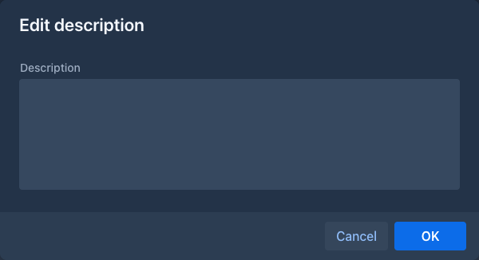
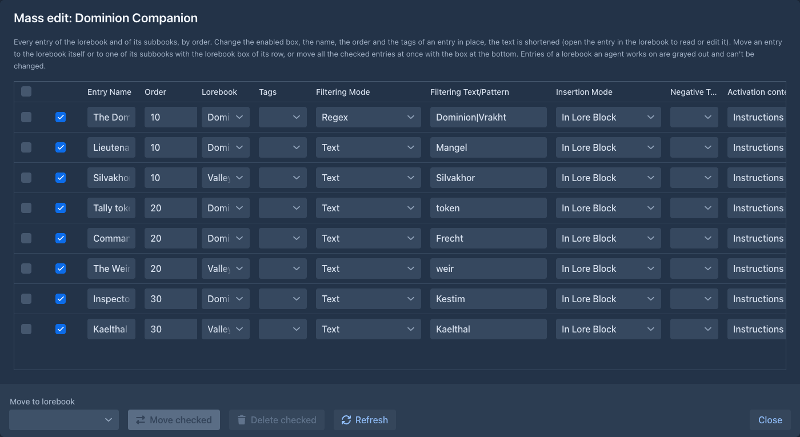
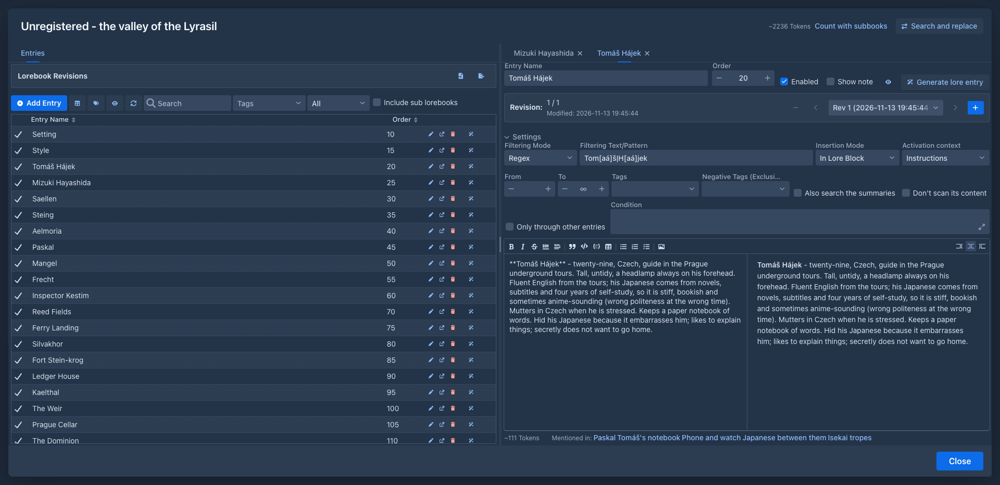
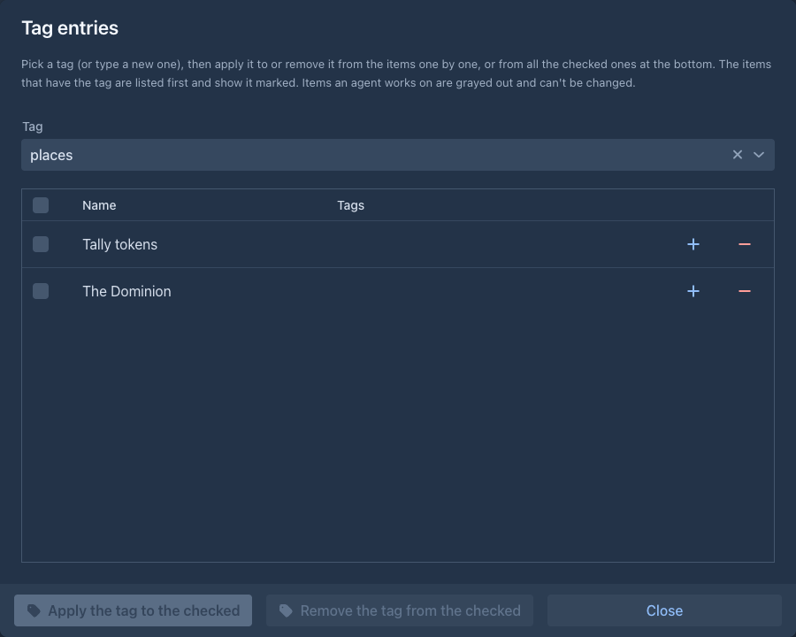
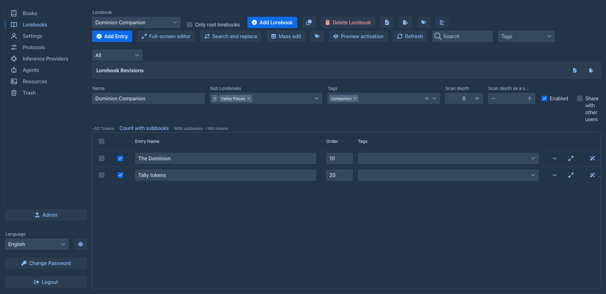

# Creating lorebooks

## The lorebook editor

Open the **Lorebooks** tab. The editor shows one lorebook at a time; pick it in the **Lorebook** field at the top.
Lorebooks belong to your account: other users don't see them, unless you [share](#sharing-a-lorebook) one.

The toolbar has two rows, which wrap onto more lines in a narrow window: the first for the lorebooks (**Lorebook** to **Tag lorebooks**), the second for the entries of the selected lorebook (**Add Entry** to **Refresh**).

| Button | |
|---|---|
| **Lorebook** | Selects the lorebook to edit. |
| **Only root lorebooks** | Lists only the lorebooks that are not a sub lorebook of another one (the selected lorebook stays in the list). |
| **Add Lorebook** | Creates a new lorebook named *New Lorebook* and selects it. |
| Clone (two sheets icon) | Makes a copy of the selected lorebook: asks for the name (the original's with *(Copy)*) and selects the copy. The copy has the same entries (with their settings, tags and negative tags), tags, description and data of extensions. Its sub lorebooks are not copied, the copy uses the same ones. The original is not changed. |
| **Delete Lorebook** | Deletes the selected lorebook (after confirming). |
| Import (file icon) | **Import Marginalia Lorebook**, **Import from SillyTavern**, **Import from archive** (a zip of `.md` files) or **Import from other user** (a lorebook another user [shares](#sharing-a-lorebook)), see [Import & export](import-export.md). |
| Export (file icon) | Downloads the lorebook with its sub lorebooks, see [Import & export](import-export.md#exporting). |
| Tags (tags icon) | **Tag lorebooks**: puts a tag on many lorebooks at once, see [below](#tagging-many-at-once). Not shown for a lorebook that is open in a book. |
| Description (lines icon, last of the first row) | **Edit description**: opens a window to write what the lorebook is about, see [below](#description). |
| **Add Entry** | Adds an entry to the lorebook, see [Entries & activation](entries.md). |
| **Full-screen editor** | Opens the entries of the lorebook in a full-screen window with tabs, see [Editing in full screen](#editing-in-full-screen). Desktop only. |
| **Search and replace** | Changes a text in the name, text and comment of the entries of the lorebook, see [Search and replace](entries.md#search-and-replace). |
| **Mass edit** | Opens all the entries of the lorebook and of its sub lorebooks in one table, see [Mass edit](#mass-edit). |
| Tags (tags icon, right of **Search and replace**, second row) | **Tag entries**: puts a tag on many entries of the selected lorebook at once, see [below](#tagging-many-at-once). |
| **Preview activation** | Shows which entries a turn with a text you type would use and why, see [Preview activation](entries.md#preview-activation). |
| **Refresh** | Reloads the entries. |
| Search box | Shows only the entries that have the text in them, see [Searching and deleting many entries](entries.md#searching-and-deleting-many-entries). |
| **Delete selected** | Appears when entries are selected in the list; deletes them after confirming. |

Below the toolbar are the settings of the selected lorebook:

| Field | |
|---|---|
| **Name** | The name of the lorebook, shown when you pick it for a book or as a sub lorebook. |
| **Sub Lorebooks** | Other lorebooks whose entries are included with this one, see [below](#sub-lorebooks). Click the name of a selected sub lorebook to open it. |
| **Tags** | Tags of the whole lorebook; they count as tags of each of its entries, see [Tags](entries.md#tags). |
| **Scan depth** | `0` to `5`: how many times the content of the entries that were used is searched for the filters of the other entries, see [Entries brought in by other entries](entries.md#entries-brought-in-by-other-entries). It counts for the entries of the lorebook a book uses and for those of its sub lorebooks, unless a sub lorebook has its own depth (next row). |
| **Scan depth as a sub lorebook** | Empty, or `0` to `5`: the scan depth for the entries of this lorebook while it is a sub lorebook of the one a book uses. Empty means the scan depth of that lorebook, `0` that the entries of this lorebook are never found by the content of others. |
| **Enabled** | When unchecked, the lorebook contributes nothing - neither its entries nor those of its sub lorebooks. |
| **Share with other users** | When checked, other users can look at the lorebook and import a copy, see [below](#sharing-a-lorebook). Off for a new lorebook. |

Under the settings is the [description](#description) of the lorebook, when it has one.

The rest of the editor is the list of [entries](entries.md). All changes are saved as you make them.

### Description

The description is a few words (or lines) about the lorebook: what world it is, what it is for, which book uses it. Click the lines icon in the first row of the toolbar, write it in the window and confirm; an empty text removes it. A lorebook that has a description shows it in one line under its settings, cut with an ellipsis where it does not fit; rest the mouse pointer on the line to read all of it. The description is copied with the lorebook (clone, export, import, backups) and is the text other users see next to its name when you share it.



### Sharing a lorebook

Check **Share with other users** and every other user of this installation sees the lorebook in **Import from other user** (the import button in the first row of the toolbar), with its name, its author (your full name, or your login when you have none) and its description. They can open a row to read the entries (and the entries of the sub lorebooks) and import a copy. Uncheck it and the lorebook is gone from their list; copies they already made stay theirs.

* Sharing is reading only. Nobody else can change, delete or use your lorebook in a book; your lorebook stays yours and you see it as before.
* An import makes **new lorebooks of the other user**: the lorebook and its **shared** sub lorebooks, however deep, with their entries, tags and description, linked the way yours are. The copies are private (not shared), whatever you do with your lorebook afterwards does not reach them, and what they change does not reach yours.
* **Only sub lorebooks that are shared themselves are shown and copied.** A sub lorebook that is not shared is left out together with everything below it, also a shared lorebook below it. When you check **Share with other users** on a lorebook that has sub lorebooks that are not shared, a question asks whether to share them too: **Yes** shares the lorebook and all of them (however deep), **No** shares only the lorebook, **Cancel** shares nothing and leaves the box unchecked. A sub lorebook you add later is not shared until you share it.
* Unchecking the box stops sharing that lorebook only; its sub lorebooks stay shared (and appear in the list of the others on their own) until you uncheck them too.
* Deleted lorebooks, the working copies of agents and your own lorebooks are not listed, and nothing is listed for a user who has been deleted.

Under the settings, the estimate of the tokens of the enabled entries of the lorebook is shown. The link **Count with subbooks** next to it adds up
the tokens of the enabled entries of the lorebook and of all its sub lorebooks, however deep, and shows the total next to it. As when a
story is written, a disabled sub lorebook is left out together with the lorebooks under it, and a lorebook that is a sub lorebook in more than one place counts once.
The total is a count of the moment you click: change an entry and it disappears, click again to count again.

A lorebook of a book an agent works on is shown read only (see [Agents](../agents.md)), without **Add Entry**, **Search and replace**, **Mass edit**, **Delete Lorebook** and the settings; **Add Lorebook**, import, export and **Refresh** stay, so you can always start another lorebook.

## Mass edit

**Mass edit** opens a window with every entry of the selected lorebook **and of its sub lorebooks** (however deep) in one table,
ordered by the **Order** of the entries (entries with the same order by lorebook, then by name). It is for tidying a big lorebook:

- Change the *enabled* box, the **Entry Name**, the **Order**, the **Tags**, the **Filtering Mode**, the **Filtering**, the **Insertion Mode**, the
  **Negative Tags**, the **Activation Context** with its **Parts**, the range of parts (**From message** and **To message**, empty: no limit) and
  the **Note** of an entry in place, as in the editor. Every entry is one line; the table scrolls down (and to the side when the
  window is narrow). The row moves to its new place when you change the order. The text of an entry is shortened in the table; open the entry in
  the lorebook to read or edit all of it.
- The **Lorebook** box of a row says in which lorebook the entry is. Pick another one (the lorebook itself or any of its sub lorebooks) to move the entry there.
- To move many entries, tick them (the box in the header ticks all), pick **Move to lorebook** at the bottom and press **Move checked**.
- To delete many entries, tick them and press **Delete checked**; it asks once and moves them to the [trash](../trash.md).
- A lorebook that an agent works on is locked: its entries are grayed out and can not be changed or moved, and nothing can be moved into
  it. This is checked for each lorebook, so a lorebook can be free while one of its sub lorebooks is locked (it is used by another book).
  **Refresh** reads the window again to see whether a lock is gone.

The lorebook in the editor is refreshed when the window is closed after a change.



## Editing in full screen

**Full-screen editor** (second row of the toolbar) opens the selected lorebook in a window that fills the screen, for working
on long entries (the expand button in the row of an entry opens the window on that entry); the *Lorebook* tab of a book's window has the same button, for the lorebook shown there. The window is titled with the name of the lorebook. It is a set of tabs like the [story editor](../books/story-editor.md)'s: drag a tab to put it beside or
under another one, and drag the splitters between them.



- The **Entries** tab lists the entries, with the search box and the tag and status filters of the lorebook page,
  **Add Entry**, **Mass edit**, **Tag entries**, **Preview activation** and **Refresh** (mass edit and tags show their
  changes in the open tabs too). With **Include sub lorebooks** it lists the entries of the
  [sub lorebooks](#sub-lorebooks) too, each with the name of its lorebook; **Add Entry** then adds the entry to the lorebook
  picked next to it, and the tab of such an entry names its lorebook. It can't be closed. Each row has three buttons:
  - **Open** (pen icon, also a double-click on the row) shows the entry in the entry tab you used last, or, when there is none,
    opens one in a column right of the list;
  - **Open in new tab** (arrow icon) adds a tab for the entry, next to the entry tab you used last;
  - **Delete** (bin icon) deletes the entry after confirming, and closes its tab.

  An entry is open in one tab at most: opening it again shows the tab it already has.
- An **entry tab** has, from the top: the **Name**, the **Order** and **Enabled**; **Settings**, a panel you can fold,
  with the rest of the settings of the entry (filtering mode and filter, insertion mode, activation context and parts,
  tags and negative tags, the range of parts, the recursion check boxes and the condition, see
  [Entries & activation](entries.md)); then the **content** in a Markdown editor (each tab keeps whether it shows the text, the
  text and the preview, or the preview, also when the window is opened again), and the **note** beside it when
  **Show note** is checked. The eye opens the [activation preview](entries.md#preview-activation) for this entry. The bottom line shows the estimated tokens of the content and, in red, what is wrong with its
  template (it is saved anyway). Close a tab with its **×**.
- **Images in entries.** Paste an image into the content, drop one on it or pick one with the image button of the toolbar
  (PNG, JPEG, GIF or WebP, up to 10 MB). It is stored with your files (the *Resources* tab) and the content gets a
  line like `` where the cursor was; the preview shows the image, and the text in brackets is its caption.
  Delete the line to take the image out of the entry. The model reads the entry without these lines. The images
  themselves are sent only when the model's settings say *Send lore images* (see [Inference providers](../inference-providers.md)).
  Images travel with the lorebook: a clone, a copy of a shared lorebook, an exported lorebook file and a book backup
  with its files carry them, and the copy gets images of its own. The SillyTavern export and the book exports leave them
  out. The story's *Lorebook* tab shows them under the text of the entry. Images do not count in the token estimates yet.
- **Jumping between entries.** Ctrl+click (Cmd+click on a Mac) the name or a keyword of another entry in the content, in
  the text or in the preview, to open that entry in the tab you used last; with Shift too it opens in a new tab. The
  bottom line also lists, after **Mentioned in:**, the entries whose content names this one; click one to open it,
  Shift+click for a new tab. An entry is named by its name and by the words of its filter (each keyword, the whole text of
  a *Text* filter, what a regular expression matches), as whole words, upper or lower case alike. This is close to what
  [recursion](entries.md) follows but not the same: recursion also finds a keyword inside a longer word, needs all the
  keywords of an *AND* filter and checks the tags and the condition.
- The Markdown editor has a toolbar (bold, italic, strikethrough, a line, headings, quote, code, code block, table and the
  three kinds of lists) and, on the right, the views *edit*, *edit with preview* (the default) and *preview*. The usual
  keys work (Ctrl+B, Ctrl+I...); Tab moves to the next field instead of indenting. What you type is saved when you stop
  typing for a moment and when you leave the editor.
- The header shows the estimated tokens of the enabled entries, **Count with subbooks** and **Search and
  replace**, which shows the replaced text in the open tabs too.

All changes are saved as you make them, so **Close** loses nothing. The window remembers how you left it, for each lorebook:
the next time it opens with the same entries in the same tabs, arranged the same way (entries deleted since are left out). The lorebook page shows the entries again when the
window is closed.

**Changes made elsewhere.** A change in a tab is saved into the entry as it is stored at that moment, so what was changed
somewhere else (the lorebook page, mass edit, another window) in the *other* fields of the entry stays, and the tab shows it.
If the **content** or the **note** was changed elsewhere since the tab showed it, your text is not saved over it: the bottom
line says so, with **Keep my text** (save yours anyway) and **Load the saved text** (drop yours). An entry deleted elsewhere
closes its tab.
The window also follows what is saved while it is open: when an agent or another window (another browser tab, the
story's lorebook tab) saves or deletes an entry, the list is loaded again and the tab of that entry shows it as it is
now (a deleted entry's tab closes). A tab whose text is waiting for **Keep my text** or **Load the saved text** is left
as it is until you answer. A change saved in the same second you type may still cross: the bottom line then asks as above.

**Agents.** The window is not offered while an agent works on a book that uses the lorebook. If a run starts while the
window is open, the window turns read only at your next change or when you switch tabs: a bar names the agent (and says
when your last change could not be saved). Pause or stop the run, then click **Check again**: the entries are loaded as the
run left them and you can edit again.

The [Lore Generator](../extensions/lore-generator.md) and [Lorebook VCS](../extensions/lorebook-vcs.md) extensions work here
too: the wand is in the rows of the list and in the name row of an entry tab, the revisions panel is above the list and
the revision bar of an entry is in its tab.

## Tagging many at once

The two tags buttons of the toolbar open one window that puts a tag on many items, or takes it off them: **Tag lorebooks** lists
your lorebooks, **Tag entries** the entries of the selected lorebook. Pick the **Tag** (or type a new one and press Enter);
the list shows every item with its tags, and the items that have the picked tag come first with the tag highlighted. A row's
**+** and **-** buttons apply or remove the tag for that item; tick several items (the box in the header ticks all) and
use **Apply the tag to the checked** or **Remove the tag from the checked** at the bottom to do it for all of them. An item
an agent works on (a lorebook of a book with a running agent, and so all its entries) is grayed out and can not be changed
until the run is paused or stopped. The window also tags [books](../books/managing-books.md#tagging-many-books-at-once).
The tags it puts on entries are the ordinary ones, see [Tags](entries.md#tags); negative tags are set on the entry itself.



## Using a lorebook in a book

Open the book and its **Lorebook** tab, and pick the lorebook in the **Lorebook** field. The editor below shows the
lorebook, so you can add and change entries while you write. Clear the field to write without a lorebook.

A book uses one lorebook. To use several, create a lorebook that includes them as sub lorebooks, and use that one.

The same lorebook can be used by any number of books. Changes to it affect all of them from the next generated part
on; parts that were already written keep the lore they were written with.

## Sub lorebooks

**Sub Lorebooks** includes the entries of other lorebooks in this one. A typical setup:

```
"Saga" (used by the books of the series)
 ├─ "World"       places, history, rules of magic
 ├─ "Characters"  the main cast
 └─ "Book 2 notes"
```

- Sub lorebooks can have sub lorebooks of their own; all levels are included.
- A lorebook can be a sub lorebook of several lorebooks. When it is reached more than once, its entries are still used
  only once.
- A lorebook can't include itself, directly or through other lorebooks: such a choice is refused with
  *Cannot select sub lorebook: cycle detected.*
- A disabled sub lorebook is left out together with everything it includes.



The entries of all included lorebooks are put together and sorted by their [order](entries.md#order-and-insertion),
regardless of which lorebook they come from.

## Disabling and deleting

Uncheck **Enabled** to switch a lorebook off for a while, for example to see how a book reads without it. Books keep
using it, and it works again when you check it.

**Delete Lorebook** removes the lorebook from your lists. Books that used it no longer get its entries, and lorebooks
that included it as a sub lorebook skip it. The data stays in the database until an administrator runs
[Cleanup](../administration/cleanup.md), and until then you can restore the lorebook from the [Trash](../trash.md); copies in [book backups](../books/backups.md) and exported files are not
affected.
