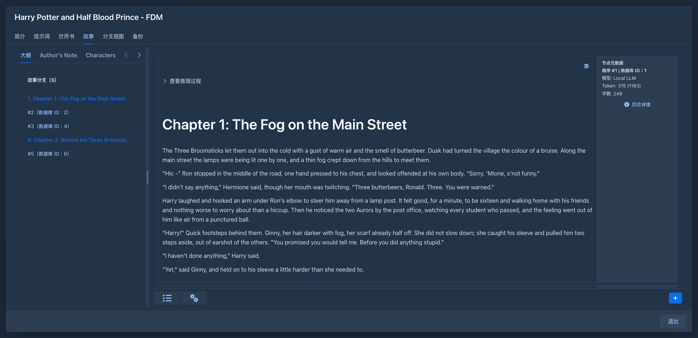

# Chinese localization

Adds Simplified Chinese (中文（简体）) to the languages of the Marginalia user interface.

## Usage

Load the JAR in *Admin → Extensions*. *中文（简体）* then appears in the *Language* selector at the bottom of the
sidebar (the menu on a phone); each user picks their own language, and the page reloads with it.

Unloading the plugin removes the language; users who had it see the default language (English) until they pick
another one.

## How it works

The plugin has no user interface code. Its extension implements `ExtensionHasLocalization` and returns a
`LocalizationBundle` - `LocalizationBundleZH`, the Chinese text of every key of `L`. Marginalia registers the bundle
when the extension is loaded and removes it when it is unloaded. It is the example for localization in the developer
manual (*Plugin development → Example plugin*), copy it to add another language.
