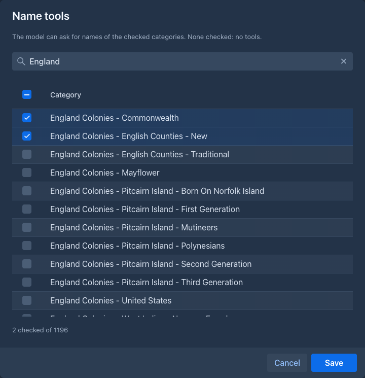

# Lore Generator

Generates the content of a lore entry from the existing lore. Works in the lorebook editor of the desktop UI (not on the phone).

Every row of the lorebook has a wand button that opens the Lore Generator dialog for that entry (a warning is shown when the entry already has content).

- **Lore**: *Current Lorebook* (only the lorebook itself, its subbooks are ignored) or *All Lore* (the lorebook together with its subbooks).
- **Entries**: *Only up to position (n)* (n is the order of the entry; entries with a higher order are left out, ties are broken by creation) or *All entries*. The entry being generated is never included.
  Enabled flags, tags, filtering and insertion modes are ignored, only the content of the entries is used.
- **Generation prompt**: prompts are stored in the user settings; Save, Save as and Delete manage them. Deleting the last one recreates `DEFAULT`. The prompt used last is selected again when the dialog opens.
- **Generation**: the system prompt is `[ Existing Lore ]` with the selected entries followed by the prompt from the text area.
- **Name tools**: shown only when the [Name generator](../name-generator/README.md) (made up names) or the [Name provider](../name-provider/README.md) (real names) extension is loaded. It shows the categories of both in one lazy table, with the prefix of the source (`Generator: `, `Provider: `), a filter field (the checked ones always stay in it) and checkboxes (the header one checks the shown rows); the checked ones are saved in the user settings and the generation (not the compaction) lets the model list them and ask for names of them. The tools of a source are given only when a category of it is checked, so a generation has the tools of both, of one or of none. The extensions are found among the loaded ones and used by reflection (`NameToolsBridge`), this bundle does not import their packages, so they can be unloaded and installed again without restarting this one. A category saved without a prefix (before the Name provider) is one of the Name generator. For every source whose tools are given, a hint about them is appended to the generation prompt: the built-in one, or the *Name generator hint* / *Name provider hint* of Settings → Extensions → Lore Generator when it is not blank. The provider hint tells the model to pick a name from the returned ones and to keep it as it is.
- **Attachments**: images, audio (wav, mp3) and other files can be uploaded under the prompt (up to 20 MB each); they are sent with the generation request, not with the compaction. Each one has a delete button, disabled while an inference runs. Whether they are used depends on the model.
- **Compaction**: the same lore followed by the compaction prompt (Settings → Extensions → Lore Generator, the built-in one when blank) in which `{{compactionData}}` is replaced by the generated text.
- **Remembered per entry**: *Copy to Lore Entry* also stores the options of the generation in the attributes of the entry: the prompt (and the name of the saved prompt it came from), the lore and entries choices and the checked name categories. The next time the generator opens for that entry it restores them, ahead of the last used prompt and the name categories of the user settings.
- **Copy to Lore Entry**: the compaction result becomes the content of the entry (a top-level code block around it is removed), the generation result goes to its note. Both are replaced.

The model and the protocol start as the default ones from the user settings; the two lists under the header of the dialog change them for this generation (nothing is saved). They are disabled while the model runs.

### Screenshots

