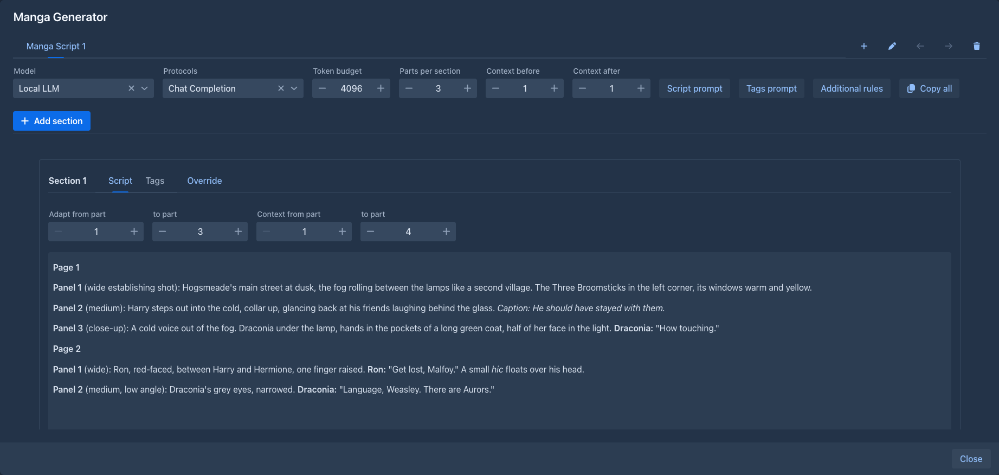
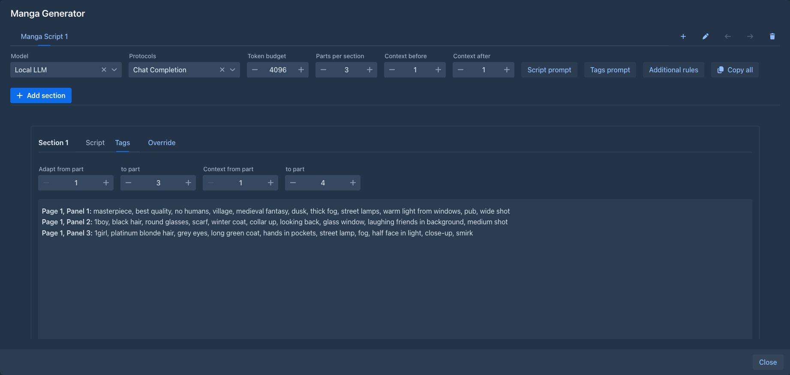

# Manga Generator

Turns the story into a manga: the model adapts parts of the book into a script of pages and panels, then writes image
generation tags (Danbooru style) for every panel. A port of the SillyTavern extension
[MangaGenerator](https://github.com/Enerccio/SillyTavern-MangaGenerator).

## Usage

Choose **Manga Generator** in the settings (⚙) menu of the story. One large window opens:

- the **mangas** of the book are tabs - add (+), rename, move left or right, delete. A book can have several, each with its
  own settings and sections.
- the settings of the open manga: the **model** and protocol the requests go to (by default the book's; the last choice is
  remembered), the **token budget** (the length of script asked for), **parts per section** (how many parts of the story a
  new section adapts) and **context before / after** (how many more parts around them the model gets as the background).
  **Script prompt**, **Tags prompt** and **Additional rules** edit the prompts of the manga; **Copy all** copies every script, then every
  tags text. What a new manga starts with (these settings, the prompts, a text put before every request) is set in
  *Settings → Extension Settings → Manga Generator Settings*.
- **Add section** adds a section for the next parts of the story, after the last section. A section has the parts it adapts, the
  parts it gets as the context (all editable, numbered from 1 like in the outline) and two views: **Script** and **Tags**.
  **Generate script** streams the script of the parts (the thinking of a reasoning model is shown, with the time it took);
  **Generate tags** writes the tags of every panel of the script. Both can be edited by hand, copied, or stopped
  (**Abort** - what came in is kept). **Override** gives a section its own prompts and rules, or adds a rules addendum to the
  rules of the manga. The eye shows the exact request the model gets, with its size.

Sections of one manga can generate side by side. While a model writes, mangas and sections cannot be changed.

### What the model gets

- the text of the parts of the section (the context range), each under its number,
- the lore the text activates: the entries of the book's lorebook and its sub lorebooks whose filters are found in that text (scan
  depth included), as in a generation. Only as many entries as fit into the context of the model next to the rest of the request
  (the context size and the reply size of the AI and the protocol) are put in; the others are left out and the eye says how many,
- the script of the previous section, for the script of the next one (so the page numbers go on and nothing is adapted twice),
- the prompt. `{{tokenBudget}}` and `{{additionalRules}}` in it are replaced; the built-in prompts are in
  `service/Defaults.java`.

### Differences from the SillyTavern extension

- the chat messages are the **parts** of the story; the names of the characters in front of the messages, the persona and the
  character card do not exist here (the lore replaces them),
- the world info trigger is gone - the lore is activated by the text of the section, with the rules of the book,
- the size of the context comes from the AI and the protocol, there is no setting for it,
- tabs are reordered with arrow buttons instead of dragging,
- a new section adapts 3 parts and gets 1 part of context on each side by default (a part of a story is much longer than a chat
  message).

## Storage

The mangas are stored with the book (its attributes), so they are included in book backups and copies. The defaults and the
last chosen model are stored in your user settings.
