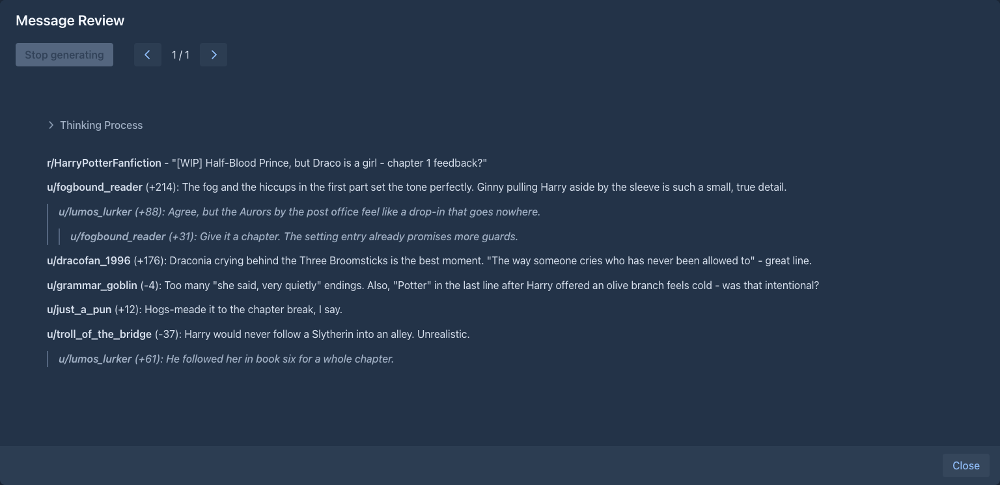

# Reviewer

Lets the model review what you've written - get reader reactions, critique or anything else you prompt it for, right
next to the story.

## Usage

Every story part gets a **Review** item in its menu:

- **View / Generate Review** opens the review dialog. *Generate* writes a new review of the part (it can be stopped
  while generating); a part can have several reviews and you can page through them.
- **Advanced Options** changes how this part is reviewed:
  - *Prompt from Profile* - fills the prompt override with the review prompt of one of your profiles (only its
    prompt - the model and protocol are not changed),
  - *Prompt Override* - a different review prompt for this part,
  - *Use standard prompt info* - review with the prompt the part was written from (system prompt, lore, earlier
    parts); when off, only the story parts and the options below are sent,
  - *Include Lorebook* - include the lore that was active for the part (with standard prompt info off),
  - *Token Limit* - how many tokens of the story (parts up to the reviewed one) are sent along.
- **Delete Review** removes the reviews of the part.

## Settings

Reviewer profiles are configured on the *Settings* page. A profile has:

- *Review Pre-Prompt (System)* - the system prompt,
- *Review Post-Prompt (User)* - what to ask for; the default simulates readers' comments on a story forum,
- the model and protocol to use - by default the book's own.

Create several profiles (a strict editor, enthusiastic readers...) and pick the default one.

A book can use a different profile: choose it in *Reviewer Profile* on the book's info tab, under the protocol. It
takes priority over the default one; clear it to use the default again. If the chosen profile is deleted, the default
one is used.

## Storage

Reviews are stored with the story part, so they are included in book backups and copies. Profiles are stored in
your user settings (included in database backups). The profile chosen for a book is stored with the book (by the id
of the profile, so renaming it keeps the choice).
