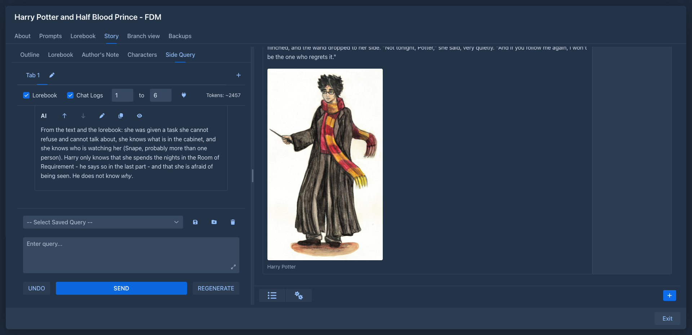
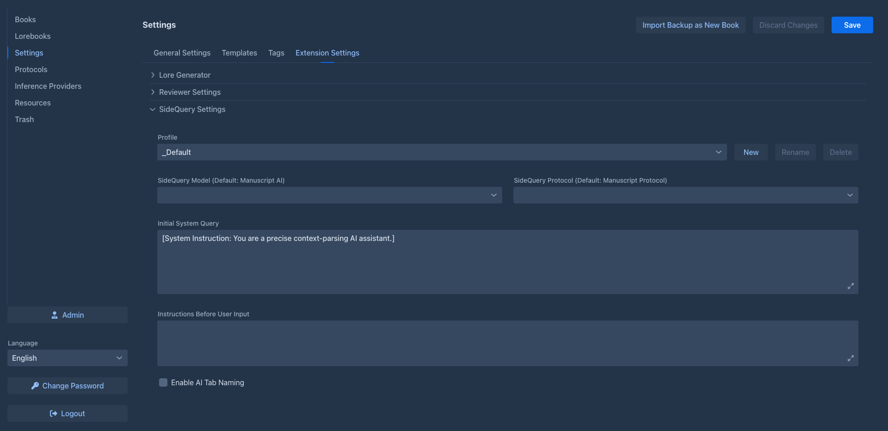

# Side Query

A chat with the model next to your story - ask about the plot, check continuity, brainstorm names or the next
chapter, without adding anything to the book.

## Usage

The story view gets a *Side Query* tab in its left sidebar (next to the outline), with chat tabs. In each tab:

- type a question and **SEND**,
- **REGENERATE** drops the last answer and asks again,
- **UNDO** removes the last message - if it was your question, it goes back into the input box to edit,
- messages can be edited and copied,
- choose what the model gets to see:
  - *Lorebook* - the book's lore: the book's lorebook and its sub lorebooks (disabled ones are skipped), enabled
    entries whose tags match the book, with macros rendered like in a generation (keyword filters are not applied),
  - *Chat Logs* - story parts of the active branch, from part N to part M (numbered from 1, as in the outline),
- the plug button lists the data other extensions offer through `IPCService` (e.g. the outline of the Arc Outline): checked sources about the book go into the system message after the lorebook, checked sources about story parts are added after the text of each story part in the *Chat Logs* range. The choice is stored with the tab,
- the token counter shows how big the request is,
- frequently used questions can be saved and picked from a list.

Open several tabs for separate conversations; tabs can be renamed.

### Screenshots

## Settings

Side query profiles are configured on the *Settings* page:

- *Initial System Query* - the system prompt,
- *Instructions Before User Input* - text put right before your (last) question in the same message,
- the model and protocol to use - by default the book's own,
- *Enable AI Tab Naming* - after the first answer, the model names the tab (a tab you renamed yourself keeps its
  name).

## Storage

Conversations are stored with the book, so they are included in book backups and copies. Profiles and saved
queries are stored in your user settings (included in database backups).
