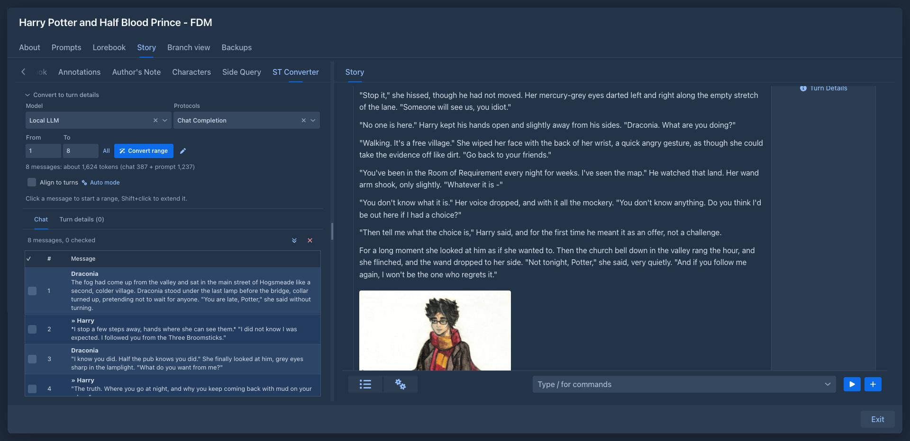

# Converter (sillytavern-converter)

Rewrite a SillyTavern roleplay chat as a story, turn by turn. Load the chat into the book, read it in a table, let the
model split it into *turn details* (scene setting, POV character, present characters, instructions) from the chat and the
lore of the book, and put each of them into the new turn form of the story with a click.

## Usage

The sidebar of the story editor (the drawer of the story in the phone layout) gets a **Converter** tab. The text is small and the tab scrolls when the
sidebar is low. At the top of the tab a **Convert to turn details** section, closed until you open it (the chat and the
turn details get the room), holds:

- the **model and protocol** the wand runs with (the model of the book by default; the choice is kept with the book),
- the **range** of the chat the wand works on, **From** and **To**, with the number of tokens the request takes (the
  messages of the range, and the template and lore, which are counted once),
- the **wand** (*Convert range*) and a pen button that edits its prompt.
- **Align to turns**: every chosen range snaps to the boundaries of the turns (the end back to the last message of the
  character, the start to the first message of its turn),
- **Auto mode**: converts the whole range in batches of a chosen number of messages, one request after another (a batch
  ends at the end of a turn when aligned); a stop or a failed batch leaves the rest of the range selected.

Under that, two tabs:

- **Chat** - upload a `.jsonl` chat exported by SillyTavern (a chat without branches; of the swipes of a message the
  shown one is read, hidden system messages are left out). It is shown as a table: a checkbox, the number and the message with
  the name of the speaker in bold above it. Tick the messages you have gone through while you rewrite them; the double arrow above the table goes
  to the next unchecked message (the turn details have one too). **Click a message** to start a range,
  **Shift+click** another to extend it up to there; the range is highlighted. The button with the cross removes the chat
  (and the turn details) from the book.
- **Turn details** - what the wand prepared, one row per turn with the messages it covers and one element with the scene
  setting, POV, present characters and instructions, each under a bold line with its name, also with a checkbox for the turns you have used. **Click a turn** to open the new turn form
  of the story and copy all four fields into it, then generate as usual.

The wand sends the chat of the range together with the lore of the book (all non-deleted entries of the lorebook and its
sub lorebooks, rendered like the story would) and asks for a list of turns that cover the range. The turns replace the
turns of the earlier runs that touch the range, except those you ticked as reviewed.

## Redrafting a book

The source can also be the parts of another book instead of a chat. While the tab has no source it offers **Upload a chat**,
**Load a backup** (the JSON of a backup, the archive with the images, or the file stored with a book) and **Pick a book**
(a book of the user, not the open one). The converter strips the book to the branch it is on (from the first part to the active
leaf; for a backup the flat `messages` are walked up by `parentUuid` from `activeLeafUuid`, a leaf that is not there or a chain with
a missing part or a loop is a damaged backup, and a book without a leaf has no parts and loads nothing) and keeps of each part
only `instructions`, `sceneSetting`, `povCharacter`, `presentCharacters` and the text (`BookSource`, versioned, in
`BookSourceReader`). That JSON is the resource; the text of the parts is the list on the left, and the turn details are the
instructions of the parts, so there is no wand and no range. Only one source is kept; removing it (with the cross) deletes the
resource and forgets the ticks.

## Storage

The uploaded file is a resource of the user (`ResourceService.upload`, content type `application/x-ndjson`, linked to the
book), because a chat with everything SillyTavern keeps in it can be megabytes and the attributes of a book are loaded
with every fetch of it. The attributes (`ConverterData`) hold the uuid of the resource, the numbers of the ticked messages,
the turn details, the model and the prompt; the messages are read from the file when the tab opens. A resource is not in the
book backups (only images are), so after a restore the chat has to be uploaded again.

For the parts of a book the resource is the stripped JSON (`<book name>.redraft.json`, content type `application/json`) and
`ConverterData.sourceKind` is `book`. The attributes then hold the ticked part numbers and the ticked turn numbers
(`reviewedTurns`) but not the turn details, which are made from the resource each time the tab opens.
