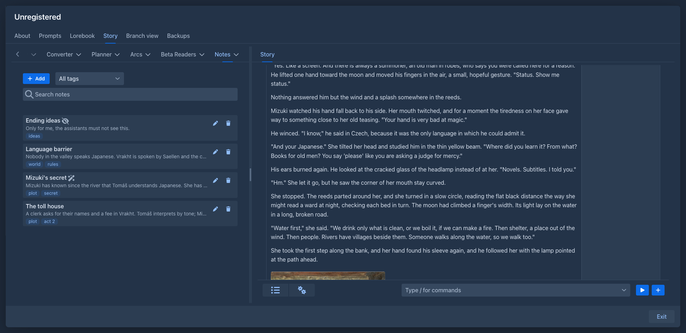

# Story Notes

A small wiki per book in the story sidebar: pages with a title, tags and Markdown text, `[[links]]` between them (`[[Title]]`, or `[[Title|shown text]]` to show other words in the preview) with the
pages that link back, a search and a filter by tag. The pages are the author's own thinking about plots, ideas and rules of
the world. They are **not** sent with a generation; assistants (agents, macros, the plot wizard of the
[Arc Outline](../arc-outline/README.md)) reach them through commands, and a page can be hidden from them.

User manual: `manual/user/extensions/story-notes.md`.

## Usage

The story view gets a *Notes* tab in its left sidebar (next to the outline): *Add*, a filter by tag, a search, and the pages
by title. A page opens in a dialog (title, tags, text with a preview, *Visible to assistants*, the pages it links to and the
pages that link to it). The preview turns `[[Title]]` into Markdown links (`NoteBook.linkify`, the address is `#note:<title>`), a click on one is caught by a DOM
listener on the preview (`StoryNotesScripts.LINK_CLICK`: the event data is the address, the move to it is stopped) and opens the page. Nothing is stored before *Save*.

## Commands

For the command bar, agents and the plot wizard. A page is addressed by its title (unique, the case does not matter).

| Command | |
|---|---|
| `list-notes [tag]`, `get-note note`, `search-notes query` | Read; `get-note` gives the text, the links (and whether they exist) and the backlinks. |
| `create-note title [content [tags]]`, `append-to-note note text` | Add (`NON_DESTRUCTIVE`). |
| `update-note note [title [content [tags]]]`, `edit-note note find replace [all]` | Change text that exists (`DESTRUCTIVE`, so an agent or the wizard asks first when it is set to). `edit-note` replaces `find` (exact, the case matters), which must occur once unless `all` is true, then every occurrence is replaced (`NoteBook.replace`); the answer has the number of pieces replaced. |
| `delete-note note` | `DESTRUCTIVE`, confirms. Not offered to the wizard. |
| `note-text note` | For macros: `{{command::note-text::Title}}`. |

**A page with *Visible to assistants* switched off does not exist for any of these commands** (not listed, found, read,
linked as existing or changed; a title only it has is refused like any unusable title). The `[[links]]` that other pages
have to it are shown to assistants as links to a page that does not exist.

## For other extensions

`IPCService` sources of the bundle `story-notes`: `notes-index` (the titles, tags and first lines of the visible pages) and
`notes` (their full text). The Arc Outline asks for them by these names; they are a contract, don't rename them. Other plugins
can call the commands by name (the plot wizard does) without importing this one, see *Plugin development → Sharing data between
extensions*.

## Storage

The pages are stored with the book (`com.github.enerccio.marginalia.extensions.storynotes` in its attributes), so they are
in book backups and copies. Every change goes through `StoryNotesService.update`: the pages are read again from the stored
book, changed and stored under a lock, so the editor and a command working on different pages do not overwrite each other. The
editor remembers when the page was last changed as it opened it and asks before it overwrites a change made since. Open tabs
read the pages again when they are stored (`onChange`).

The text of a page is at most 100,000 characters, a title 120 (no brackets, bar or line break: a link could not name it), a page has at most 20 tags of 40.

[TODO.md](TODO.md) has what is open.
