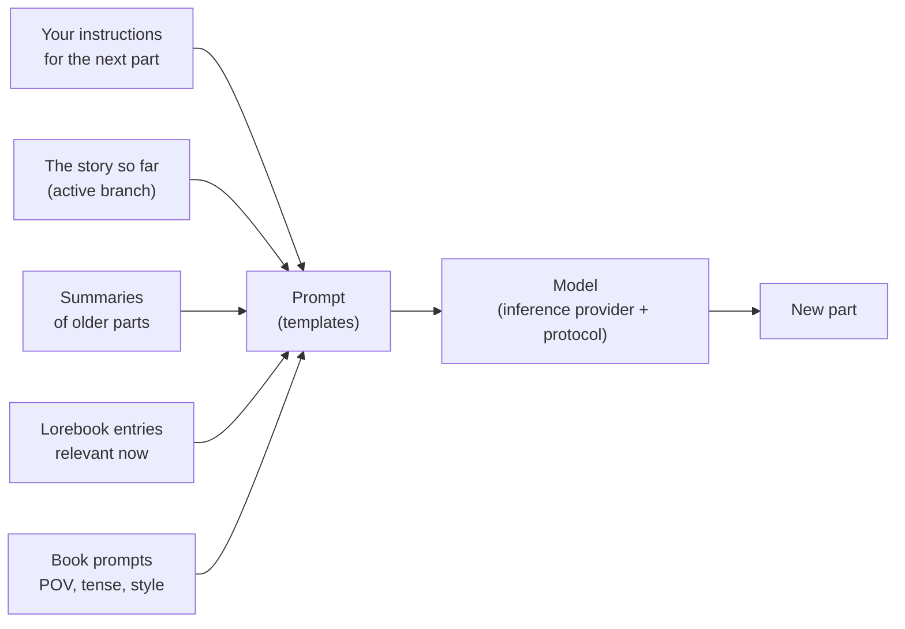

# Benutzerhandbuch

Dieser Teil des Handbuchs richtet sich an Menschen, die mit Marginalia schreiben, und an alle, die es für andere betreiben. Er erklärt jeden Bildschirm und jede Einstellung, von der Installation von Marginalia und dem Anschluss eines Modells über das Verzweigen einer Geschichte und den Aufbau eines Lorebooks bis zur Datensicherung der Datenbank. Sie brauchen keine Programmierkenntnisse. Einige Seiten zu Vorlagen gehen für diejenigen tiefer, die genau steuern möchten, was an das Modell gesendet wird.

Wenn Sie neu sind, beginnen Sie mit [Erste Schritte](getting-started/index.md). Dort geht es in wenigen Minuten von der Installation bis zum ersten generierten Abschnitt eines Buches.

## So funktioniert Marginalia

Sie schreiben eine Geschichte gemeinsam mit einem großen Sprachmodell. Für jeden **Abschnitt** der Geschichte legen Sie fest, was passieren soll (die Szene, die Erzählperspektive, wer anwesend ist, ein paar Sätze Anweisungen), und das Modell schreibt den Text. Vor jedem Abschnitt erstellt Marginalia den Prompt für das Modell aus:

Alles in diesem Schaubild lässt sich anpassen. Das Benutzerhandbuch ist entlang dieses Ablaufs gegliedert.

## Grundbegriffe

| Begriff                | Was es ist                                                                                                                                                                                                                  | Mehr dazu                                                   |
|------------------------|-----------------------------------------------------------------------------------------------------------------------------------------------------------------------------------------------------------------------------|-------------------------------------------------------------|
| **Buch**               | Eine Geschichte mit allem, was dazugehört: Abschnitte, Prompts, Lorebook, Zusammenfassungen, Sicherungen.                                                                                                                   | [Bücher](books/index.md)                                    |
| **Abschnitt**          | Ein Teil der Geschichte, normalerweise eine Antwort des Modells. Sie können ihn bearbeiten, neu generieren oder löschen.                                                                                                    | [Story-Editor](books/story-editor.md)                       |
| **Zweig**              | Abschnitte bilden einen Baum: Sie können eine andere Fassung eines Abschnitts schreiben oder von jedem früheren Abschnitt aus anders weitererzählen. Der *aktive Zweig* ist das, was Sie sehen und was das Modell liest.      | [Zweige & Erzählbaum](books/branches-and-story-tree.md)     |
| **Lorebook**           | Notizen zu Welt und Figuren. Jeder **Eintrag** wird nur dann in den Prompt aufgenommen, wenn er relevant ist, z. B. wenn der Name einer Figur vorkommt.                                                                     | [Lorebooks](lorebooks/index.md)                             |
| **Zusammenfassung**    | Eine verdichtete Fassung älterer Abschnitte, damit ein langes Buch noch in das passt, was das Modell auf einmal lesen kann.                                                                                                 | [Zusammenfassungen](books/summaries.md)                     |
| **Metazusammenfassung**| Eine Zusammenfassung von Zusammenfassungen: Mehrere Zusammenfassungen werden zu einem kürzeren Text vereinigt, um Kontext freizugeben.                                                                                      | [Zusammenfassungen](books/summaries.md#meta-summaries)      |
| **Vorlage**            | Der Text mit Platzhaltern und Makros, aus dem der Prompt gebaut wird. Jedes Buch hat eigene Prompts, mit Standardwerten in *Einstellungen*.                                                                                  | [Vorlagen & Makros](templates/index.md)                     |
| **Inferenzanbieter**   | Die Verbindung zu einem Modell: API-Adresse, API-Schlüssel, Modell und dessen Grenzen.                                                                                                                                      | [Inferenzanbieter](inference-providers.md)                  |
| **Protokoll**          | Generierungseinstellungen: Temperatur, Top P, Strafwerte und optionale Grenzen. Der Anbieter legt fest, *welches* Modell schreibt, das Protokoll *wie*.                                                                    | [Protokolle](protocols.md)                                  |
| **Ordner**             | Ein Ort für Bücher, beliebig tief verschachtelbar. Er kann auch Einstellungen (Sprache, Stil, Prompts) enthalten, die die Bücher darin übernehmen.                                                                          | [Ordner](books/folders.md)                                  |
| **Tag**                | Ein Etikett für Bücher und Lorebooks. Tags legen außerdem fest, welche Lorebook-Einträge ein Buch verwendet.                                                                                                                | [Bücher verwalten](books/managing-books.md)                 |
| **Erweiterung**        | Ein Plugin, das Funktionen ergänzt, etwa Kapitelmarkierungen oder KI-Reviews.                                                                                                                                               | [Erweiterungen](extensions/index.md)                        |
| **Befehl**             | Eine kleine Aktion, die Sie ausführen, indem Sie `/name` in die Befehlszeile neben dem Geschichtenmenü eingeben. Erweiterungen bringen eigene Befehle mit.                                                                  | [Befehle](commands/index.md)                                |
| **Agent**              | Ein LLM, das allein über die Befehle an einer Kopie eines Buches arbeitet. Sie prüfen, was es getan hat, und übernehmen das Ergebnis oder verwerfen es.                                                                     | [Agenten](agents.md)                                        |

Alles, was Sie anlegen, gehört zu Ihrem Konto. Andere Benutzer derselben Marginalia-Installation sehen Ihre Bücher, Lorebooks, Anbieter oder Einstellungen nicht. Sichtbar wird nur, was Sie [veröffentlichen](books/publishing.md), sowie Lorebooks und Protokolle, die Sie [teilen](lorebooks/lorebooks.md#sharing-a-lorebook) (andere können eine Kopie importieren, [Protokolle](protocols.md#sharing-a-protocol) ebenfalls).

## Der Arbeitsbereich

Nach dem Anmelden sehen Sie den Arbeitsbereich. Die Reiter links sind die Hauptbereiche von Marginalia, jeweils mit einem kleinen Symbol gekennzeichnet:

| Reiter                  |                                                                                                                                  |
|-------------------------|----------------------------------------------------------------------------------------------------------------------------------|
| **Bücher**              | Ihre Bücher. Öffnen Sie eins, um zu schreiben. Siehe [Bücher](books/index.md).                                                   |
| **Lorebooks**           | Alle Ihre Lorebooks und deren Einträge. Siehe [Lorebooks](lorebooks/index.md).                                                   |
| **Einstellungen**       | Ihre Standardwerte: Modell, Protokoll und die Standard-Prompts für neue Bücher. Siehe [Konto & Einstellungen](account.md).       |
| **Protokolle**          | Generierungseinstellungen. Siehe [Protokolle](protocols.md).                                                                     |
| **Inferenzanbieter**    | Verbindungen zu Modellen. Siehe [Inferenzanbieter](inference-providers.md).                                                      |
| **Ressourcen**          | Die hochgeladenen Dateien, etwa Bilder von Abschnitten. Siehe [Ressourcen](resources.md).                                       |
| **Papierkorb**          | Was Sie gelöscht haben, bis ein Administrator aufräumt. Stellen Sie es von hier aus wieder her. Siehe [Papierkorb](trash.md).    |
| **Agenten**             | (Experimentell) Ihre Agenten, deren Läufe und die Ergebnisse zur Prüfung. Nur für Benutzer, die Agenten verwenden dürfen. Siehe [Agenten](agents.md). |

Unten stehen **Passwort ändern**, **Abmelden** und, für Administratoren, **Administration**. Erweiterungen können weitere Reiter und Schaltflächen hinzufügen.

Auf einem schmalen Bildschirm (unter 768 Pixeln) erhalten Sie stattdessen ein einfacheres [Smartphone-Layout](phone.md). Die Reiter befinden sich dann in einer Schublade (einschließlich **Administration**), und die Fenster sind einspaltig. Das Layout wird beim Laden der Seite gewählt. Nach dem Drehen eines Geräts oder dem Ändern der Fenstergröße laden Sie die Seite neu, um das andere Layout zu erhalten.

## Kapitel dieses Handbuchs

| Kapitel                                        | Für                                                                                                                                                                                                                                                                                                                                 |
|------------------------------------------------|-------------------------------------------------------------------------------------------------------------------------------------------------------------------------------------------------------------------------------------------------------------------------------------------------------------------------------------|
| [Erste Schritte](getting-started/index.md)     | Installation der [Desktop-App](getting-started/desktop-app.md) oder eines [Servers](getting-started/docker-server.md), der [erste Start](getting-started/first-start.md) und ein [Schnellstart](getting-started/quick-start.md).                                                                                                      |
| [Inferenzanbieter](inference-providers.md)     | Anbindung von Cloud- und lokalen Modellen, Kontextgrenzen, Reasoning-Modelle.                                                                                                                                                                                                                                                       |
| [Ressourcen](resources.md)                     | Die hochgeladenen Dateien: herunterladen, ersetzen und löschen.                                                                                                                                                                                                                                                                     |
| [Papierkorb](trash.md)                         | Gelöschte Bücher, Lorebooks und andere Objekte und wie Sie sie wiederherstellen.                                                                                                                                                                                                                                                    |
| [Protokolle](protocols.md)                     | Temperatur, Top P, Strafwerte und Grenzen je Protokoll.                                                                                                                                                                                                                                                                             |
| [Bücher](books/index.md)                       | Bücher verwalten (klonen, Tags, Import aus einem Archiv), der Story-Editor (Suchen und Ersetzen), Zweige, Buch-Prompts, Zusammenfassungen, Sicherungen und Veröffentlichung.                                                                                                                                                         |
| [Lorebooks](lorebooks/index.md)                | Lorebooks, Einträge und ihre Aktivierung anlegen, Import und Export (einschließlich SillyTavern).                                                                                                                                                                                                                                  |
| [Vorlagen & Makros](templates/index.md)        | Was an das Modell gesendet wird und wie Sie es ändern; die Makro-Referenz.                                                                                                                                                                                                                                                          |
| [Erweiterungen](extensions/index.md)           | Die mitgelieferten Erweiterungen: Author's Note, Chapter Marker, Gemma 4 tools fix, Google Gemini, Instruction Exporter, Lore Generator, Lorebook VCS, Name generator, Name provider, Place provider, Reviewer, Side Query, Arc Outline, Character Tracker und die chinesische Lokalisierung.                                          |
| [Agenten](agents.md)                           | (Experimentell) Ein Modell arbeitet selbstständig an einem Buch: Agenten, die Konsole, Prüfen und Übernehmen des Ergebnisses, Grenzen.                                                                                                                                                                                             |
| [Befehle](commands/index.md)                   | Die Befehlszeile neben dem Geschichtenmenü: Befehle ausführen, Argumente schreiben, einen langen Befehl anhalten.                                                                                                                                                                                                                   |
| [Reguläre Ausdrücke](regular-expressions.md)   | Die regulären Ausdrücke von Suchen und Ersetzen sowie der Filter, und das Zeitlimit.                                                                                                                                                                                                                                                |
| [Konto & Einstellungen](account.md)            | Ihr Passwort, Ihr Benutzername und Ihre Standardeinstellungen.                                                                                                                                                                                                                                                                      |
| [Administration](administration/index.md)      | Für Administratoren: Benutzer und ihre Rechte, Datenbanksicherungen, Aufräumen, Installation von Erweiterungen, der Hilfe-Assistent und Agenten.                                                                                                                                                                                    |
| [Smartphone verwenden](phone.md)               | Das Smartphone-Layout: worin es sich vom Desktop unterscheidet, was fehlt und welche Erweiterungen funktionieren.                                                                                                                                                                                                                  |
| [Fehlerbehebung & FAQ](troubleshooting.md)     | Logdateien, häufige Probleme und ihre Lösungen.                                                                                                                                                                                                                                                                                     |

## Konventionen

- Namen von Reitern, Schaltflächen und Feldern stehen **fett** oder *kursiv*, so wie sie in Marginalia erscheinen, z. B. *Administration → Users*.
- `~/.marginalia` ist der Datenordner in Ihrem Benutzerverzeichnis (`%USERPROFILE%\.marginalia` unter Windows). Auf einem Docker-Server ist es der Ordner `./data` neben `docker-compose.yml`.
- Die meisten Änderungen werden gespeichert, sobald Sie sie vornehmen. Ausnahme ist der Reiter *Einstellungen*, der eine Schaltfläche **Speichern** hat.
