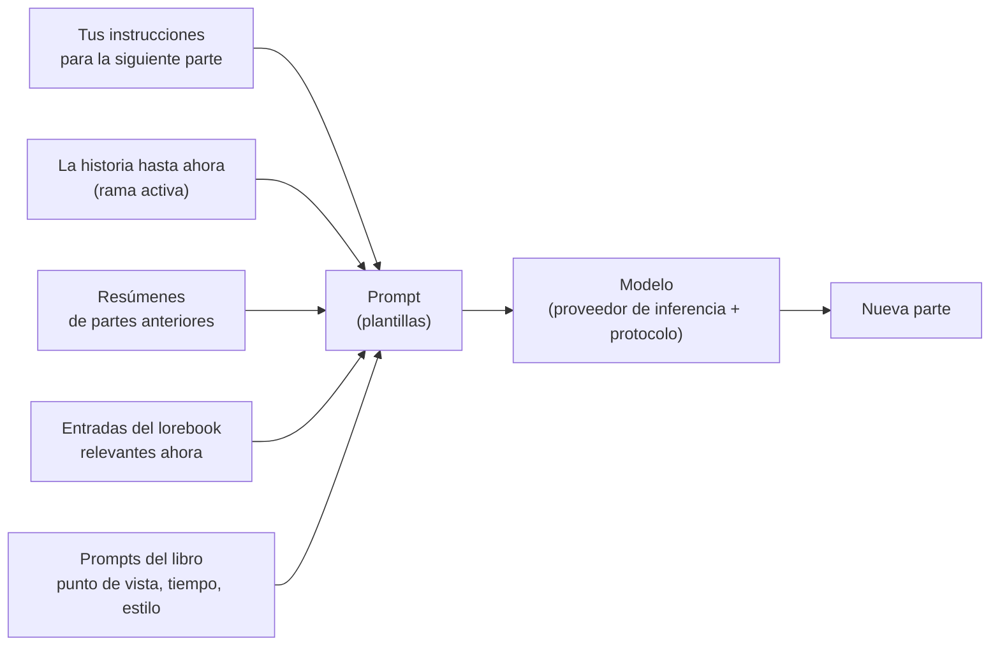

# Guía de usuario

Esta parte del manual está pensada para quienes escriben con Marginalia y para quienes lo administran para otras personas. Explica cada pantalla y cada ajuste, desde la instalación de Marginalia y la conexión de un modelo hasta la creación de ramas en una historia, la construcción de un libro de lore y la copia de seguridad de la base de datos. No necesitas saber nada de programación; algunas páginas sobre plantillas profundizan más para quienes quieran afinar lo que se envía al modelo.

Si es tu primera vez, empieza por [Primeros pasos](getting-started/index.md): te lleva desde la instalación hasta la primera parte generada de un libro en unos pocos minutos.

## Cómo funciona Marginalia

Escribes una historia junto con un modelo de lenguaje grande. Para cada **parte** de la historia indicas lo que debe ocurrir: la escena, el punto de vista, quién está presente, unas frases de instrucciones; y el modelo escribe la prosa. Antes de cada parte, Marginalia construye el prompt para el modelo a partir de:

Todo lo que aparece en este esquema se puede ajustar, y la guía de usuario está organizada siguiendo ese recorrido.

## Conceptos básicos

| Concepto               | Qué es                                                                                                                                                                                                  | Más información                                                   |
|------------------------|---------------------------------------------------------------------------------------------------------------------------------------------------------------------------------------------------------|-------------------------------------------------------------------|
| **Libro**              | Una historia con todo lo que le pertenece: partes, prompts, lorebook, resúmenes, copias de seguridad.                                                                                                   | [Libros](books/index.md)                                          |
| **Parte**              | Un fragmento de la historia, normalmente una respuesta del modelo. Puedes editarlo, regenerarlo o eliminarlo.                                                                                           | [Editor de historia](books/story-editor.md)                       |
| **Rama**               | Las partes forman un árbol: puedes escribir otra versión de una parte o continuar de forma distinta desde cualquiera de las anteriores. La *rama activa* es lo que ves y lo que lee el modelo.           | [Ramas y árbol de la historia](books/branches-and-story-tree.md)  |
| **Lorebook**           | Notas sobre el mundo y los personajes. Cada **entrada** se incluye en el prompt solo cuando es relevante, por ejemplo cuando aparece el nombre de un personaje.                                         | [Lorebooks](lorebooks/index.md)                                   |
| **Resumen**            | Una versión condensada de partes anteriores, para que un libro largo quepa en lo que el modelo puede leer de una vez.                                                                                   | [Resúmenes](books/summaries.md)                                   |
| **Metarresumen**       | Un resumen de resúmenes: varios resúmenes fusionados en un texto más corto, para liberar contexto.                                                                                                      | [Resúmenes](books/summaries.md#meta-summaries)                    |
| **Plantilla**          | El texto con marcadores y macros a partir del cual se construye el prompt. Cada libro tiene sus propios prompts, con valores por defecto en *Ajustes*.                                                  | [Plantillas y macros](templates/index.md)                         |
| **Proveedor de inferencia** | La conexión con un modelo: dirección de la API, clave de API, modelo y sus límites.                                                                                                              | [Proveedores de inferencia](inference-providers.md)               |
| **Protocolo**          | Ajustes de generación: temperatura, top P, penalizaciones y límites opcionales. El proveedor indica *qué* modelo escribe; el protocolo, *cómo*.                                                         | [Protocolos](protocols.md)                                        |
| **Carpeta**            | Un lugar para los libros, anidable tanto como quieras. También puede contener ajustes (idioma, estilo, prompts) que heredan los libros que hay dentro.                                                  | [Carpetas](books/folders.md)                                      |
| **Etiqueta**           | Una marca en libros y lorebooks; las etiquetas también deciden qué entradas del lorebook usa un libro.                                                                                                  | [Gestión de libros](books/managing-books.md)                      |
| **Extensión**          | Un complemento que añade funciones, como marcadores de capítulo o revisiones con IA.                                                                                                                    | [Extensiones](extensions/index.md)                                |
| **Comando**            | Una pequeña acción que ejecutas escribiendo `/nombre` en la línea de comandos junto al menú de la historia; las extensiones añaden los suyos.                                                          | [Comandos](commands/index.md)                                     |
| **Agente**             | Un LLM que trabaja por su cuenta en un libro, mediante los comandos, sobre una copia del libro; tú revisas lo que hizo y decides si lo aceptas o lo descartas.                                          | [Agentes](agents.md)                                              |

Todo lo que creas pertenece a tu cuenta. Los demás usuarios de la misma instalación de Marginalia no ven tus libros, lorebooks, proveedores ni ajustes; solo ven los libros que decidas [publicar](books/publishing.md), y los lorebooks y protocolos que decidas [compartir](lorebooks/lorebooks.md#sharing-a-lorebook) (otros pueden importar una copia; lo mismo con los [protocolos](protocols.md#sharing-a-protocol)).

## El espacio de trabajo

Al iniciar sesión ves el espacio de trabajo. Las pestañas de la izquierda son las áreas principales de Marginalia, cada una marcada con un pequeño icono:

| Pestaña                 |                                                                                                                                     |
|-------------------------|-------------------------------------------------------------------------------------------------------------------------------------|
| **Libros**              | Tus libros. Ábrelo para escribir. Consulta [Libros](books/index.md).                                                                |
| **Lorebooks**           | Todos tus lorebooks y sus entradas. Consulta [Lorebooks](lorebooks/index.md).                                                       |
| **Ajustes**             | Tus valores por defecto: modelo, protocolo y los prompts predeterminados para los libros nuevos. Consulta [Cuenta y ajustes](account.md). |
| **Protocolos**          | Ajustes de generación. Consulta [Protocolos](protocols.md).                                                                         |
| **Proveedores de inferencia** | Conexiones con modelos. Consulta [Proveedores de inferencia](inference-providers.md).                                         |
| **Recursos**            | Los archivos que has subido, como imágenes de partes. Consulta [Recursos](resources.md).                                            |
| **Papelera**            | Lo que has eliminado, hasta que un administrador lo limpie. Restáuralo desde aquí. Consulta [Papelera](trash.md).                   |
| **Agentes**             | (Experimental) Tus agentes, sus ejecuciones y los resultados que hay que revisar. Solo para usuarios que pueden usar agentes. Consulta [Agentes](agents.md). |

En la parte inferior están **Cambiar la contraseña**, **Cerrar sesión** y, para los administradores, **Administración**. Las extensiones pueden añadir más pestañas y botones.

En una pantalla estrecha (menos de 768 píxeles) obtienes en su lugar una [disposición para teléfono](phone.md), más sencilla: las pestañas están en un cajón (incluida Administración) y las ventanas se muestran en una sola columna. La disposición se elige al cargar la página: después de girar el dispositivo o cambiar el tamaño de la ventana, recarga la página para obtener la otra.

## Secciones de esta guía

| Sección                                       | Para                                                                                                                                                                                                                                                  |
|-----------------------------------------------|-------------------------------------------------------------------------------------------------------------------------------------------------------------------------------------------------------------------------------------------------------|
| [Primeros pasos](getting-started/index.md)    | Instalar la [aplicación de escritorio](getting-started/desktop-app.md) o un [servidor](getting-started/docker-server.md), el [primer arranque](getting-started/first-start.md) y un [inicio rápido](getting-started/quick-start.md).                       |
| [Proveedores de inferencia](inference-providers.md) | Conectar modelos en la nube y locales, límites de contexto, modelos de razonamiento.                                                                                                                                                    |
| [Recursos](resources.md)                      | Los archivos que has subido: descargarlos, reemplazarlos y eliminarlos.                                                                                                                                                                               |
| [Papelera](trash.md)                          | Libros, lorebooks y otros objetos eliminados, y cómo restaurarlos.                                                                                                                                                                                    |
| [Protocolos](protocols.md)                    | Temperatura, top P, penalizaciones y límites por protocolo.                                                                                                                                                                                           |
| [Libros](books/index.md)                      | Gestionar libros (clonar, etiquetas, importar desde un archivo), el editor de historia (buscar y reemplazar), ramas, prompts del libro, resúmenes, copias de seguridad y publicación.                                                                  |
| [Lorebooks](lorebooks/index.md)               | Crear lorebooks, entradas y cómo se activan; importar y exportar (incluido SillyTavern).                                                                                                                                                              |
| [Plantillas y macros](templates/index.md)     | Qué se envía al modelo y cómo cambiarlo; la referencia de macros.                                                                                                                                                                                     |
| [Extensiones](extensions/index.md)            | Las extensiones incluidas: Author's Note, Chapter Marker, Gemma 4 tools fix, Google Gemini, Instruction Exporter, Lore Generator, Lorebook VCS, Name generator, Name provider, Place provider, Reviewer, Side Query, Arc Outline, Character Tracker y la localización al chino. |
| [Agentes](agents.md)                          | (Experimental) Dejar que un modelo trabaje por su cuenta en un libro: agentes, la consola, revisar y aplicar el resultado, límites.                                                                                                                  |
| [Comandos](commands/index.md)                 | La línea de comandos junto al menú de la historia: ejecutar comandos, escribir argumentos, detener un comando largo.                                                                                                                                 |
| [Expresiones regulares](regular-expressions.md) | Las expresiones regulares de la búsqueda y reemplazo y de los filtros, y el límite de tiempo.                                                                                                                                                      |
| [Cuenta y ajustes](account.md)                | Tu contraseña, nombre de usuario y ajustes por defecto.                                                                                                                                                                                               |
| [Administración](administration/index.md)     | Para administradores: usuarios y sus permisos, copias de seguridad de la base de datos, limpieza, instalación de extensiones, el asistente de ayuda y agentes.                                                                                       |
| [Uso de Marginalia en un teléfono](phone.md)  | La disposición para teléfono: en qué se diferencia del escritorio, qué falta, qué extensiones funcionan.                                                                                                                                              |
| [Solución de problemas y preguntas frecuentes](troubleshooting.md) | Registros, problemas habituales y sus soluciones.                                                                                                                                                                                  |

## Convenciones

- Los nombres de pestañas, botones y campos van en **negrita** o *cursiva*, escritos tal como aparecen en Marginalia, por ejemplo *Administración → Usuarios*.
- `~/.marginalia` es la carpeta de datos en tu directorio personal (`%USERPROFILE%\.marginalia` en Windows); en un servidor Docker es la carpeta `./data` junto a `docker-compose.yml`.
- La mayoría de los cambios se guardan en cuanto los haces. La excepción es la pestaña *Ajustes*, que tiene un botón **Guardar**.
