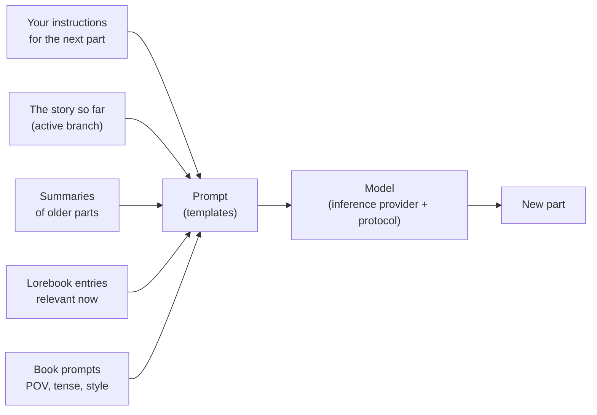

# Guide utilisateur

Cette partie du manuel s'adresse aux personnes qui écrivent avec Marginalia et à celles qui le font fonctionner pour d'autres. Elle explique
chaque écran et chaque paramètre, de l'installation de Marginalia à la connexion d'un modèle, en passant par la création de branches dans une histoire, la construction d'un livre de lore et la sauvegarde de la base de données. Il n'est pas nécessaire de savoir programmer ; quelques pages consacrées aux modèles vont plus loin pour ceux qui souhaitent affiner ce qui est envoyé au modèle.

Si vous débutez, commencez par [Premiers pas](getting-started/index.md) : en quelques minutes, vous passez de l'installation à la première partie générée d'un livre.

## Fonctionnement de Marginalia

Vous écrivez une histoire avec un grand modèle de langage. Pour chaque **partie** de l'histoire, vous indiquez ce qui doit se passer : la scène, le point de vue, les personnages présents, quelques phrases d'instructions. Le modèle rédige alors le texte. Avant chaque partie, Marginalia construit le prompt destiné au modèle à partir de :

Chacun de ces éléments peut être ajusté, et le guide utilisateur suit ce schéma.

## Notions de base

| Notion                 | Ce que c'est                                                                                                                                                                                  | Pour en savoir plus                                         |
|------------------------|-----------------------------------------------------------------------------------------------------------------------------------------------------------------------------------------------|-------------------------------------------------------------|
| **Livre**              | Une histoire avec tout ce qui lui appartient : parties, prompts, livre de lore, résumés, sauvegardes.                                                                                        | [Livres](books/index.md)                                              |
| **Partie**             | Un morceau de l'histoire, normalement une réponse du modèle. Vous pouvez la modifier, la régénérer ou la supprimer.                                                                          | [Éditeur d'histoire](books/story-editor.md)                                  |
| **Branche**            | Les parties forment un arbre : vous pouvez écrire une autre version d'une partie ou poursuivre autrement à partir de n'importe quelle partie antérieure. La *branche active* est celle que vous voyez et que lit le modèle. | [Branches et arbre de l'histoire](books/branches-and-story-tree.md) |
| **Livre de lore**      | Notes sur le monde et les personnages. Chaque **entrée** n'est ajoutée au prompt que lorsqu'elle est pertinente, par exemple lorsque le nom d'un personnage apparaît.                       | [Livres de lore](lorebooks/index.md)                                      |
| **Résumé**             | Une version condensée des parties anciennes, pour qu'un livre long tienne encore dans ce que le modèle peut lire d'un coup.                                                                  | [Résumés](books/summaries.md)                                             |
| **Méta-résumé**        | Un résumé de résumés : plusieurs résumés fusionnés en un texte plus court, pour libérer du contexte.                                                                                          | [Résumés](books/summaries.md#meta-summaries)                                             |
| **Modèle de prompt**   | Le texte avec des espaces réservés et des macros à partir duquel le prompt est construit. Chaque livre a ses propres prompts, avec des valeurs par défaut dans *Paramètres*.                  | [Modèles et macros](templates/index.md)                                   |
| **Fournisseur d'inférence** | La connexion à un modèle : adresse de l'API, clé d'API, modèle et ses limites.                                                                                                          | [Fournisseurs d'inférence](inference-providers.md)                            |
| **Protocole**          | Réglages de génération : température, top P, pénalités et limites optionnelles. Le fournisseur indique *quel* modèle écrit, le protocole *comment*.                                          | [Protocoles](protocols.md)                                          |
| **Dossier**            | Un emplacement pour les livres, imbriqué à volonté. Il peut aussi contenir des paramètres (langue, style, prompts) dont héritent les livres qu'il contient.                                 | [Dossiers](books/folders.md)                                           |
| **Mot-clé**            | Une étiquette posée sur les livres et les livres de lore ; les mots-clés décident aussi des entrées du livre de lore qu'un livre utilise.                                                    | [Gérer les livres](books/managing-books.md)                                   |
| **Extension**          | Un plugin qui ajoute des fonctions, comme des marqueurs de chapitre ou des relectures par IA.                                                                                                 | [Extensions](extensions/index.md)                                         |
| **Commande**           | Une petite action que vous lancez en tapant `/name` dans la ligne de commande à côté du menu de l'histoire ; les extensions ajoutent les leurs.                                                 | [Commandes](commands/index.md)                                          |
| **Agent**              | Un LLM qui travaille seul sur un livre, par les commandes, sur une copie du livre ; vous examinez ce qu'il a fait, puis vous le conservez ou le jetez.                                       | [Agents](agents.md)                                             |

Tout ce que vous créez appartient à votre compte. Les autres utilisateurs de la même instance de Marginalia ne voient ni vos livres, ni vos livres de lore, ni vos fournisseurs, ni vos paramètres : seuls les livres que vous choisissez de [publier](books/publishing.md), et les livres de lore et protocoles que vous choisissez de [partager](lorebooks/lorebooks.md#sharing-a-lorebook), sont visibles (les autres peuvent en importer une copie, [les protocoles](protocols.md#sharing-a-protocol) aussi).

## L'espace de travail

Après la connexion, vous voyez l'espace de travail. Les onglets à gauche correspondent aux grands espaces de Marginalia, chacun repéré par une petite icône :

| Onglet                  |                                                                                                                  |
|-------------------------|------------------------------------------------------------------------------------------------------------------|
| **Livres**              | Vos livres. Ouvrez-en un pour écrire. Voir [Livres](books/index.md).                                                      |
| **Livres de lore**      | Tous vos livres de lore et leurs entrées. Voir [Livres de lore](lorebooks/index.md).                                          |
| **Paramètres**          | Vos valeurs par défaut : modèle, protocole et prompts par défaut des nouveaux livres. Voir [Compte et paramètres](account.md). |
| **Protocoles**          | Réglages de génération. Voir [Protocoles](protocols.md).                                                                |
| **Fournisseurs d'inférence** | Connexions aux modèles. Voir [Fournisseurs d'inférence](inference-providers.md).                                             |
| **Ressources**          | Les fichiers que vous avez envoyés, comme les images de parties. Voir [Ressources](resources.md).                       |
| **Corbeille**           | Ce que vous avez supprimé, jusqu'à ce qu'un administrateur le nettoie. Vous pouvez le restaurer ici. Voir [Corbeille](trash.md). |
| **Agents**              | (Expérimental) Vos agents, leurs exécutions et les résultats à examiner. Réservé aux utilisateurs autorisés à utiliser les agents. Voir [Agents](agents.md). |

En bas se trouvent **Changer le mot de passe**, **Déconnexion** et, pour les administrateurs, **Administration**. Les extensions peuvent ajouter d'autres onglets et boutons.

Sur un écran étroit (moins de 768 pixels), vous obtenez à la place une [disposition pour téléphone](phone.md), plus simple : les onglets sont dans un tiroir (Administration compris) et les fenêtres tiennent sur une seule colonne. La disposition est choisie au chargement de la page : après avoir tourné l'appareil ou redimensionné la fenêtre, rechargez la page pour obtenir l'autre.

## Sections de ce guide

| Section                                       | Pour                                                                                                                                                                                                                 |
|-----------------------------------------------|----------------------------------------------------------------------------------------------------------------------------------------------------------------------------------------------------------------------|
| [Premiers pas](getting-started/index.md)   | Installer l'[application de bureau](getting-started/desktop-app.md) ou un [serveur](getting-started/docker-server.md), le [premier démarrage](getting-started/first-start.md) et un [démarrage rapide](getting-started/quick-start.md). |
| [Fournisseurs d'inférence](inference-providers.md) | Connecter des modèles dans le cloud ou en local, limites de contexte, modèles de raisonnement.                                                                                                                       |
| [Ressources](resources.md)                     | Les fichiers que vous avez envoyés : les télécharger, les remplacer et les supprimer.                                                                                                                                |
| [Corbeille](trash.md)                             | Livres, livres de lore et autres objets supprimés, et comment les restaurer.                                                                                                                                         |
| [Protocoles](protocols.md)                     | Température, top P, pénalités et limites par protocole.                                                                                                                                                              |
| [Livres](books/index.md)                       | Gérer les livres (cloner, mots-clés, importer depuis une archive), l'éditeur d'histoire (recherche et remplacement), les branches, les prompts du livre, les résumés, les sauvegardes et la publication.           |
| [Livres de lore](lorebooks/index.md)               | Créer des livres de lore et leurs entrées, comprendre leur activation, import et export (y compris SillyTavern).                                                                                                    |
| [Modèles et macros](templates/index.md)      | Ce qui est envoyé au modèle et comment le modifier ; la référence des macros.                                                                                                                                        |
| [Extensions](extensions/index.md)             | Les extensions fournies : Author's Note, Chapter Marker, correctif d'outils Gemma 4, Google Gemini, Instruction Exporter, Lore Generator, Lorebook VCS, Name generator, Name provider, Place provider, Reviewer, Side Query, Arc Outline, Character Tracker et la localisation chinoise. |
| [Agents](agents.md) | (Expérimental) Laisser un modèle travailler seul sur un livre : agents, console, examen et application du résultat, limites. |
| [Commandes](commands/index.md) | La ligne de commande à côté du menu de l'histoire : lancer des commandes, écrire les arguments, arrêter une commande longue. |
| [Expressions régulières](regular-expressions.md) | Les expressions régulières de la recherche et du remplacement et des filtres, et la limite de temps. |
| [Compte et paramètres](account.md)              | Votre mot de passe, votre nom d'utilisateur et vos paramètres par défaut.                                                                                                                                            |
| [Administration](administration/index.md)     | Pour les administrateurs : utilisateurs et leurs droits, sauvegardes de la base de données, nettoyage, installation d'extensions, assistant d'aide et agents.                                                         |
| [Utiliser Marginalia sur téléphone](phone.md)       | La disposition pour téléphone : en quoi elle diffère du bureau, ce qui manque, quelles extensions fonctionnent.                                                                                                      |
| [Dépannage et FAQ](troubleshooting.md)   | Journaux, problèmes courants et leurs solutions.                                                                                                                                                                     |

## Conventions

- Les noms des onglets, boutons et champs sont en **gras** ou en *italique*, écrits tels qu'ils apparaissent dans Marginalia, par exemple *Administration → Utilisateurs*.
- `~/.marginalia` est le dossier de données de votre répertoire personnel (`%USERPROFILE%\.marginalia` sous Windows) ; sur un serveur Docker, c'est le dossier `./data` à côté de `docker-compose.yml`.
- La plupart des modifications sont enregistrées dès que vous les faites. L'exception est l'onglet *Paramètres*, qui possède un bouton **Enregistrer**.
