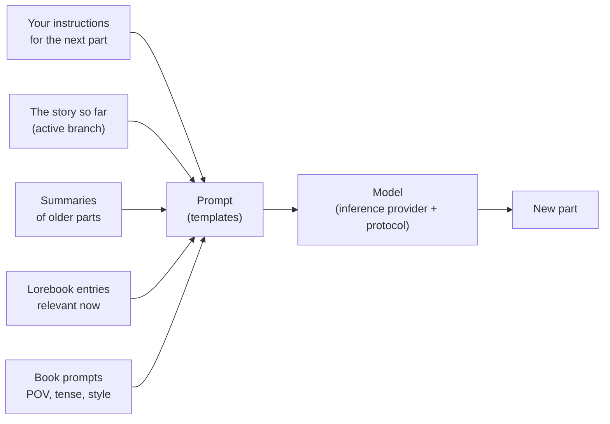

# Guida utente

Questa parte del manuale è destinata a chi scrive con Marginalia e a chi lo gestisce per altri. Spiega ogni schermata e
ogni impostazione, dall'installazione di Marginalia e dalla connessione a un modello fino alla creazione di rami in una
storia, alla costruzione di un lorebook e al backup del database. Non serve alcuna conoscenza di programmazione; alcune
pagine sui template approfondiscono l'argomento per chi vuole mettere a punto ciò che viene inviato al modello.

Se è la prima volta che usi Marginalia, inizia da [Primi passi](getting-started/index.md): ti accompagna dall'installazione
alla prima parte generata di un libro in pochi minuti.

## Come funziona Marginalia

Scrivi una storia insieme a un grande modello linguistico. Per ogni **parte** della storia indichi cosa dovrebbe accadere -
la scena, il punto di vista, chi è presente, qualche frase di istruzioni - e il modello scrive la prosa.
Prima di ogni parte Marginalia costruisce il prompt per il modello a partire da:

Ogni elemento di questo schema può essere modificato, e la guida utente è organizzata seguendo questo percorso.

## Concetti fondamentali

| Concetto               | Cos'è                                                                                                                                                                  | Per saperne di più                                        |
|------------------------|------------------------------------------------------------------------------------------------------------------------------------------------------------------------|-----------------------------------------------------------|
| **Book**               | Una storia con tutto ciò che le appartiene: parti, prompt, lorebook, riassunti, backup.                                                                                | [Books](books/index.md)                                   |
| **Part**               | Un pezzo della storia, normalmente una risposta del modello. Puoi modificarla, rigenerarla o eliminarla.                                                              | [Story editor](books/story-editor.md)                     |
| **Branch**             | Le parti formano un albero: puoi scrivere un'altra versione di una parte oppure continuare in modo diverso da una qualsiasi parte precedente. Il *ramo attivo* è ciò che vedi e ciò che legge il modello. | [Branches & story tree](books/branches-and-story-tree.md) |
| **Lorebook**           | Note su mondo e personaggi. Ogni **entry** viene inserita nel prompt solo quando è rilevante, ad esempio quando compare il nome di un personaggio.                    | [Lorebooks](lorebooks/index.md)                           |
| **Summary**            | Una versione condensata delle parti più vecchie, così un libro lungo entra comunque in ciò che il modello può leggere in una volta sola.                              | [Summaries](books/summaries.md)                           |
| **Meta summary**       | Un riassunto di riassunti: più riassunti uniti in un unico testo più breve, per liberare spazio nel contesto.                                                          | [Summaries](books/summaries.md#meta-summaries)            |
| **Template**           | Il testo con segnaposto e macro da cui viene costruito il prompt. Ogni libro ha i propri prompt, con valori predefiniti in *Settings*.                                 | [Templates & macros](templates/index.md)                  |
| **Inference provider** | La connessione a un modello: indirizzo API, chiave API, modello e relativi limiti.                                                                                     | [Inference providers](inference-providers.md)             |
| **Protocol**           | Impostazioni di generazione: temperatura, top P, penalità e limiti facoltativi. Il provider stabilisce *quale* modello scrive, il protocollo *come*.                  | [Protocols](protocols.md)                                 |
| **Folder**             | Un luogo per i libri, annidabile a piacere. Può anche contenere impostazioni (lingua, stile, prompt) che i libri al suo interno ereditano.                            | [Folders](books/folders.md)                               |
| **Tag**                | Un'etichetta su libri e lorebook; i tag decidono anche quali entry di lorebook usa un libro.                                                                           | [Managing books](books/managing-books.md)                 |
| **Extension**          | Un plugin che aggiunge funzioni, come i segnalibri di capitolo o le revisioni con IA.                                                                                  | [Extensions](extensions/index.md)                         |
| **Command**            | Un'azione breve che si esegue digitando `/nome` nella riga di comando accanto al menu della storia; le estensioni aggiungono i propri comandi.                         | [Commands](commands/index.md)                             |
| **Agent**              | Un LLM che lavora da solo su un libro, tramite i comandi, su una copia del libro; tu verifichi ciò che ha fatto e lo accetti o lo scarti.                              | [Agents](agents.md)                                       |

Tutto ciò che crei appartiene al tuo account. Gli altri utenti della stessa istanza di Marginalia non vedono i tuoi libri,
i tuoi lorebook, i tuoi provider o le tue impostazioni, a meno che non scegli di [pubblicare](books/publishing.md) un libro
oppure di [condividere](lorebooks/lorebooks.md#sharing-a-lorebook) un lorebook o un protocollo (chi lo riceve può importarne una copia, e
vale lo stesso [per i protocolli](protocols.md#sharing-a-protocol)).

## L'area di lavoro

Dopo l'accesso vedi l'area di lavoro. Le schede a sinistra sono le aree principali di Marginalia, ciascuna contrassegnata da una piccola icona:

| Scheda                  |                                                                                                             |
|-------------------------|-------------------------------------------------------------------------------------------------------------|
| **Libri**               | I tuoi libri. Aprine uno per scrivere. Vedi [Libri](books/index.md).                                        |
| **Lorebook**            | Tutti i tuoi lorebook e le relative entry. Vedi [Lorebook](lorebooks/index.md).                             |
| **Impostazioni**        | I tuoi valori predefiniti: modello, protocollo e prompt predefiniti per i nuovi libri. Vedi [Account e impostazioni](account.md). |
| **Protocolli**          | Impostazioni di generazione. Vedi [Protocolli](protocols.md).                                               |
| **Provider di inferenza** | Connessioni ai modelli. Vedi [Provider di inferenza](inference-providers.md).                             |
| **Risorse**             | I file caricati, come le immagini delle parti. Vedi [Risorse](resources.md).                                |
| **Cestino**             | Ciò che hai eliminato, finché un amministratore non esegue la pulizia. Ripristinalo da qui. Vedi [Cestino](trash.md). |
| **Agenti**              | (Sperimentale) I tuoi agenti, le loro esecuzioni e i risultati da verificare. Solo per gli utenti autorizzati a usare gli agenti. Vedi [Agenti](agents.md). |

In basso trovi **Cambia password**, **Esci* e, per gli amministratori, **Amministratore**. Le estensioni possono aggiungere altre schede
e pulsanti.

Su uno schermo stretto (sotto i 768 pixel) ottieni invece una [versione per telefono](phone.md), più semplice: le schede si trovano in un
cassetto (incluso Amministratore) e le finestre occupano una sola colonna. La versione viene scelta al caricamento della pagina: dopo aver
ruotato il dispositivo o ridimensionato la finestra, ricarica la pagina per ottenere l'altra.

## Sezioni di questa guida

| Sezione                                       | Per                                                                                                                                                                                                                  |
|-----------------------------------------------|----------------------------------------------------------------------------------------------------------------------------------------------------------------------------------------------------------------------|
| [Primi passi](getting-started/index.md)       | Installare l'[app desktop](getting-started/desktop-app.md) o un [server](getting-started/docker-server.md), il [primo avvio](getting-started/first-start.md) e un [avvio rapido](getting-started/quick-start.md). |
| [Provider di inferenza](inference-providers.md) | Collegare modelli cloud e locali, limiti di contesto, modelli di ragionamento.                                                                                                                                     |
| [Risorse](resources.md)                       | I file caricati: scaricarli, sostituirli ed eliminarli.                                                                                                                                                              |
| [Cestino](trash.md)                           | Libri, lorebook e altri oggetti eliminati, e come ripristinarli.                                                                                                                                                     |
| [Protocolli](protocols.md)                    | Temperatura, top P, penalità e limiti per protocollo.                                                                                                                                                                |
| [Libri](books/index.md)                       | Gestione dei libri (clonazione, tag, importazione da archivio), story editor (ricerca e sostituzione), rami, prompt del libro, riassunti, backup e pubblicazione.                                                   |
| [Lorebook](lorebooks/index.md)                | Creazione dei lorebook, delle entry e della loro attivazione, importazione ed esportazione (incluso SillyTavern).                                                                                                    |
| [Template e macro](templates/index.md)        | Cosa viene inviato al modello e come modificarlo; il riferimento delle macro.                                                                                                                                        |
| [Estensioni](extensions/index.md)             | Le estensioni incluse: Author's Note, Chapter Marker, Gemma 4 tools fix, Google Gemini, Instruction Exporter, Lore Generator, Lorebook VCS, Name generator, Name provider, Place provider, Reviewer, Side Query, Arc Outline, Character Tracker e la localizzazione cinese. |
| [Agenti](agents.md)                           | (Sperimentale) Far lavorare un modello da solo su un libro: agenti, console, verifica e applicazione del risultato, limiti.                                                                                          |
| [Comandi](commands/index.md)                  | La riga di comando accanto al menu della storia: esecuzione dei comandi, scrittura degli argomenti, interruzione di un comando lungo.                                                                                 |
| [Espressioni regolari](regular-expressions.md) | Le espressioni regolari di ricerca e sostituzione e dei filtri, e il limite di tempo.                                                                                                                                |
| [Account e impostazioni](account.md)          | La tua password, il nome utente e le impostazioni predefinite.                                                                                                                                                       |
| [Amministrazione](administration/index.md)    | Per gli amministratori: utenti e permessi, backup del database, pulizia, installazione delle estensioni, l'assistente di aiuto e gli agenti.                                                                         |
| [Usare Marginalia sul telefono](phone.md)     | La versione per telefono: in cosa differisce dal desktop, cosa manca, quali estensioni funzionano.                                                                                                                   |
| [Risoluzione dei problemi e FAQ](troubleshooting.md) | Log, problemi comuni e relative soluzioni.                                                                                                                                                                    |

## Convenzioni

- I nomi di schede, pulsanti e campi sono in **grassetto** o *corsivo*, scritti come compaiono in Marginalia, ad esempio
  *Amministratore → Utenti*.
- `~/.marginalia` è la cartella dei dati nella tua directory home (`%USERPROFILE%\.marginalia` su Windows); su un server Docker
  è la cartella `./data` accanto a `docker-compose.yml`.
- La maggior parte delle modifiche viene salvata non appena le fai. Fa eccezione la scheda *Impostazioni*, che ha un pulsante **Salva**.
