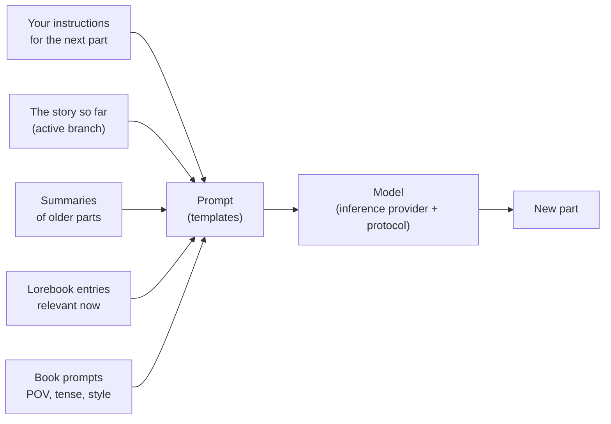

# Guida utente

Questa parte del manuale è destinata a chi scrive con Marginalia e a chi lo gestisce per altri. Spiega ogni schermata e
ogni impostazione, dall'installazione di Marginalia e dal collegamento a un modello fino alla creazione di rami in una storia, alla costruzione di
un lorebook e al backup del database. Non serve alcuna conoscenza di programmazione; alcune pagine sui template approfondiscono
il tema per chi vuole mettere a punto ciò che viene inviato al modello.

Se sei alle prime armi, inizia da [Primi passi](getting-started/index.md): ti accompagna dall'installazione alla prima parte generata di un libro in pochi minuti.

## Come funziona Marginalia

Scrivi una storia insieme a un modello linguistico di grandi dimensioni. Per ogni **parte** della storia indichi cosa deve accadere -
la scena, il punto di vista, chi è presente, alcune frasi di istruzioni - e il modello scrive il testo. 
Prima di ogni parte Marginalia costruisce il prompt per il modello a partire da:

Ogni elemento di questo schema può essere modificato, e la guida utente è organizzata seguendo questo schema.

## Concetti fondamentali

| Concetto               | Cos'è                                                                                                                                                                  | Per saperne di più                                        |
|------------------------|------------------------------------------------------------------------------------------------------------------------------------------------------------------------|-----------------------------------------------------------|
| **Libro**              | Una storia con tutto ciò che le appartiene: parti, prompt, lorebook, riassunti, backup.                                                                               | [Libri](books/index.md)                                   |
| **Parte**              | Un pezzo della storia, normalmente una risposta del modello. Puoi modificarla, rigenerarla o eliminarla.                                                              | [Editor della storia](books/story-editor.md)                     |
| **Ramo**               | Le parti formano un albero: puoi scrivere un'altra versione di una parte oppure proseguire in modo diverso da una qualsiasi precedente. Il *ramo attivo* è ciò che vedi e ciò che legge il modello. | [Rami e albero della storia](books/branches-and-story-tree.md) |
| **Lorebook**           | Note sul mondo e sui personaggi. Ogni **voce** entra nel prompt solo quando è pertinente, ad esempio quando compare il nome di un personaggio.                        | [Lorebook](lorebooks/index.md)                           |
| **Riassunto**          | Una versione condensata delle parti più vecchie, così che un libro lungo rientri comunque in ciò che il modello può leggere in una volta sola.                        | [Riassunti](books/summaries.md)                                  |
| **Meta-riassunto**     | Un riassunto di riassunti: più riassunti uniti in un unico testo più breve, per liberare spazio nel contesto.                                                          | [Riassunti](books/summaries.md#meta-summaries)            |
| **Template**           | Il testo con segnaposto e macro da cui viene costruito il prompt. Ogni libro ha i propri prompt, con i valori predefiniti in *Impostazioni*.                          | [Template e macro](templates/index.md)                  |
| **Provider di inferenza** | La connessione a un modello: indirizzo API, chiave API, modello e relativi limiti.                                                                                  | [Provider di inferenza](inference-providers.md)             |
| **Protocollo**         | Impostazioni di generazione: temperatura, top P, penalità e limiti facoltativi. Il provider stabilisce *quale* modello scrive, il protocollo *come*.                  | [Protocolli](protocols.md)                                 |
| **Cartella**           | Un luogo per i libri, annidabile a piacere. Può contenere anche impostazioni (lingua, stile, prompt) che i libri al suo interno ereditano.                            | [Cartelle](books/folders.md)                               |
| **Tag**                | Un'etichetta applicata a libri e lorebook; i tag decidono anche quali voci del lorebook usa un libro.                                                                  | [Gestione dei libri](books/managing-books.md)                 |
| **Estensione**         | Un plugin che aggiunge funzioni, come i marcatori di capitolo o le revisioni con IA.                                                                                  | [Estensioni](extensions/index.md)                         |
| **Comando**            | Una piccola azione che avvii digitando `/name` nella riga di comando accanto al menu della storia; le estensioni aggiungono i propri.                                     | [Comandi](commands/index.md)                             |
| **Agente**             | Un LLM che lavora da solo su un libro, tramite i comandi, su una copia del libro; tu verifichi cosa ha fatto e lo adotti oppure lo scarti.                            | [Agenti](agents.md)                                       |

Tutto ciò che crei appartiene al tuo account. Gli altri utenti della stessa istanza di Marginalia non vedono i tuoi libri, lorebook,
provider o impostazioni - solo i libri che scegli di [pubblicare](books/publishing.md), e i lorebook e i protocolli che scegli di
[condividere](lorebooks/lorebooks.md#sharing-a-lorebook) (altri possono importarne una copia, [i protocolli](protocols.md#sharing-a-protocol) compresi).

## Lo spazio di lavoro

Dopo l'accesso vedi lo spazio di lavoro. Le schede a sinistra sono le aree principali di Marginalia, ciascuna contrassegnata da una piccola icona:

| Scheda                  |                                                                                                             |
|-------------------------|-------------------------------------------------------------------------------------------------------------|
| **Libri**               | I tuoi libri. Aprine uno per scrivere. Vedi [Libri](books/index.md).                                                 |
| **Lorebook**            | Tutti i tuoi lorebook e le relative voci. Vedi [Lorebook](lorebooks/index.md).                                  |
| **Impostazioni**        | I tuoi valori predefiniti: modello, protocollo e prompt predefiniti per i nuovi libri. Vedi [Account e impostazioni](account.md). |
| **Protocolli**          | Impostazioni di generazione. Vedi [Protocolli](protocols.md).                                                         |
| **Provider di inferenza** | Connessioni ai modelli. Vedi [Provider di inferenza](inference-providers.md).                                   |
| **Risorse**             | I file che hai caricato, come le immagini delle parti. Vedi [Risorse](resources.md).                           |
| **Cestino**             | Ciò che hai eliminato, finché un amministratore non esegue la pulizia. Da qui puoi ripristinarlo. Vedi [Cestino](trash.md).            |
| **Agenti**              | (Sperimentale) I tuoi agenti, le loro esecuzioni e i risultati da verificare. Solo per gli utenti autorizzati a usare gli agenti. Vedi [Agenti](agents.md). |

In basso trovi **Cambia password**, **Esci** e, per gli amministratori, **Amministratore**. Le estensioni possono aggiungere altre schede
e pulsanti.

Su uno schermo stretto (sotto i 768 pixel) ottieni invece una [disposizione per telefono](phone.md), più semplice: le schede sono in un cassetto (Amministratore
compreso) e le finestre occupano una sola colonna. La disposizione viene scelta al caricamento della pagina: dopo aver ruotato il dispositivo o ridimensionato la finestra,
ricarica la pagina per ottenere l'altra.

## Sezioni di questa guida

| Sezione                                       | Per                                                                                                                                                                                                                  |
|-----------------------------------------------|----------------------------------------------------------------------------------------------------------------------------------------------------------------------------------------------------------------------|
| [Primi passi](getting-started/index.md)   | Installare la [app desktop](getting-started/desktop-app.md) o un [server](getting-started/docker-server.md), il [primo avvio](getting-started/first-start.md) e un [avvio rapido](getting-started/quick-start.md). |
| [Provider di inferenza](inference-providers.md) | Collegare modelli cloud e locali, limiti di contesto, modelli di ragionamento.                                                                                                                                                 |
| [Risorse](resources.md)                     | I file caricati: scaricarli, sostituirli ed eliminarli.                                                                                                                                                           |
| [Cestino](trash.md)                             | Libri, lorebook e altri oggetti eliminati, e come ripristinarli.                                                                                     |
| [Protocolli](protocols.md)                     | Temperatura, top P, penalità e limiti per protocollo.                                                                                                                                                               |
| [Libri](books/index.md)                       | Gestione dei libri (clonazione, tag, importazione da un archivio), editor della storia (ricerca e sostituzione), rami, prompt del libro, riassunti, backup e pubblicazione.                                                                                                                         |
| [Lorebook](lorebooks/index.md)               | Creazione dei lorebook, delle voci e come vengono attivate, importazione ed esportazione (incluso SillyTavern).                                                                                                                   |
| [Template e macro](templates/index.md)      | Cosa viene inviato al modello e come modificarlo; il riferimento delle macro.                                                                                                                                                 |
| [Estensioni](extensions/index.md)             | Le estensioni incluse: Author's Note, Chapter Marker, correzione degli strumenti Gemma 4, Google Gemini, Instruction Exporter, Lore Generator, Lorebook VCS, Name generator, Name provider, Place provider, Reviewer, Side Query, Arc Outline, Character Tracker e la localizzazione in cinese.                                                                                                                                          |
| [Agenti](agents.md) | (Sperimentale) Far lavorare un modello da solo su un libro: agenti, console, verifica e applicazione del risultato, limiti. |
| [Comandi](commands/index.md) | La riga di comando accanto al menu della storia: eseguire comandi, scrivere gli argomenti, interrompere un comando lungo. |
| [Espressioni regolari](regular-expressions.md) | Le espressioni regolari della ricerca e sostituzione e dei filtri, e il limite di tempo. |
| [Account e impostazioni](account.md)              | La tua password, il nome utente e le impostazioni predefinite.                                                                                                                                                                       |
| [Amministrazione](administration/index.md)     | Per gli amministratori: utenti e relativi permessi, backup del database, pulizia, installazione delle estensioni, l'assistente di aiuto e gli agenti.                                                                                                                                         |
| [Usare Marginalia da telefono](phone.md)       | La disposizione per telefono: in cosa differisce da quella desktop, cosa manca, quali estensioni funzionano.                                                                                                                           |
| [Risoluzione dei problemi e FAQ](troubleshooting.md)   | Log, problemi comuni e relative soluzioni.                                                                                                                                                                           |

## Convenzioni

- I nomi di schede, pulsanti e campi sono in **grassetto** o *corsivo*, scritti come compaiono in Marginalia, ad esempio
  *Amministratore → Utenti*.
- `~/.marginalia` è la cartella dei dati nella tua directory home (`%USERPROFILE%\.marginalia` su Windows); su un server
  Docker è la cartella `./data` accanto a `docker-compose.yml`.
- La maggior parte delle modifiche viene salvata non appena le fai. Fa eccezione la scheda *Impostazioni*, che ha un pulsante **Salva**.
