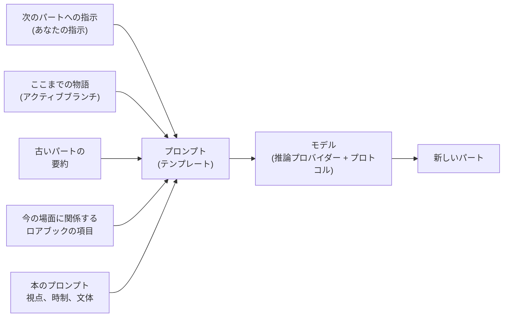

# ユーザーガイド

マニュアルのこの部分は、Marginaliaで執筆する人と、他の人のためにMarginaliaを運用する人を対象としています。Marginaliaのインストールからモデルの接続、ストーリーの分岐、ロアブックの作成、データベースのバックアップまで、すべての画面と設定を説明します。プログラミングの知識は必要ありません。テンプレートに関するいくつかのページでは、モデルに送られる内容を細かく調整したい人のために、より詳しく説明しています。

初めての方は、[はじめに](getting-started/index.md)から読むことをおすすめします。インストールから、本の最初の生成パートまでを数分で体験できます。

## Marginaliaの仕組み

あなたは大規模言語モデルと一緒に物語を書きます。物語の各**パート**について、何が起こるべきかを指定します。場面、視点、登場人物、数文の指示などです。すると、モデルが文章を書きます。すべてのパートの前に、Marginaliaは次の要素からモデルへのプロンプトを組み立てます。

この図のすべての要素は調整できます。このユーザーガイドも、この流れに沿って構成されています。

## 基本的な概念

| 概念                   | 内容                                                                                                                                                                       | 詳しくは                                                  |
|------------------------|------------------------------------------------------------------------------------------------------------------------------------------------------------------------|-----------------------------------------------------------|
| **本**                 | 1つの物語と、それに属するすべてのもの（パート、プロンプト、ロアブック、要約、バックアップ）。                                                                            | [本](books/index.md)                                      |
| **パート**             | 物語の1つの部分で、通常はモデルの1回の応答です。編集、再生成、削除ができます。                                                                                           | [ストーリーエディター](books/story-editor.md)             |
| **ブランチ**           | パートは木構造を作ります。あるパートの別バージョンを書いたり、以前のどのパートからでも別の展開で続けたりできます。*アクティブブランチ*は、あなたが見ていて、モデルが読む部分です。 | [ブランチとストーリーツリー](books/branches-and-story-tree.md) |
| **ロアブック**         | 世界観や登場人物に関するメモです。各**項目**は、たとえば登場人物の名前が出てきたときなど、関係がある場合にだけプロンプトに入ります。                                       | [ロアブック](lorebooks/index.md)                          |
| **要約**               | 古いパートを圧縮したものです。長い本でも、モデルが一度に読める量に収まるようにします。                                                                                     | [要約](books/summaries.md)                                |
| **メタ要約**           | 要約の要約です。複数の要約を1つのより短い文章にまとめ、コンテキストに空きを作ります。                                                                                     | [要約](books/summaries.md#meta-summaries)                 |
| **テンプレート**       | プレースホルダーとマクロを含む文章で、そこからプロンプトが組み立てられます。すべての本には独自のプロンプトがあり、既定値は*設定*にあります。                              | [テンプレートとマクロ](templates/index.md)                |
| **推論プロバイダー**   | モデルへの接続です。APIのアドレス、APIキー、モデルとその上限を含みます。                                                                                                   | [推論プロバイダー](inference-providers.md)                |
| **プロトコル**         | 生成の設定です。温度、top P、ペナルティ、任意の上限を含みます。プロバイダーは*どの*モデルが書くかを決め、プロトコルは*どのように*書くかを決めます。                         | [プロトコル](protocols.md)                                |
| **フォルダ**           | 本を入れる場所で、好きなだけ深く入れ子にできます。中の本が引き継ぐ設定（言語、文体、プロンプトなど）を持つこともできます。                                                 | [フォルダ](books/folders.md)                              |
| **タグ**               | 本やロアブックに付けるラベルです。タグは、本がどのロアブックの項目を使うかも決めます。                                                                                     | [本の管理](books/managing-books.md)                       |
| **拡張機能**           | 章マーカーやAIによるレビューなど、機能を追加するプラグインです。                                                                                                           | [拡張機能](extensions/index.md)                           |
| **コマンド**           | 物語メニューの横にあるコマンドラインで `/name` と入力して実行する小さな操作です。拡張機能が独自のコマンドを追加します。                                                     | [コマンド](commands/index.md)                             |
| **エージェント**       | 1つの本に対して単独で作業するLLMです。コマンドを通して本のコピーに対して作業します。結果を確認し、採用するか破棄するかを決めます。                                         | [エージェント](agents.md)                                 |

あなたが作成したものはすべて、あなたのアカウントに属します。同じMarginaliaを使う他のユーザーには、あなたの本、ロアブック、プロバイダー、設定は見えません。見えるのは、あなたが[公開](books/publishing.md)を選んだ本と、[共有](lorebooks/lorebooks.md#sharing-a-lorebook)を選んだロアブックおよびプロトコルだけです（他の人はコピーをインポートできます。[プロトコル](protocols.md#sharing-a-protocol)も同様です）。

## ワークスペース

ログイン後にワークスペースが表示されます。左側のタブがMarginaliaの主な領域で、それぞれに小さなアイコンが付いています。

| タブ                    |                                                                                                             |
|-------------------------|-------------------------------------------------------------------------------------------------------------|
| **本**                  | あなたの本です。開いて執筆します。[本](books/index.md)を参照してください。                                  |
| **ロアブック**          | すべてのロアブックとその項目です。[ロアブック](lorebooks/index.md)を参照してください。                      |
| **設定**                | あなたの既定値です。モデル、プロトコル、新しい本の既定のプロンプトを含みます。[アカウントと設定](account.md)を参照してください。 |
| **プロトコル**          | 生成の設定です。[プロトコル](protocols.md)を参照してください。                                              |
| **推論プロバイダー**    | モデルへの接続です。[推論プロバイダー](inference-providers.md)を参照してください。                          |
| **リソース**            | アップロードしたファイル（パートの画像など）です。[リソース](resources.md)を参照してください。              |
| **ゴミ箱**              | 削除したものです。管理者が整理するまで残ります。ここから復元できます。[ゴミ箱](trash.md)を参照してください。 |
| **エージェント**        | （実験的）あなたのエージェント、その実行、確認すべき結果です。エージェントの利用が許可されたユーザーだけが使えます。[エージェント](agents.md)を参照してください。 |

下部には**パスワードを変更**、**ログアウト**があり、管理者には**管理**も表示されます。拡張機能によっては、さらにタブやボタンが追加されることがあります。

幅の狭い画面（768ピクセル未満）では、代わりにより単純な[スマートフォン向けの画面](phone.md)が表示されます。タブはドロワーに入り（管理も含む）、ウィンドウは1列になります。画面のレイアウトはページの読み込み時に決まります。デバイスの向きを変えたりウィンドウのサイズを変えたりした後は、ページを再読み込みすると、もう一方のレイアウトになります。

## このガイドの構成

| セクション                                    | 対象                                                                                                                                                                                                                 |
|-----------------------------------------------|----------------------------------------------------------------------------------------------------------------------------------------------------------------------------------------------------------------------|
| [はじめに](getting-started/index.md)          | [デスクトップアプリ](getting-started/desktop-app.md)または[サーバー](getting-started/docker-server.md)のインストール、[初回起動](getting-started/first-start.md)、[クイックスタート](getting-started/quick-start.md)。 |
| [推論プロバイダー](inference-providers.md)    | クラウドモデルとローカルモデルの接続、コンテキストの上限、推論モデル。                                                                                                                                                 |
| [リソース](resources.md)                      | アップロードしたファイル：ダウンロード、置き換え、削除。                                                                                                                                                              |
| [ゴミ箱](trash.md)                            | 削除された本、ロアブック、その他のオブジェクトと、その復元方法。                                                                                                                                                      |
| [プロトコル](protocols.md)                    | 温度、top P、ペナルティ、プロトコルごとの上限。                                                                                                                                                                       |
| [本](books/index.md)                          | 本の管理（複製、タグ、アーカイブからのインポート）、ストーリーエディター（検索と置換）、ブランチ、本のプロンプト、要約、バックアップ、公開。                                                                          |
| [ロアブック](lorebooks/index.md)              | ロアブックの作成、項目と有効化の仕組み、インポートとエクスポート（SillyTavernを含む）。                                                                                                                              |
| [テンプレートとマクロ](templates/index.md)    | モデルに送られるものと、その変更方法。マクロのリファレンス。                                                                                                                                                          |
| [拡張機能](extensions/index.md)               | 同梱の拡張機能：Author's Note、Chapter Marker、Gemma 4 tools fix、Google Gemini、Instruction Exporter、Lore Generator、Lorebook VCS、Name generator、Name provider、Place provider、Reviewer、Side Query、Arc Outline、Character Tracker、中国語のローカライズ。 |
| [エージェント](agents.md)                     | （実験的）モデルに本を単独で扱わせる仕組み：エージェント、コンソール、結果の確認と適用、上限。                                                                                                                         |
| [コマンド](commands/index.md)                 | 物語メニューの横のコマンドライン：コマンドの実行、引数の書き方、長いコマンドの停止。                                                                                                                                  |
| [正規表現](regular-expressions.md)            | 検索と置換、フィルターで使う正規表現と、時間制限。                                                                                                                                                                    |
| [アカウントと設定](account.md)                | パスワード、ユーザー名、既定の設定。                                                                                                                                                                                  |
| [管理](administration/index.md)               | 管理者向け：ユーザーとその権限、データベースのバックアップ、クリーンアップ、拡張機能のインストール、ヘルプアシスタント、エージェント。                                                                              |
| [スマートフォンでのMarginaliaの利用](phone.md) | スマートフォン向けの画面：デスクトップとの違い、ない機能、動作する拡張機能。                                                                                                                                          |
| [トラブルシューティングとFAQ](troubleshooting.md) | ログ、よくある問題と解決策。                                                                                                                                                                                      |

## 表記について

- タブ、ボタン、フィールドの名前は**太字**または*斜体*で示し、Marginaliaに表示されるとおりに書いています。例：*管理 → ユーザー*。
- `~/.marginalia` はホームディレクトリにあるデータフォルダです（Windowsでは `%USERPROFILE%\.marginalia`）。Dockerサーバーでは、`docker-compose.yml` の隣にある `./data` フォルダになります。
- ほとんどの変更は、行った時点ですぐに保存されます。例外は*設定*タブで、こちらには**保存**ボタンがあります。
