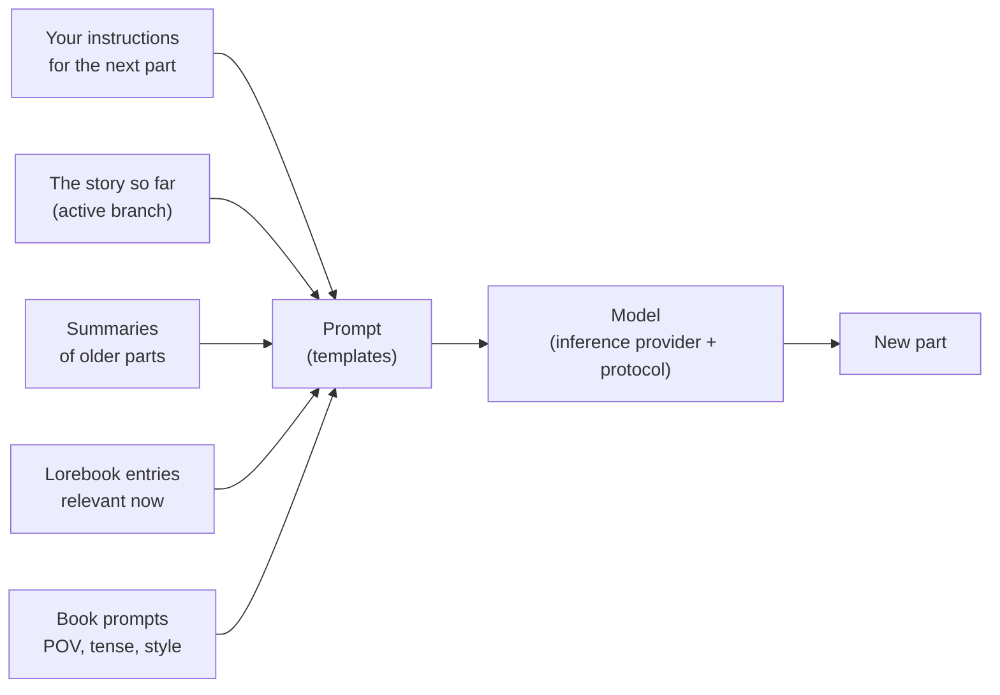

# ユーザーガイド

このマニュアルのこの部分は、Marginalia で執筆する人と、それを他の人のために運用する人を対象としています。Marginalia のインストールからモデルの接続、ストーリーのブランチ分岐、ロアブックの作成、データベースのバックアップまで、すべての画面と設定を説明します。プログラミングの知識は必要ありません。テンプレートに関する数ページでは、モデルに送られる内容を細かく調整したい人向けに、さらに詳しく説明しています。

初めての方は、まず [はじめに](getting-started/index.md) をご覧ください。インストールから、本の最初の生成パートができるまでを数分で案内します。

## Marginalia の仕組み

あなたは大規模言語モデルと一緒に物語を書きます。物語の**パート**ごとに、何が起きるべきかを指定します。場面、視点人物、登場人物、数文の指示などです。そしてモデルが文章を書きます。パートを生成する前に、Marginalia はモデルへのプロンプトを次のものから組み立てます。

この図のすべての要素は調整できます。このユーザーガイドも、この図に沿って構成されています。

## 基本的な概念

| 概念                   | 内容                                                                                                                                                                   | 詳しく                                                    |
|------------------------|------------------------------------------------------------------------------------------------------------------------------------------------------------------------|-----------------------------------------------------------|
| **本**                 | 1つの物語と、それに属するすべてのもの（パート、プロンプト、ロアブック、要約、バックアップ）。                                                                            | [本](books/index.md)                                   |
| **パート**             | 物語の1つのまとまり。通常はモデルの1回の応答にあたります。編集、再生成、削除ができます。                                                                                 | [ストーリーエディター](books/story-editor.md)                     |
| **ブランチ**           | パートは木構造をなします。パートの別バージョンを書いたり、過去のどのパートからでも別の展開で続けたりできます。*アクティブなブランチ*が、あなたに表示され、モデルが読む内容です。 | [ブランチとストーリーツリー](books/branches-and-story-tree.md) |
| **ロアブック**         | 世界観や登場人物に関するメモ。各**エントリー**は、関連するときにだけプロンプトに入れられます。たとえば、登場人物の名前が現れたときです。                                  | [ロアブック](lorebooks/index.md)                           |
| **要約**               | 古いパートを短くまとめたもの。長い本でも、モデルが一度に読める範囲に収まるようにします。                                                                                   | [要約](books/summaries.md)                                 |
| **メタ要約**           | 要約の要約。複数の要約を1つのより短い文章にまとめ、コンテキストを空けます。                                                                                               | [要約](books/summaries.md#meta-summaries)            |
| **テンプレート**       | プロンプトを組み立てる元になる、プレースホルダーとマクロを含む文章。すべての本が独自のプロンプトを持ち、既定値は*設定*にあります。                                       | [テンプレートとマクロ](templates/index.md)                  |
| **推論プロバイダー**   | モデルへの接続。APIのアドレス、APIキー、モデルとその上限。                                                                                                              | [推論プロバイダー](inference-providers.md)             |
| **プロトコル**         | 生成の設定。温度、top P、ペナルティ、必要に応じた上限。どのモデルが書くかはプロバイダーが決め、どのように書くかはプロトコルが決めます。                                   | [プロトコル](protocols.md)                                 |
| **フォルダ**           | 本を入れる場所。好きなだけ深く入れ子にできます。言語、文体、プロンプトなどの設定を持たせることもでき、中の本はそれを引き継ぎます。                                         | [フォルダ](books/folders.md)                               |
| **タグ**               | 本やロアブックに付けるラベル。タグは、本がどのロアブックのエントリーを使うかも決めます。                                                                                   | [本の管理](books/managing-books.md)                 |
| **拡張機能**           | 章のマーカーやAIによるレビューなど、機能を追加するプラグイン。                                                                                                            | [拡張機能](extensions/index.md)                         |
| **コマンド**           | ストーリーメニューの横にあるコマンドラインに `/name` と入力して実行する小さな操作。拡張機能も独自のコマンドを追加します。                                                     | [コマンド](commands/index.md)                             |
| **エージェント**       | 1つの本に対して、コマンドを通じて本のコピー上で単独で作業するLLM。その作業内容を確認し、採用するか破棄します。                                                             | [エージェント](agents.md)                                       |

作成したものはすべてあなたのアカウントに属します。同じ Marginalia を使う他のユーザーには、あなたの本、ロアブック、プロバイダー、設定は見えません。見えるのは、あなたが[公開](books/publishing.md)を選んだ本と、[共有](lorebooks/lorebooks.md#sharing-a-lorebook)を選んだロアブックとプロトコルだけです（他のユーザーは、[プロトコル](protocols.md#sharing-a-protocol)も含めて、そのコピーを取り込めます）。

## ワークスペース

ログイン後、ワークスペースが表示されます。左側のタブが Marginalia の主な領域で、それぞれに小さなアイコンが付いています。

| タブ                    |                                                                                                             |
|-------------------------|-------------------------------------------------------------------------------------------------------------|
| **本**                  | あなたの本。開いて執筆します。[本](books/index.md) を参照してください。                                                 |
| **ロアブック**          | すべてのロアブックとそのエントリー。[ロアブック](lorebooks/index.md) を参照してください。                                  |
| **設定**                | 既定値：モデル、プロトコル、新しい本の既定のプロンプト。[アカウントと設定](account.md) を参照してください。 |
| **プロトコル**          | 生成の設定。[プロトコル](protocols.md) を参照してください。                                                         |
| **推論プロバイダー**    | モデルへの接続。[推論プロバイダー](inference-providers.md) を参照してください。                                   |
| **リソース**            | アップロードしたファイル（パートの画像など）。[リソース](resources.md) を参照してください。                           |
| **ゴミ箱**              | 削除したもの。管理者が整理するまで残ります。ここから復元できます。[ゴミ箱](trash.md) を参照してください。            |
| **エージェント**        | （試験的機能）あなたのエージェント、その実行、確認すべき結果。エージェントの使用を許可されたユーザーのみ。[エージェント](agents.md) を参照してください。 |

下部には **パスワードを変更**、**ログアウト**、そして管理者には **管理** があります。拡張機能によって、さらにタブやボタンが追加される場合があります。

幅の狭い画面（768ピクセル未満）では、代わりにより簡単な[スマートフォン向けレイアウト](phone.md)が使われます。タブはドロワーに収まり（管理も含む）、ウィンドウは1列になります。レイアウトはページの読み込み時に決まります。端末を回転させたりウィンドウのサイズを変えたりした後は、ページを再読み込みすると別のレイアウトに切り替わります。

## このガイドの構成

| セクション                                    | 対象                                                                                                                                                                                                                 |
|-----------------------------------------------|----------------------------------------------------------------------------------------------------------------------------------------------------------------------------------------------------------------------|
| [はじめに](getting-started/index.md)   | [デスクトップアプリ](getting-started/desktop-app.md)または[サーバー](getting-started/docker-server.md)のインストール、[初回起動](getting-started/first-start.md)、[クイックスタート](getting-started/quick-start.md)。 |
| [推論プロバイダー](inference-providers.md) | クラウドモデルとローカルモデルの接続、コンテキストの上限、推論モデル。                                                                                                                                                 |
| [リソース](resources.md)                     | アップロードしたファイル：ダウンロード、置き換え、削除。                                                                                                                                                           |
| [ゴミ箱](trash.md)                             | 削除された本、ロアブック、その他のオブジェクトと、それらの復元方法。                                                                                     |
| [プロトコル](protocols.md)                     | 温度、top P、ペナルティ、プロトコルごとの上限。                                                                                                                                                               |
| [本](books/index.md)                       | 本の管理（複製、タグ、アーカイブからの取り込み）、ストーリーエディター（検索と置換）、ブランチ、本のプロンプト、要約、バックアップ、公開。                                                                                                                         |
| [ロアブック](lorebooks/index.md)               | ロアブックの作成、エントリーとその有効化の仕組み、インポートとエクスポート（SillyTavern を含む）。                                                                                                                   |
| [テンプレートとマクロ](templates/index.md)      | モデルに送られる内容と、その変更方法。マクロのリファレンス。                                                                                                                                                 |
| [拡張機能](extensions/index.md)             | 同梱の拡張機能：Author's Note、Chapter Marker、Gemma 4 tools fix、Google Gemini、Instruction Exporter、Lore Generator、Lorebook VCS、Name generator、Name provider、Place provider、Reviewer、Side Query、Arc Outline、Character Tracker、中国語のローカライズ。                                                                                                                                          |
| [エージェント](agents.md) | （試験的機能）モデルに本を単独で作業させる仕組み：エージェント、コンソール、結果の確認と適用、上限。 |
| [コマンド](commands/index.md) | ストーリーメニューの横にあるコマンドライン：コマンドの実行、引数の書き方、長時間のコマンドの停止。 |
| [正規表現](regular-expressions.md) | 検索と置換、フィルターで使う正規表現と、時間制限。 |
| [アカウントと設定](account.md)              | パスワード、ユーザー名、既定の設定。                                                                                                                                                                       |
| [管理](administration/index.md)     | 管理者向け：ユーザーとその権限、データベースのバックアップ、整理、拡張機能のインストール、ヘルプアシスタント、エージェント。                                                                                                                                         |
| [スマートフォンでの Marginalia の利用](phone.md)       | スマートフォン向けレイアウト：デスクトップとの違い、使えない機能、動作する拡張機能。                                                                                                                           |
| [トラブルシューティングとFAQ](troubleshooting.md)   | ログ、よくある問題とその解決策。                                                                                                                                                                           |

## 表記について

- タブ、ボタン、フィールドの名前は **太字**または*斜体*で示し、Marginalia に表示されるとおりに書きます。例：*管理 → ユーザー*。
- `~/.marginalia` はホームディレクトリにあるデータフォルダです（Windows では `%USERPROFILE%\.marginalia`）。Docker サーバーでは、`docker-compose.yml` の隣にある `./data` フォルダになります。
- ほとんどの変更は、行った時点ですぐに保存されます。例外は *設定* タブで、こちらには **保存** ボタンがあります。
