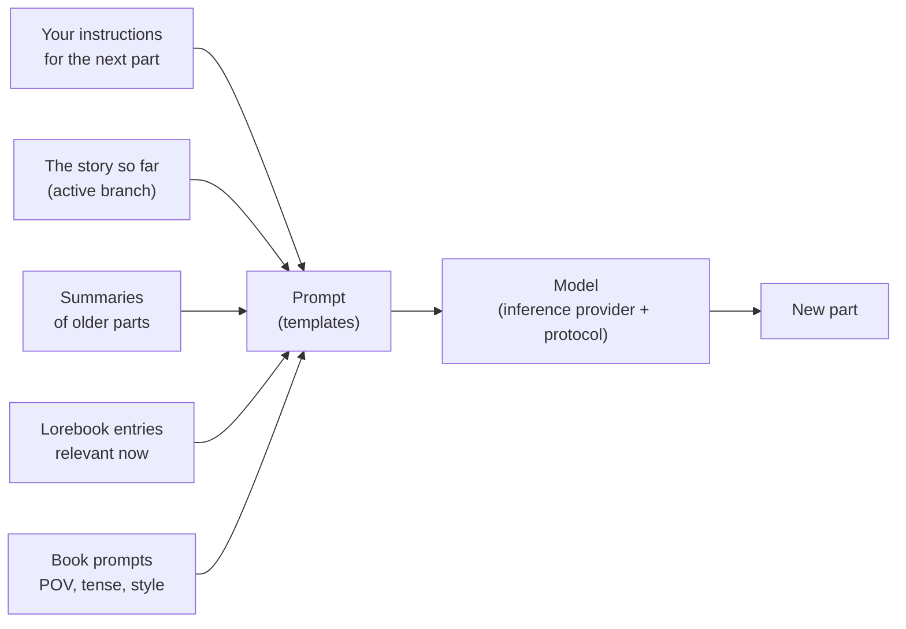

# 사용자 가이드

이 매뉴얼의 이 부분은 Marginalia로 글을 쓰는 사람과 다른 사람을 위해 Marginalia를 운영하는 사람을 위한 것입니다. Marginalia 설치와 언어 모델 연결부터 이야기 분기, 로어북 작성, 데이터베이스 백업까지 모든 화면과 설정을 설명합니다. 프로그래밍 지식은 필요 없습니다. 템플릿에 관한 몇몇 페이지는 모델로 전송되는 내용을 세밀하게 조정하고 싶은 분을 위해 더 깊이 다룹니다.

처음 사용하신다면 [시작하기](getting-started/index.md)부터 보세요. 설치부터 책의 첫 번째 생성 파트까지 몇 분이면 진행할 수 있습니다.

## Marginalia 작동 방식

여러분은 대규모 언어 모델과 함께 이야기를 씁니다. 이야기의 각 **파트**마다 무슨 일이 일어나야 하는지(장면, 시점, 등장인물, 몇 문장의 지시)를 정하면, 모델이 산문을 씁니다. 모든 파트 전에 Marginalia는 다음 요소로 모델에 보낼 프롬프트를 만듭니다:

이 그림의 모든 요소는 조정할 수 있으며, 사용자 가이드도 이 그림을 따라 구성되어 있습니다.

## 핵심 개념

| 개념                | 설명                                                                                                                                                                     | 자세히 보기                                                 |
|---------------------|--------------------------------------------------------------------------------------------------------------------------------------------------------------------------|-----------------------------------------------------------|
| **책**              | 하나의 이야기와 그에 속한 모든 것: 파트, 프롬프트, 로어북, 요약, 백업.                                                                                                  | [책](books/index.md)                                                |
| **파트**            | 이야기의 한 조각으로, 보통 모델의 응답 하나입니다. 편집, 재생성, 삭제할 수 있습니다.                                                                                    | [스토리 편집기](books/story-editor.md)                                      |
| **분기**            | 파트는 트리를 이룹니다. 파트의 다른 버전을 쓰거나, 이전 파트 어디에서든 다르게 이어 쓸 수 있습니다. *활성 분기*는 여러분이 보는 것이며 모델이 읽는 것입니다.           | [분기와 스토리 트리](books/branches-and-story-tree.md)                                 |
| **로어북**          | 세계와 인물에 관한 메모. 각 **항목**은 관련이 있을 때만 프롬프트에 들어갑니다. 예: 인물 이름이 나타날 때.                                                              | [로어북](lorebooks/index.md)                                            |
| **요약**            | 오래된 파트를 압축한 버전으로, 긴 책도 모델이 한 번에 읽을 수 있는 범위에 들어가게 합니다.                                                                              | [요약](books/summaries.md)                                              |
| **메타 요약**       | 요약의 요약. 여러 요약을 더 짧은 하나의 텍스트로 합쳐 컨텍스트를 확보합니다.                                                                                            | [요약](books/summaries.md#meta-summaries)                                              |
| **템플릿**          | 플레이스홀더와 매크로가 들어 있는 텍스트로, 여기서 프롬프트가 만들어집니다. 모든 책은 자체 프롬프트를 가지며, 기본값은 *설정*에 있습니다.                              | [템플릿과 매크로](templates/index.md)                                    |
| **추론 제공자**     | 모델 연결: API 주소, API 키, 모델과 그 한계.                                                                                                                            | [추론 제공자](inference-providers.md)                                        |
| **프로토콜**        | 생성 설정: temperature, top P, 페널티, 선택적 제한. 제공자는 *어떤* 모델이 쓸지 정하고, 프로토콜은 *어떻게* 쓸지 정합니다.                                              | [프로토콜](protocols.md)                                           |
| **폴더**            | 책을 담는 곳으로, 원하는 만큼 깊게 중첩할 수 있습니다. 그 안의 책이 상속하는 설정(언어, 문체, 프롬프트)을 담을 수도 있습니다.                                           | [폴더](books/folders.md)                                              |
| **태그**            | 책과 로어북에 붙이는 라벨. 태그는 책이 어떤 로어북 항목을 쓸지도 정합니다.                                                                                             | [책 관리](books/managing-books.md)                                           |
| **확장 기능**       | 기능을 추가하는 플러그인. 예: 장 표시, AI 리뷰.                                                                                                                         | [확장 기능](extensions/index.md)                                         |
| **명령**            | 스토리 메뉴 옆 명령줄에 `/name`을 입력해 실행하는 작은 동작. 확장 기능이 자체 명령을 추가합니다.                                                                          | [명령](commands/index.md)                                              |
| **에이전트**        | 명령을 통해 책의 사본에서 혼자 작업하는 LLM. 결과를 검토하고 받아들이거나 버릴 수 있습니다.                                                                             | [에이전트](agents.md)                                          |

여러분이 만든 모든 것은 여러분의 계정에 속합니다. 같은 Marginalia를 쓰는 다른 사용자는 여러분의 책, 로어북, 제공자, 설정을 볼 수 없습니다. 다만 여러분이 [게시](books/publishing.md)하기로 한 책과 [공유](lorebooks/lorebooks.md#sharing-a-lorebook)하기로 한 로어북 및 프로토콜은 예외입니다(다른 사람은 사본을 가져올 수 있으며, [프로토콜](protocols.md#sharing-a-protocol)도 마찬가지입니다).

## 작업 공간

로그인하면 작업 공간이 보입니다. 왼쪽의 탭은 Marginalia의 주요 영역이며, 각각 작은 아이콘으로 표시되어 있습니다:

| 탭                      |                                                                                                                                  |
|-------------------------|----------------------------------------------------------------------------------------------------------------------------------|
| **책**                  | 여러분의 책. 하나를 열어 글을 쓰세요. [책](books/index.md)을 참고하세요.                                                                  |
| **로어북**              | 모든 로어북과 그 항목. [로어북](lorebooks/index.md)을 참고하세요.                                                                              |
| **설정**                | 기본값: 모델, 프로토콜, 새 책의 기본 프롬프트. [계정과 설정](account.md)을 참고하세요.                                                 |
| **프로토콜**            | 생성 설정. [프로토콜](protocols.md)을 참고하세요.                                                                                        |
| **추론 제공자**         | 모델 연결. [추론 제공자](inference-providers.md)를 참고하세요.                                                                                     |
| **리소스**              | 업로드한 파일, 예를 들어 파트의 그림. [리소스](resources.md)를 참고하세요.                                                               |
| **휴지통**              | 삭제한 항목. 관리자가 정리하기 전까지 보관됩니다. 여기서 복원할 수 있습니다. [휴지통](trash.md)을 참고하세요.                         |
| **에이전트**            | (실험적) 여러분의 에이전트, 실행 기록, 검토할 결과. 에이전트 사용 권한이 있는 사용자만 해당합니다. [에이전트](agents.md)를 참고하세요. |

맨 아래에는 **비밀번호 변경**, **로그아웃**과, 관리자에게는 **관리**가 있습니다. 확장 기능이 탭과 버튼을 더 추가할 수 있습니다.

폭이 768픽셀 미만인 좁은 화면에서는 대신 더 단순한 [휴대폰 레이아웃](phone.md)이 표시됩니다. 탭은 서랍 메뉴(관리 포함)에 들어가고 창은 한 열로 나뉩니다. 레이아웃은 페이지를 불러올 때 결정됩니다. 기기를 돌리거나 창 크기를 바꾼 뒤에는 페이지를 새로고침해야 다른 레이아웃을 쓸 수 있습니다.

## 이 가이드의 구성

| 섹션                                          | 대상                                                                                                                                                                                                                 |
|-----------------------------------------------|----------------------------------------------------------------------------------------------------------------------------------------------------------------------------------------------------------------------|
| [시작하기](getting-started/index.md)                             | [데스크톱 앱](getting-started/desktop-app.md) 또는 [서버](getting-started/docker-server.md) 설치, [첫 실행](getting-started/first-start.md)과 [빠른 시작](getting-started/quick-start.md).                                                                                                                              |
| [추론 제공자](inference-providers.md)                          | 클라우드 및 로컬 모델 연결, 컨텍스트 한계, 추론 모델.                                                                                                                                                               |
| [리소스](resources.md)                               | 업로드한 파일: 다운로드, 교체, 삭제.                                                                                                                                                                                 |
| [휴지통](trash.md)                               | 삭제된 책, 로어북 및 기타 객체, 복원 방법.                                                                                                                                                                           |
| [프로토콜](protocols.md)                             | temperature, top P, 페널티, 프로토콜별 제한.                                                                                                                                                                         |
| [책](books/index.md)                                   | 책 관리(복제, 태그, 아카이브에서 가져오기), 스토리 편집기(검색과 바꾸기), 분기, 책 프롬프트, 요약, 백업, 게시.                                                                                                      |
| [로어북](lorebooks/index.md)                               | 로어북 만들기, 항목과 활성화 방식, 가져오기와 내보내기(SillyTavern 포함).                                                                                                                                           |
| [템플릿과 매크로](templates/index.md)                      | 모델로 전송되는 내용과 변경 방법, 매크로 참조.                                                                                                                                                                       |
| [확장 기능](extensions/index.md)                            | 기본 제공 확장 기능: Author's Note, Chapter Marker, Gemma 4 tools fix, Google Gemini, Instruction Exporter, Lore Generator, Lorebook VCS, Name generator, Name provider, Place provider, Reviewer, Side Query, Arc Outline, Character Tracker, 그리고 중국어 현지화. |
| [에이전트](agents.md)                             | (실험적) 모델이 책을 혼자 다루게 하기: 에이전트, 콘솔, 결과 검토와 적용, 제한.                                                                                                                                      |
| [명령](commands/index.md)                                 | 스토리 메뉴 옆 명령줄: 명령 실행, 인수 쓰기, 오래 걸리는 명령 중지.                                                                                                                                                 |
| [정규 표현식](regular-expressions.md)                          | 찾기 및 바꾸기와 필터의 정규 표현식, 시간 제한.                                                                                                                                                                      |
| [계정과 설정](account.md)                          | 비밀번호, 사용자 이름, 기본 설정.                                                                                                                                                                                    |
| [관리](administration/index.md)                                 | 관리자용: 사용자와 권한, 데이터베이스 백업, 정리, 확장 기능 설치, 도움말 도우미, 에이전트.                                                                                                                          |
| [휴대폰에서 Marginalia 사용하기](phone.md)       | 휴대폰 레이아웃: 데스크톱과의 차이, 빠진 기능, 작동하는 확장 기능.                                                                                                                                                  |
| [문제 해결과 FAQ](troubleshooting.md)                      | 로그, 흔한 문제와 해결책.                                                                                                                                                                                            |

## 표기 규칙

- 탭, 버튼, 필드의 이름은 Marginalia에 나타나는 대로 **굵게** 또는 *기울임꼴*로 적습니다. 예: *관리 → Users*.
- `~/.marginalia`은 홈 디렉터리에 있는 데이터 폴더입니다(Windows에서는 `%USERPROFILE%\.marginalia`). Docker 서버에서는 `docker-compose.yml` 옆의 `./data` 폴더입니다.
- 대부분의 변경 사항은 입력하는 즉시 저장됩니다. 예외는 **저장** 버튼이 있는 *설정* 탭입니다.
