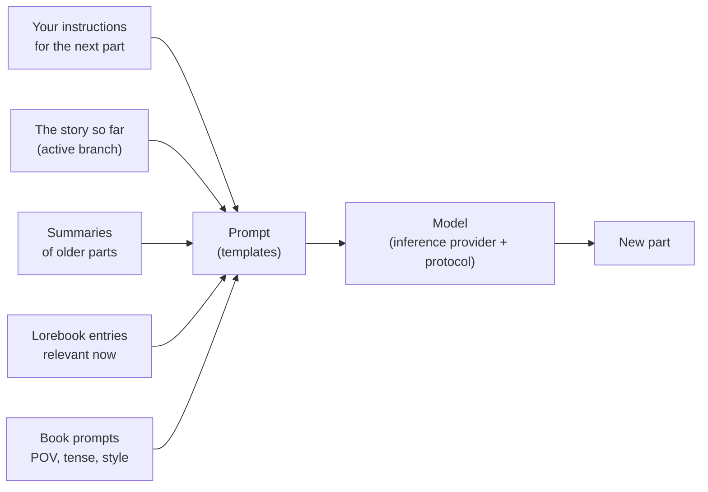

# 用户指南

本部分手册面向使用 Marginalia 写作的人，也面向为他人运行 Marginalia 的人。它介绍每个界面和每项设置，内容涵盖安装 Marginalia、连接模型、分支故事、构建 Lorebook 以及备份数据库。你不需要懂编程；几篇关于模板的页面讲得更深，供想要微调发送给模型内容的读者参考。

如果你是新手，请从 [入门指南](getting-started/index.md) 开始。几分钟之内，它就能带你从安装走到生成书籍的第一部分。

## Marginalia 的工作原理

你与大语言模型共同写一个故事。对于故事的每个**部分**，你说明应当发生什么：场景、视角、出场人物，以及几句指示。然后模型负责写出正文。每次生成之前，Marginalia 会按以下内容为模型构建提示词：

图中的每一项都可以调整，本用户指南也按照这张图来组织。

## 核心概念

| 概念       | 含义                                                                                                                                                       | 详细了解                                          |
|------------|------------------------------------------------------------------------------------------------------------------------------------------------------------|---------------------------------------------------|
| **Book**   | 一个故事及其全部相关内容：部分、提示词、Lorebook、摘要、备份。                                                                                              | [书籍](books/index.md)                                      |
| **Part**   | 故事的一段，通常是模型的一次回答。你可以编辑、重新生成或删除它。                                                                                            | [故事编辑器](books/story-editor.md)                                |
| **Branch** | 各个部分构成一棵树：你可以为某个部分另写一个版本，也可以从之前的任一部分开始另一条走向。*活动分支*是你所看到的内容，也是模型所读取的内容。                 | [分支与故事树](books/branches-and-story-tree.md)                              |
| **Lorebook** | 关于世界和人物的笔记。每个**条目**只有在相关时才会被放入提示词，例如某个人物的名字出现时。                                                             | [Lorebook](lorebooks/index.md)                                  |
| **Summary** | 较早部分的精简版本，使长篇书籍仍能一次性放入模型可读取的范围。                                                                                              | [摘要](books/summaries.md)                                      |
| **Meta summary** | 摘要的摘要：将若干摘要合并为一段更短的文字，以释放上下文空间。                                                                                         | [摘要](books/summaries.md#meta-summaries)                                      |
| **Template** | 带有占位符和宏的文本，提示词由它构建而成。每本书都有自己的提示词，其默认值在 *Settings* 中设置。                                                           | [模板与宏](templates/index.md)                                  |
| **Inference provider** | 与模型的连接：API 地址、API 密钥、模型及其限制。                                                                                              | [推理提供方](inference-providers.md)                                |
| **Protocol** | 生成设置：温度、Top P、惩罚项以及可选的限制。提供方决定*由哪个*模型来写，协议决定*如何*写。                                                              | [协议](protocols.md)                                      |
| **Folder** | 存放书籍的位置，可以任意多层嵌套。它也可以保存设置（语言、风格、提示词），其中的书籍会继承这些设置。                                                        | [文件夹](books/folders.md)                                   |
| **Tag**    | 附加在书籍和 Lorebook 上的标签；标签还决定一本书使用哪些 Lorebook 条目。                                                                                   | [管理书籍](books/managing-books.md)                                 |
| **Extension** | 插件，用于添加功能，例如章节标记或 AI 审阅。                                                                                                            | [扩展](extensions/index.md)                                     |
| **Command** | 在故事菜单旁的命令行中输入 `/name` 来运行的小型操作；扩展会添加它们自己的命令。                                                                              | [命令](commands/index.md)                                     |
| **Agent**  | 一个在书籍副本上通过命令独立工作的 LLM；你检查它的操作结果，然后接受或丢弃。                                                                               | [代理](agents.md)                                     |

你创建的所有内容都归你的账户所有。同一个 Marginalia 的其他用户看不到你的书籍、Lorebook、提供方或设置，只有你选择[发布](books/publishing.md)的书籍，以及你选择[共享](lorebooks/lorebooks.md#sharing-a-lorebook)的 Lorebook 和协议（其他人可以导入一份副本，[协议](protocols.md#sharing-a-protocol)也是如此）除外。

## 工作区

登录后，你会看到工作区。左侧的标签页是 Marginalia 的主要区域，每个标签都带有一个小图标：

| 标签页                  |                                                                                                              |
|-------------------------|--------------------------------------------------------------------------------------------------------------|
| **Books**               | 你的书籍。打开一本即可开始写作。参见[书籍](books/index.md)。                                                          |
| **Lorebooks**           | 你的所有 Lorebook 及其条目。参见[Lorebook](lorebooks/index.md)。                                                           |
| **Settings**            | 你的默认设置：模型、协议，以及新书的默认提示词。参见[账户与设置](account.md)。                                     |
| **Protocols**           | 生成设置。参见[协议](protocols.md)。                                                                                |
| **Inference Providers** | 与模型的连接。参见[推理提供方](inference-providers.md)。                                                                      |
| **Resources**           | 你上传的文件，例如部分的图片。参见[资源](resources.md)。                                                            |
| **Trash**               | 你删除的内容，在管理员清理之前都保留在这里。你可以从这里恢复。参见[回收站](trash.md)。                           |
| **Agents**              | （实验性）你的代理、它们的运行记录以及待审阅的结果。仅供获准使用代理的用户。参见[代理](agents.md)。              |

底部有 **Change Password**、**Logout**，管理员还会看到 **Admin**。扩展可能会添加更多标签页和按钮。

在窄屏（宽度小于 768 像素）上，你会看到更简单的[手机布局](phone.md)：标签页收纳在抽屉中（包括 Admin），窗口只有一列。布局在页面加载时确定：更换设备或调整窗口大小后，请重新加载页面以切换到另一种布局。

## 本指南的章节

| 章节                                          | 适合读者                                                                                                                                                                                                             |
|-----------------------------------------------|----------------------------------------------------------------------------------------------------------------------------------------------------------------------------------------------------------------------|
| [入门指南](getting-started/index.md)                             | 安装[桌面应用](getting-started/desktop-app.md)或[服务器](getting-started/docker-server.md)、[首次启动](getting-started/first-start.md)以及[快速上手](getting-started/quick-start.md)。                                                                                                                                    |
| [推理提供方](inference-providers.md)                           | 连接云端和本地模型、上下文限制、推理模型。                                                                                                                                                                           |
| [资源](resources.md)                                 | 你上传的文件：下载、替换和删除。                                                                                                                                                                                     |
| [回收站](trash.md)                               | 已删除的书籍、Lorebook 及其他对象，以及如何恢复它们。                                                                                                                                                                |
| [协议](protocols.md)                                 | 温度、Top P、惩罚项以及每个协议的限制。                                                                                                                                                                              |
| [书籍](books/index.md)                                 | 管理书籍（克隆、标签、从归档导入）、故事编辑器（搜索和替换）、分支、书籍提示词、摘要、备份和发布。                                                                                                                  |
| [Lorebook](lorebooks/index.md)                             | 创建 Lorebook 和条目、条目如何被激活、导入和导出（包括 SillyTavern）。                                                                                                                                               |
| [模板与宏](templates/index.md)                             | 发送给模型的内容以及如何修改它；宏参考。                                                                                                                                                                             |
| [扩展](extensions/index.md)                                 | 随附的扩展：Author's Note、Chapter Marker、Gemma 4 tools fix、Google Gemini、Instruction Exporter、Lore Generator、Lorebook VCS、Name generator、Name provider、Place provider、Reviewer、Side Query、Arc Outline、Character Tracker 以及中文本地化。 |
| [代理](agents.md)                                 | （实验性）让模型独立处理一本书：代理、控制台、审阅并应用结果、限制。                                                                                                                                                  |
| [命令](commands/index.md)                                 | 故事菜单旁的命令行：运行命令、编写参数、停止耗时较长的命令。                                                                                                                                                          |
| [正则表达式](regular-expressions.md)                           | 搜索和替换以及过滤器所用的正则表达式，以及时间限制。                                                                                                                                                                 |
| [账户与设置](account.md)                           | 你的密码、用户名和默认设置。                                                                                                                                                                                         |
| [管理](administration/index.md)                                 | 面向管理员：用户及其权限、数据库备份、清理、安装扩展、帮助助手和代理。                                                                                                                                               |
| [在手机上使用 Marginalia](phone.md)              | 手机布局：它与桌面版的区别、缺少的功能、哪些扩展可用。                                                                                                                                                               |
| [故障排除与常见问题](troubleshooting.md)                   | 日志、常见问题及其解决方法。                                                                                                                                                                                         |

## 约定

- 标签页、按钮和字段的名称使用**粗体**或*斜体*标示，并与 Marginalia 中显示的写法一致，例如 *Admin → Users*。
- `~/.marginalia` 是你主目录中的数据文件夹（在 Windows 上为 `%USERPROFILE%\.marginalia`）；在 Docker 服务器上，它是 `./data` 旁边的 `docker-compose.yml` 文件夹。
- 大多数更改在你做出后立即保存。例外是 *Settings* 标签页，它有一个 **Save** 按钮。
