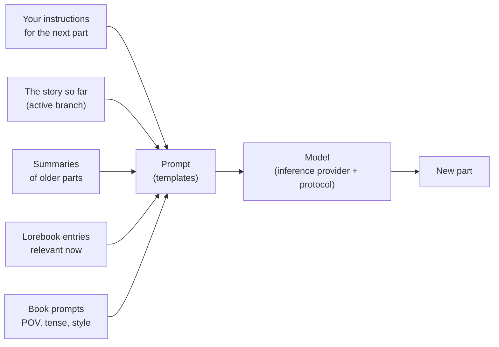

# 用户指南

本手册面向使用 Marginalia 写作的人，也面向为他人运行 Marginalia 的人。它逐一介绍每个界面和设置，内容涵盖安装 Marginalia、连接模型、为故事创建分支、构建设定集以及备份数据库。你不需要了解编程；关于模板的几页内容讲得更深入，供希望微调发送给模型内容的读者参考。

如果你是新手，请先阅读[入门指南](getting-started/index.md)。它会带你从安装到生成书籍的第一部分，只需几分钟。

## Marginalia 如何工作

你与大型语言模型共同撰写故事。对于故事的每个**片段**，你需要说明接下来应当发生什么：场景、视角、出场人物，以及几句指示。然后由模型写出正文。每个片段之前，Marginalia 都会根据以下内容为模型构建提示词：

这张图中的所有部分都可以调整，本用户指南也是沿着这张图来组织的。

## 核心概念

| 概念                   | 说明                                                                                                                                                                   | 详细阅读                                                  |
|------------------------|------------------------------------------------------------------------------------------------------------------------------------------------------------------------|-----------------------------------------------------------|
| **书籍**               | 一个故事以及属于它的全部内容：片段、提示词、设定集、摘要、备份。                                                                                                       | [书籍](books/index.md)                                    |
| **片段**               | 故事的一小段，通常是模型的一次回答。你可以编辑、重新生成或删除它。                                                                                                     | [故事编辑器](books/story-editor.md)                       |
| **分支**               | 片段构成一棵树：你可以为某个片段另写一个版本，或从任意更早的片段开始另起走向。*活动分支*是你所看到的内容，也是模型所读取的内容。                                       | [分支与故事树](books/branches-and-story-tree.md)          |
| **设定集**             | 关于世界和人物的笔记。每个**条目**只有在相关时才会被放入提示词，例如某个人物的名字出现时。                                                                            | [设定集](lorebooks/index.md)                              |
| **摘要**               | 较早片段的浓缩版本，使长篇书籍仍能放入模型一次可读取的内容之中。                                                                                                       | [摘要](books/summaries.md)                                |
| **元摘要**             | 摘要的摘要：将若干摘要合并成一段更短的文字，以释放上下文空间。                                                                                                         | [摘要](books/summaries.md#meta-summaries)                 |
| **模板**               | 带有占位符和宏的文本，提示词由它构建而成。每本书都有自己的提示词，默认值在 *Settings* 中设置。                                                                        | [模板与宏](templates/index.md)                            |
| **推理提供方**         | 与模型的连接：API 地址、API 密钥、模型及其限制。                                                                                                                       | [推理提供方](inference-providers.md)                      |
| **协议**               | 生成设置：温度、top P、惩罚项以及可选的限制。提供方决定*由哪个*模型写作，协议决定*如何*写。                                                                            | [协议](protocols.md)                                      |
| **文件夹**             | 用于存放书籍的位置，可任意嵌套。它还可以保存设置（语言、风格、提示词），其中的书籍会继承这些设置。                                                                     | [文件夹](books/folders.md)                                |
| **标签**               | 书籍和设定集上的标签；标签还决定书籍使用哪些设定集条目。                                                                                                               | [管理书籍](books/managing-books.md)                       |
| **扩展**               | 添加功能的插件，例如章节标记或 AI 审阅。                                                                                                                               | [扩展](extensions/index.md)                               |
| **命令**               | 你在故事菜单旁的命令行中输入 `/名称` 即可运行的小型操作；扩展会添加它们自己的命令。                                                                                   | [命令](commands/index.md)                                 |
| **代理**               | 由大型语言模型在书籍副本上通过命令独立处理某本书；你审阅它所做的工作，然后接受或丢弃。                                                                                 | [代理](agents.md)                                         |

你创建的所有内容都属于你的账户。同一 Marginalia 的其他用户看不到你的书籍、设定集、提供方或设置。只有你选择[发布](books/publishing.md)的书籍，以及你选择[分享](lorebooks/lorebooks.md#sharing-a-lorebook)的设定集和协议才会被他人看到（他人可以导入一份副本，[协议](protocols.md#sharing-a-protocol)同样如此）。

## 工作区

登录后你会看到工作区。左侧的标签页是 Marginalia 的主要区域，每个都带有一个小图标：

| 标签页                  |                                                                                                             |
|-------------------------|-------------------------------------------------------------------------------------------------------------|
| **Books**               | 你的书籍。打开一本即可开始写作。参见[书籍](books/index.md)。                                                |
| **Lorebooks**           | 你所有的设定集及其条目。参见[设定集](lorebooks/index.md)。                                                   |
| **Settings**            | 你的默认设置：模型、协议，以及新书的默认提示词。参见[账户与设置](account.md)。                              |
| **Protocols**           | 生成设置。参见[协议](protocols.md)。                                                                        |
| **Inference Providers** | 与模型的连接。参见[推理提供方](inference-providers.md)。                                                    |
| **Resources**           | 你上传的文件，例如片段的图片。参见[资源](resources.md)。                                                    |
| **Trash**               | 你删除的内容，直到管理员清理为止。你可以在此处恢复。参见[回收站](trash.md)。                                |
| **Agents**              | （实验性功能）你的代理、它们的运行记录以及需要审阅的结果。仅供获准使用代理的用户使用。参见[代理](agents.md)。 |

底部有 **Change Password**、**Logout**，以及管理员专用的 **Admin**。扩展可能会添加更多标签页和按钮。

在窄屏幕（宽度小于 768 像素）上，你会看到更简单的[手机布局](phone.md)：标签页收纳在抽屉中（包括 Admin），窗口为单列。布局在页面加载时确定：旋转设备或调整窗口大小后，请重新加载页面以切换布局。

## 本指南的各部分

| 章节                                          | 适用对象                                                                                                                                                                                                             |
|-----------------------------------------------|----------------------------------------------------------------------------------------------------------------------------------------------------------------------------------------------------------------------|
| [入门指南](getting-started/index.md)          | 安装[桌面应用](getting-started/desktop-app.md)或[服务器](getting-started/docker-server.md)、[首次启动](getting-started/first-start.md)以及[快速上手](getting-started/quick-start.md)。                              |
| [推理提供方](inference-providers.md)          | 连接云端和本地模型、上下文限制、推理模型。                                                                                                                                                                           |
| [资源](resources.md)                          | 你上传的文件：下载、替换和删除。                                                                                                                                                                                     |
| [回收站](trash.md)                            | 已删除的书籍、设定集及其他对象，以及如何恢复它们。                                                                                                                                                                   |
| [协议](protocols.md)                          | 温度、top P、惩罚项以及每个协议的限制。                                                                                                                                                                              |
| [书籍](books/index.md)                        | 管理书籍（克隆、标签、从归档导入）、故事编辑器（搜索和替换）、分支、书籍提示词、摘要、备份和发布。                                                                                                                  |
| [设定集](lorebooks/index.md)                  | 创建设定集、条目及其激活方式，导入和导出（包括 SillyTavern）。                                                                                                                                                       |
| [模板与宏](templates/index.md)                | 发送给模型的内容以及如何修改它；宏参考手册。                                                                                                                                                                         |
| [扩展](extensions/index.md)                   | 内置扩展：Author's Note、Chapter Marker、Gemma 4 tools fix、Google Gemini、Instruction Exporter、Lore Generator、Lorebook VCS、Name generator、Name provider、Place provider、Reviewer、Side Query、Arc Outline、Character Tracker 以及中文本地化。 |
| [代理](agents.md)                             | （实验性功能）让模型独立处理书籍：代理、控制台、审阅并应用结果，以及限制。                                                                                                                                           |
| [命令](commands/index.md)                     | 故事菜单旁的命令行：运行命令、编写参数、停止长时间运行的命令。                                                                                                                                                       |
| [正则表达式](regular-expressions.md)          | 搜索和替换以及过滤器中使用的正则表达式，以及时间限制。                                                                                                                                                               |
| [账户与设置](account.md)                      | 你的密码、用户名和默认设置。                                                                                                                                                                                         |
| [管理](administration/index.md)               | 面向管理员：用户及其权限、数据库备份、清理、安装扩展、帮助助手和代理。                                                                                                                                               |
| [在手机上使用 Marginalia](phone.md)           | 手机布局：与桌面版的区别、缺失的功能，以及哪些扩展可用。                                                                                                                                                             |
| [故障排除与常见问题](troubleshooting.md)      | 日志、常见问题及其解决方法。                                                                                                                                                                                         |

## 约定

- 标签页、按钮和字段的名称以**粗体**或*斜体*显示，与 Marginalia 中的写法一致，例如 *Admin → Users*。
- `~/.marginalia` 是你主目录中的数据文件夹（Windows 上为 `%USERPROFILE%\.marginalia`）；在 Docker 服务器上，它是 `docker-compose.yml` 旁边的 `./data` 文件夹。
- 大多数更改在你做出后立即保存。例外是 *Settings* 标签页，它有一个 **Save** 按钮。
